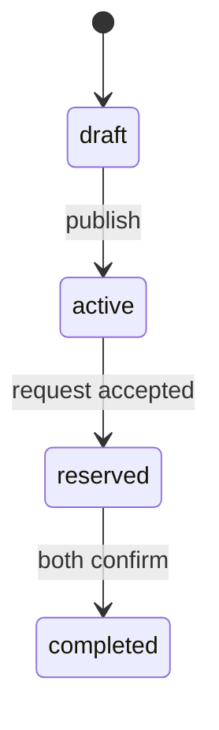

# Documentation Conventions

**Status:** Active · **Version:** 1.0.0 · **Owner:** Architecture

This document defines how Sharecropr documentation is written, numbered, changed, and retired. It applies to every file under `docs/`.

---

## 1. Why spec-driven

Sharecropr coordinates strangers meeting in physical space and stores the home locations of its users. The cost of an ambiguous requirement here is not a rework ticket — it is a privacy breach or a safety incident. Specs exist so that:

- **The dangerous parts are decided deliberately, in writing, before anyone is under deadline pressure.**
- Any engineer can pick up any feature without a hallway conversation.
- Tests are derived from acceptance criteria rather than invented after the fact.
- Future features slot into a known structure instead of accreting.

The rule: **if it isn't specified, it isn't built.** If implementation reveals the spec is wrong, the fix is a spec amendment *in the same pull request*, not a mental note.

---

## 2. Document types

| Type | Prefix | Lives in | Answers |
| --- | --- | --- | --- |
| Foundation | — | `00-foundation/` | Why and what, at product level |
| Architecture | — | `01-architecture/` | How the system is shaped |
| Decision record | `ADR-####` | `01-architecture/adr/` | Why we chose X over Y, and what it costs |
| Feature spec | `SPEC-###` | `03-specs/` | Exactly what one capability does |
| Test plan | `TP-###` | Inside its spec, §Test Plan | How we prove the spec is met |
| Operational | — | `05-operations/` | How we run it |

---

## 3. Identifier scheme

### 3.1 Feature specs — `SPEC-###`

Numbers are **permanent and never reused.** A retired spec keeps its number and gets `Status: Superseded by SPEC-###`.

| Range | Meaning |
| --- | --- |
| `001`–`019` | MVP capabilities |
| `020`–`039` | Phase 2 — planned, specified, not built |
| `040`–`059` | Phase 3 — planned, specified, not built |
| `060`+ | Unallocated |
| `900`+ | Internal/admin tooling |

Filename: `SPEC-010-exchange-lifecycle.md` — number, then kebab-case slug.

### 3.2 Requirements — `SPEC-###-R##`

Every normative statement inside a spec carries an ID so tests, code comments, and tickets can cite it.

> **SPEC-010-R14 (MUST)** — A user MUST NOT be able to accept an exchange request for a listing whose `status` is not `active`.

Rules:

- IDs are assigned in order and never renumbered. Deleting a requirement leaves a tombstone: `SPEC-010-R09 — *Removed in v1.2. See ADR-0011.*`
- Every `MUST` requirement maps to at least one test case ID in the spec's Test Plan. CI fails if a `MUST` has no linked test (see [CI/CD](../05-operations/02-cicd.md)).

### 3.3 Test cases — `SPEC-###-T##`

Test IDs live in the spec's Test Plan table and are echoed in the test source:

```ts
// SPEC-010-T14
it('rejects acceptance of an expired listing', async () => { /* … */ });
```

### 3.4 Decision records — `ADR-####`

Four digits, sequential, never reused. Superseding an ADR creates a new one and marks the old one `Superseded by ADR-####`.

### 3.5 Risks — `R-##`

Maintained centrally in [Open Risks](../06-roadmap/02-open-risks.md). Specs reference them; they do not define their own.

---

## 4. Normative language (RFC 2119)

| Keyword | Meaning |
| --- | --- |
| **MUST** / **MUST NOT** | Absolute requirement. A violation is a release blocker. Requires a test. |
| **SHOULD** / **SHOULD NOT** | Strong recommendation. Deviating requires a written justification in the PR. |
| **MAY** | Genuinely optional. |

Keywords are always **bold and uppercase**. Prose that isn't marked with a keyword is context, not a requirement — if you meant it to be binding, mark it.

---

## 5. Required spec structure

Every `SPEC-###` file uses [the template](07-spec-template.md) and contains these sections in this order. Sections are never omitted; if one doesn't apply, write "Not applicable" and one sentence explaining why.

1. **Front matter** — status, version, owner, phase, dependencies, related ADRs
2. **Summary** — three sentences maximum
3. **Goals / Non-Goals** — non-goals are as important as goals
4. **User Stories** — `As a … I want … so that …`
5. **Functional Requirements** — numbered `R##` with MUST/SHOULD/MAY
6. **Data** — tables and columns touched, with a pointer to the data model
7. **API** — endpoints, RPCs, or functions with request/response shapes
8. **UI / UX** — screens, states, empty states, error states, loading states
9. **Security & Privacy** — what could go wrong, what enforces it, which RLS policies apply
10. **Edge Cases & Failure Modes** — an explicit table
11. **Observability** — events emitted, metrics, alerts
12. **Accessibility** — specific commitments, not "follows WCAG"
13. **Test Plan** — `T##` cases mapped to `R##` requirements
14. **Open Questions** — with an owner and a needed-by date
15. **Change Log**

---

## 6. Status lifecycle

```
Draft ──▶ In Review ──▶ Approved ──▶ Implemented ──▶ Superseded
             │                            │
             └──────▶ Rejected            └──▶ Deprecated
```

| Status | Meaning |
| --- | --- |
| **Draft** | Being written. No one should build from it. |
| **In Review** | Open for comment. Requires sign-off from Engineering + one of Product/Security. |
| **Approved** | Buildable. Changes now require a version bump and a change-log entry. |
| **Implemented** | Shipped and matching production behaviour. |
| **Deprecated** | Feature is being removed; the spec documents what existed. |
| **Superseded** | Replaced. Header points to the successor. |
| **Rejected** | Considered and declined. Kept, because "why not" is valuable. |

Security-relevant specs (anything touching auth, location, KYC, messaging, or moderation) **MUST** carry a Security sign-off before reaching Approved. Those specs are tagged `security-review: required` in front matter.

---

## 7. Versioning

Semantic, per document:

- **Major (2.0.0)** — behaviour changes in a way that breaks existing clients or invalidates existing tests.
- **Minor (1.1.0)** — requirements added; nothing existing invalidated.
- **Patch (1.0.1)** — clarification, typo, formatting. No behavioural meaning.

Every version bump adds a Change Log row: date, version, author, what changed, why.

---

## 8. Cross-referencing

- Always link by relative path: `[SPEC-010](../03-specs/SPEC-010-exchange-lifecycle.md)`.
- Cite requirements inline: "…as required by [SPEC-006-R06](../03-specs/SPEC-006-crop-inventory.md#r06)."
- Never duplicate a requirement into another document. Link to it. Duplicated requirements drift, and the drift is silent.
- Data model is authoritative for schema. Specs describe *which* columns they touch and *why*, never redefine types.

---

## 9. Diagrams

Mermaid, inline, in the document. Never a binary image for anything that could be text — diffs matter more than aesthetics.



Permitted types: `flowchart`, `sequenceDiagram`, `stateDiagram-v2`, `erDiagram`, `C4Context`.

---

## 10. Writing style

- Present tense, active voice. "The server rejects the request," not "the request will be rejected by the server."
- Concrete over abstract. `1500 ms p95` beats "fast."
- One requirement per requirement. If it has an "and," it's probably two.
- Numbers get units and percentiles. "Under 200 ms" is meaningless without knowing p50 or p99.
- No marketing language in specs. Save it for the vision doc, where it belongs.
- **Write down what you rejected.** The most valuable line in most specs is the one explaining why the obvious approach doesn't work.

---

## 11. Definition of Done

A feature is Done when **all** of the following hold. This list is the PR checklist.

- [ ] Spec status is `Approved`, and its version matches what was built
- [ ] Every `MUST` requirement has a passing, ID-tagged test
- [ ] RLS policies for touched tables have both positive and **negative** pgTAP tests
- [ ] No new query path can return an exact garden coordinate — verified by the location invariant suite
- [ ] Migrations are forward-only, reversible-by-rollforward, and tested against a production-shaped seed
- [ ] Telemetry scrubber test passes for any new event that could carry a coordinate or PII
- [ ] Error states, empty states, and offline behaviour are implemented, not just the happy path
- [ ] Accessibility: labels, focus order, dynamic type, and contrast verified on both platforms
- [ ] Observability: events emitted match the spec's Observability section
- [ ] Spec's Change Log updated; Open Questions resolved or explicitly deferred with an owner

---

## 12. Adding a new feature — the workflow

1. **Open a discussion issue.** Problem, not solution. Get agreement that it's worth solving.
2. **Claim a SPEC number** by adding a row to [the spec register](../03-specs/README.md) in a small PR. This prevents collisions.
3. **Copy [the template](07-spec-template.md)** to `03-specs/SPEC-###-slug.md`. Status `Draft`.
4. **Write Goals, Non-Goals, and Open Questions first.** If you can't write the non-goals, you don't understand the feature yet.
5. **If it changes the schema, the API shape, or a locked decision, write an ADR** before finishing the spec.
6. **Move to In Review.** Request Engineering + Product; add Security if the spec touches auth, location, KYC, messaging, or moderation.
7. **Approved → build.** Tests are written from the Test Plan, not from the implementation.
8. **Mark Implemented** in the PR that ships it, and reconcile any drift between spec and code in that same PR.

---

## 13. Retiring a document

Never delete. Set status to `Deprecated` or `Superseded`, add a header banner pointing at the replacement, and leave the file in place. Deleted history is how organisations relearn the same lesson three times.

---

## Change Log

| Date | Version | Author | Change |
| --- | --- | --- | --- |
| 2026-08-08 | 1.0.0 | Architecture | Initial conventions |
