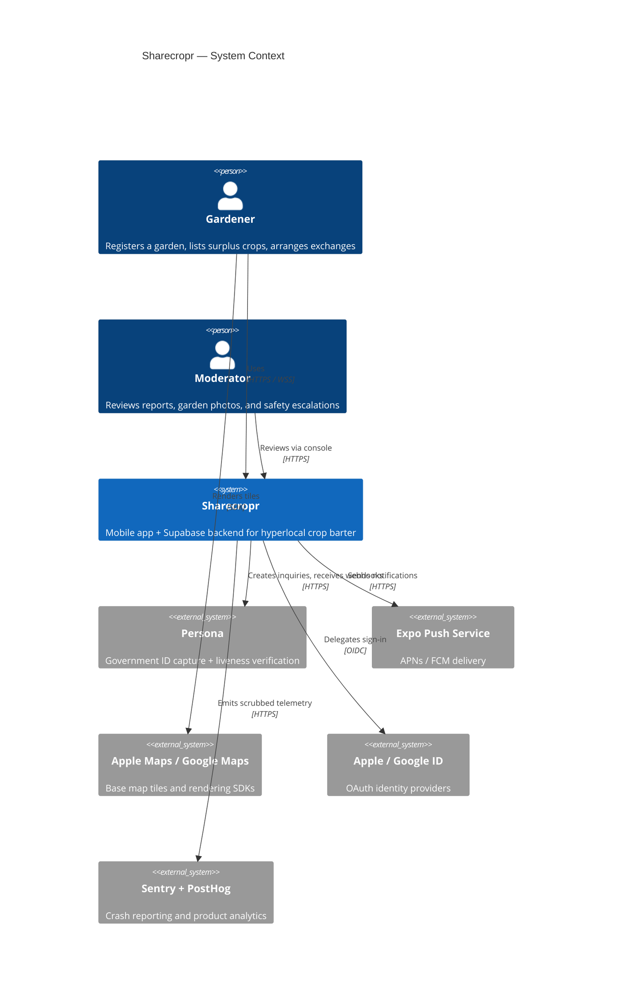
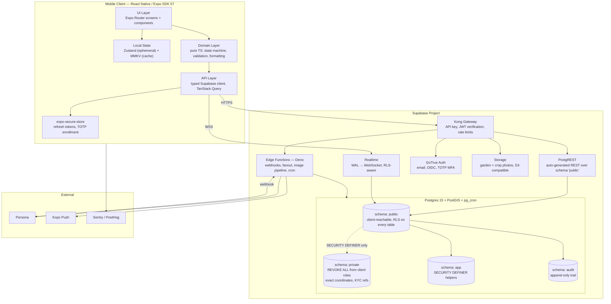
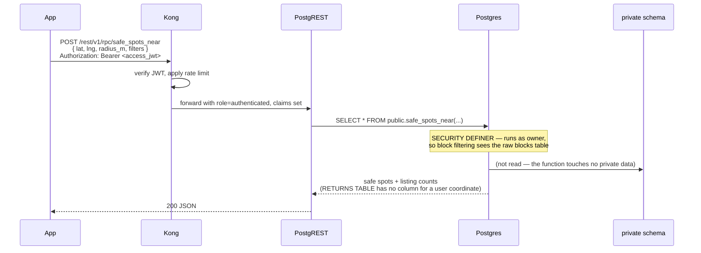
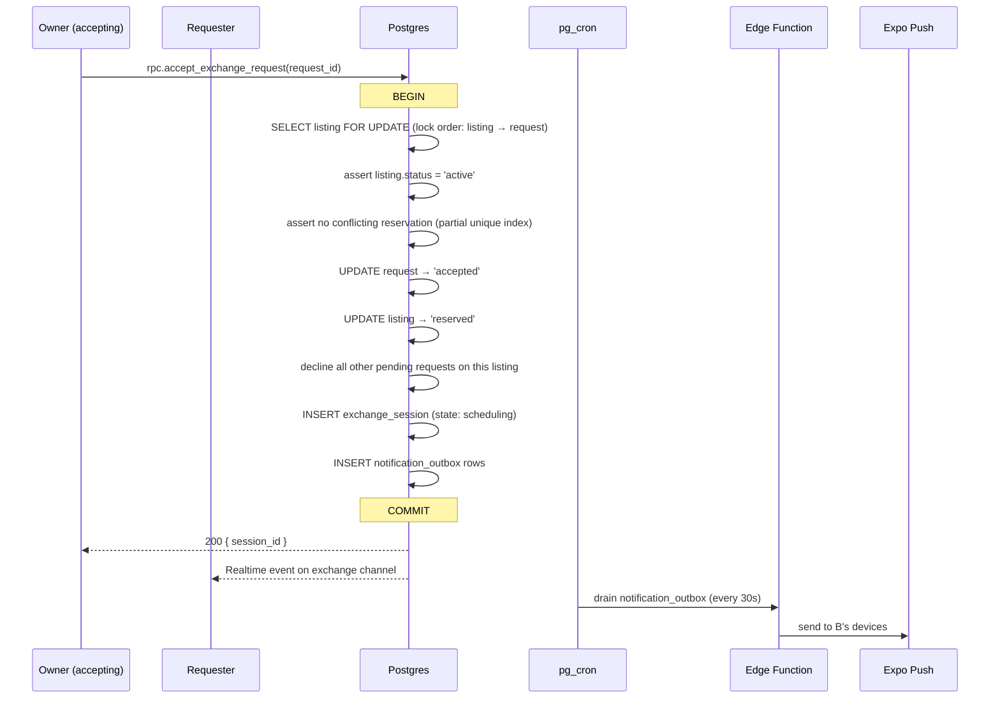
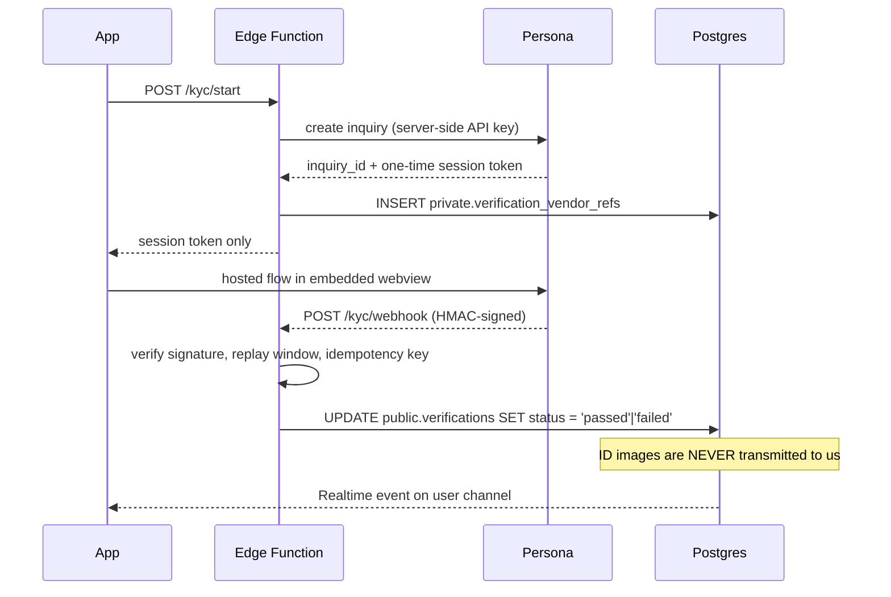

# System Architecture

**Status:** Approved · **Version:** 1.0.0 · **Owner:** Architecture

---

## 1. Architectural stance

Sharecropr is a **database-centric system**. Postgres is not a persistence detail behind a service layer — it is where authorization, invariants, and state transitions live. The mobile client talks to Postgres through PostgREST with row-level security doing the access control, and Edge Functions exist only where logic genuinely cannot live in the database (third-party webhooks, push fanout, image processing, scheduled work).

This is a deliberate and somewhat unfashionable choice. It buys a very small team a system where *the security model cannot be bypassed by forgetting a check in a controller*, because there is no controller. It costs us: business logic written in PL/pgSQL, a harder testing story, and a real migration burden if we ever outgrow Supabase. Both sides recorded in [ADR-0003](adr/ADR-0003-database-centric-authz.md).

**The single most important architectural property:** exact garden coordinates are physically unreachable by any client role, because they live in a `private` schema with `REVOKE ALL` from `anon` and `authenticated`. Not filtered out — unreachable. See [Location Privacy](04-location-privacy.md).

---

## 2. System context

### External dependencies and what happens when they fail

| Dependency | Purpose | Failure mode | Degradation strategy |
| --- | --- | --- | --- |
| Supabase (Postgres, Auth, Storage, Realtime) | Everything | Total outage | Hard down. App shows cached inventory and taxonomy with an offline banner. Accepted single point of failure; mitigations in [Runbooks](../05-operations/05-runbooks.md). |
| Persona | Identity verification | Unavailable | New verifications queue as `pending_vendor`; existing verified users unaffected. Signup continues; transacting is blocked for the affected users only. |
| Expo Push | Notifications | Delayed / dropped | In-app inbox is the durable record; push is explicitly best-effort. Users still see everything on next open. |
| Apple/Google Maps SDK | Map rendering | Tile failure | Map renders a neutral background with markers still positioned correctly. Never blocks the exchange flow. |
| Apple / Google OAuth | Sign-in | Provider down | Email/password path remains. Users tied to that provider cannot sign in — communicated via status banner. |

---

## 3. Container view

### 3.1 Schema separation

The four-schema split is the backbone of the security model.

| Schema | Client-reachable | Contents | Grants |
| --- | --- | --- | --- |
| `public` | Yes, via PostgREST | All tables the client may touch. **RLS enabled on every one, no exceptions.** | `SELECT/INSERT/UPDATE/DELETE` to `authenticated`, filtered by policy |
| `private` | **No** | `garden_locations` (exact geography), `verification_vendor_refs`, `review_bypass_accounts`, moderation internals | `REVOKE ALL ON SCHEMA private FROM anon, authenticated` |
| `app` | Only named functions | `SECURITY DEFINER` helpers: authorization predicates, fuzzing, state transitions | `EXECUTE` granted per-function on an explicit allowlist |
| `audit` | No | Append-only event trail; no `UPDATE` or `DELETE` grants to anyone including `service_role` | Insert via trigger only |

`private` is not exposed via PostgREST's `db-schemas` setting either — belt and braces. A migration that adds a grant to `private` fails CI ([CI/CD §4](../05-operations/02-cicd.md)).

### 3.2 What goes where

| Logic | Home | Why |
| --- | --- | --- |
| Read a listing, an inventory item, a safe spot | PostgREST + RLS | No custom logic needed; policy is the authorization |
| Accept an exchange request | Postgres RPC (`SECURITY DEFINER`) | Multi-row atomic state transition with row locks. Cannot be safely done client-side. |
| Fuzz a garden location for display | Postgres trigger + `app.derive_display_point` | Must be impossible to skip. A trigger cannot be forgotten; an application call can. |
| Search safe spots near me | Postgres RPC (`safe_spots_near`) | Aggregates across listings and applies block filtering in one round trip, and — critically — its `RETURNS TABLE` has no column that could carry a user coordinate |
| Persona webhook handling | Edge Function | Signature verification + vendor secret; must not be in the client or the DB |
| Push notification fanout | Edge Function on `pg_cron` | Outbound HTTP with retries; wrong job for Postgres |
| EXIF stripping + thumbnailing | Edge Function on Storage trigger | Binary image processing |
| Expiring stale listings and requests | `pg_cron` + SQL | Pure data operation |
| Trust score recomputation | `pg_cron` nightly + on-completion trigger | Derived data |

---

## 4. Technology stack

| Layer | Choice | Version target | ADR |
| --- | --- | --- | --- |
| Mobile runtime | React Native + Expo, New Architecture (Fabric + TurboModules) | Expo SDK 57 / RN 0.86 / React 19.2 | [ADR-0001](adr/ADR-0001-mobile-stack.md) |
| Language | TypeScript, `strict: true`, no `any` in `src/domain` | 5.x | [ADR-0001](adr/ADR-0001-mobile-stack.md) |
| Navigation | Expo Router (file-based, typed routes) | SDK-matched | [ADR-0012](adr/ADR-0012-navigation.md) |
| Server state | TanStack Query v5 | 5.x | [ADR-0011](adr/ADR-0011-state-management.md) |
| Client state | Zustand | 5.x | [ADR-0011](adr/ADR-0011-state-management.md) |
| Local cache | MMKV | 3.x | [ADR-0011](adr/ADR-0011-state-management.md) |
| Secure storage | `expo-secure-store` (Keychain / Android Keystore) | SDK-matched | [ADR-0007](adr/ADR-0007-token-storage.md) |
| Maps | `react-native-maps` (Apple Maps on iOS, Google Maps on Android) | 1.x | [ADR-0013](adr/ADR-0013-map-library.md) |
| Backend platform | Supabase (managed) | Postgres 15 | [ADR-0004](adr/ADR-0004-supabase.md) |
| Geospatial | PostGIS 3.4 + H3 (`h3-pg`) | — | [ADR-0005](adr/ADR-0005-geospatial-model.md) |
| Auth | Supabase GoTrue; TOTP MFA | — | [ADR-0006](adr/ADR-0006-auth-providers.md) |
| Identity verification | Persona (hosted flow) | — | [ADR-0010](adr/ADR-0010-kyc-vendor.md) |
| Serverless | Supabase Edge Functions (Deno) | — | [ADR-0008](adr/ADR-0008-edge-functions.md) |
| Push | Expo Push → APNs / FCM | — | — |
| E2E testing | Maestro | — | [ADR-0015](adr/ADR-0015-e2e-tooling.md) |
| DB testing | pgTAP | — | [ADR-0016](adr/ADR-0016-pgtap.md) |
| CI/CD | GitHub Actions + EAS Build / Submit / Update | — | [ADR-0017](adr/ADR-0017-release-cadence.md) |
| Observability | Sentry (crash + perf), PostHog (product), Supabase logs | — | [ADR-0018](adr/ADR-0018-observability.md) |

---

## 5. Request paths

### 5.1 Normal read — "show me safe spots near me"

The critical property: the function reads `private` data to compute *counts*, and the return type physically cannot carry a user coordinate — it has no column for one.

### 5.2 State transition — "accept an exchange request"

### 5.3 Verification webhook

---

## 6. Deployment topology

| Environment | Supabase project | Mobile channel | Data | Purpose |
| --- | --- | --- | --- | --- |
| `local` | Supabase CLI, Docker | Expo Dev Client | Synthetic seed | Development |
| `preview` | Ephemeral branch project per PR | EAS Update preview channel | Synthetic seed | PR review, E2E |
| `staging` | Dedicated project | `staging` channel | Production-shaped synthetic | Release candidate soak, store review builds |
| `production` | Dedicated project, PITR enabled | `production` channel | Real | Live |

There is **no path** from production data to any other environment. Seeds are generated, never copied. This is enforced by not granting anyone a production dump capability outside the break-glass runbook.

Full detail: [Environments](../05-operations/01-environments.md).

---

## 7. Scaling posture

MVP is two metros. This architecture comfortably serves low six-figure users on a single Postgres instance. The known scaling order:

1. **Read replica + `pgbouncer` tuning** — when analytics or moderation queries start affecting p95 on the map RPC.
2. **Materialized safe-spot listing counts**, refreshed on a short interval, when `safe_spots_near` exceeds its 400 ms budget.
3. **Nightly warehouse export** — before analysts get direct OLTP access, not after.
4. **Extract moderation into its own service** — trigger is >200 reports/day, per [ADR-0018](adr/ADR-0018-observability.md).
5. **Extract the exchange engine** — only if PL/pgSQL becomes an unacceptable maintenance surface. This is the expensive one; see [R-06](../06-roadmap/02-open-risks.md).

Deliberately not doing now: microservices, a GraphQL gateway, an event bus, multi-region. Each would be a real cost paid against a hypothetical scale.

---

## 8. The escape hatch

Supabase is a strategic dependency and we should be honest about it. If we need to leave:

- **Postgres is portable.** Every table, function, policy, and migration is standard SQL. This is the majority of the system and it moves unchanged to any managed Postgres.
- **PostgREST is open source and self-hostable.** The client's REST contract survives.
- **GoTrue is open source**, but user migration involves password-hash export, OAuth re-linking, and non-migratable TOTP factors. Apple private-relay addresses are scoped to our team ID and do not survive a provider change cleanly. Realistic estimate is **1–2 engineer-months**, not the two weeks it looks like — see [ADR-0004](adr/ADR-0004-supabase.md).
- **Realtime, Storage, and Edge Functions are the sticky parts.** Realtime maps to a self-hosted Realtime server or a rewrite onto WebSockets; Storage is S3-compatible; Edge Functions are Deno and move to Deno Deploy or Cloud Run with modest changes.

Mitigation we take *now*: the mobile app touches `@supabase/supabase-js` in exactly one file (`src/api/supabase.ts`). Everything else uses our own typed repository functions. Swapping the transport is then a single-file change plus type reconciliation.

---

## 9. Cross-cutting concerns

| Concern | Approach | Detail |
| --- | --- | --- |
| AuthZ | RLS policies + `SECURITY DEFINER` predicates | [RLS Design](05-rls-design.md) |
| Location privacy | `private` schema + derive trigger + fuzzed display point | [Location Privacy](04-location-privacy.md) |
| Idempotency | Client-generated UUID `idempotency_key` on every mutating RPC, unique-indexed | [API Contract §3](06-api-contract.md) |
| Concurrency | Documented lock ordering, partial unique indexes, `FOR UPDATE` | [Exchange State Machine §5](07-exchange-state-machine.md) |
| Rate limiting | Kong per-IP, plus per-user token buckets in Postgres for expensive RPCs | [API Contract §6](06-api-contract.md) |
| Audit | `audit.events` append-only, written by trigger on every sensitive table | [Data Model §12](03-data-model.md) |
| Telemetry scrubbing | Sentry `beforeSend` + PostHog sanitizer strip coordinates, emails, tokens | [Observability](../05-operations/04-observability.md) |
| Time | All timestamps `timestamptz`, UTC in storage, rendered in device timezone | [Data Model §2](03-data-model.md) |
| Soft delete | `deleted_at` on user-visible entities; RLS filters it; hard delete only via the deletion pipeline | [Privacy](../02-security/04-privacy-and-data-retention.md) |

---

## 10. Known architectural weaknesses

Stated plainly so they can be argued with:

1. **Business logic in PL/pgSQL is unpopular and under-reviewed.** `accept_exchange_request` is the most safety-critical function in the system and is written in a language most of the team won't be fluent in. The concurrency test harness is the real defense; a `CODEOWNERS` rule on `supabase/migrations/**` is the process defense.
2. **RLS correctness fails silently.** A missing policy doesn't crash — it returns data. Negative pgTAP tests plus a scheduled canary that authenticates as a synthetic user and asserts it *cannot* read another's garden.
3. **Single Postgres instance is a single point of failure.** PITR and a documented RTO/RPO, accepted for MVP scale.
4. **The dual spatial model (PostGIS geography + H3 cells) will produce at least one bug**, most likely a boundary-recall miss where someone queries one cell instead of a disk. Covered by an explicit boundary test in [Geospatial Test Plan](../04-testing/03-geospatial-test-plan.md).
5. **Backend and mobile release cadences are coupled.** Mitigated by a two-version compatibility rule enforced mechanically in CI ([ADR-0017](adr/ADR-0017-release-cadence.md)).

---

## Change Log

| Date | Version | Author | Change |
| --- | --- | --- | --- |
| 2026-08-08 | 1.0.0 | Architecture | Initial architecture |
