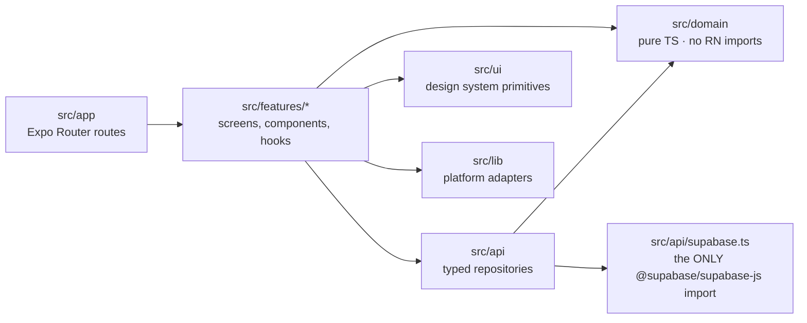

# Mobile Architecture

**Status:** Review · **Version:** 1.1.5 · **Owner:** Architecture

The backend is where authorization and invariants live ([System Architecture §1](01-system-architecture.md)). The client is therefore **a rendering and caching layer with a state machine mirror** — it is not allowed to be the place a rule is enforced, and any rule that exists only here is a bug. What the client *is* responsible for: being fast, being usable offline, being usable with a screen reader, and never holding a secret it shouldn't.

Stack is fixed by [ADR-0001](adr/ADR-0001-mobile-stack.md): Expo SDK 57 / RN 0.86 / React 19.2, New Architecture (Fabric + TurboModules) on, TypeScript `strict`.

---

## 1. Layering

Four layers, one direction of dependency. The arrows are enforced by lint, not by discipline.



| Layer | May import | May **not** import | Rationale |
| --- | --- | --- | --- |
| `src/app` | `features`, `ui` | `api`, `domain` directly | Route files are ≤ 40 lines: params in, a feature screen out. Keeps navigation refactors cheap. |
| `src/features/*` | `domain`, `api`, `ui`, `lib`, sibling features **only via their `index.ts`** | Another feature's internals | Feature-to-feature coupling through a published surface, so the blast radius of a change is a directory. |
| `src/domain` | Nothing outside `src/domain` | `react`, `react-native`, `expo*`, `@supabase/*`, `@tanstack/*`, `zustand` | Pure TypeScript. Runs in Node under Jest with zero mocks, and runs unchanged in a future web client. |
| `src/api` | `domain`, `src/api/supabase.ts` | `react-native` (no exceptions — the `AppState` listener is a feature boot hook, §5.3) and every other RN/Expo native module except the three sanctioned §1.1a adapters (`react-native-mmkv`, `expo-secure-store`, `expo-crypto`), `features`, `ui`, `@maplibre/*` | Transport isolation. Swapping Supabase is a one-file change plus type reconciliation ([System Architecture §8](01-system-architecture.md)). |

### 1.1 Why `src/domain` is platform-free

The exchange state machine, the taxonomy resolver, the unit formatter, the distance formatter, the validation schemas, and the error taxonomy are all pure functions over plain data. They are the parts most likely to be wrong in a way that hurts, and the parts that a web client (out of scope for MVP per [PRD §1](../00-foundation/02-prd.md), not out of scope forever) would need verbatim.

Keeping React Native out of `src/domain` costs almost nothing today and is nearly impossible to retrofit later, because the first `import { Platform } from 'react-native'` inside a validator drags the entire RN module graph into the Node test run and someone "fixes" it with a mock instead of a boundary.

The rule lives in `eslint.config.js`. Its shape is the part that matters. ESLint flat config **replaces** a rule's options when a later block matching the same file sets the same rule; it does not merge them. An earlier version of this excerpt had three blocks that each set `no-restricted-imports` for overlapping globs. Under that structure the domain ban silently stopped applying (SCR-0011). So every file glob gets **one complete** `no-restricted-imports` entry, assembled from shared pieces:

| Glob | Patterns |
| --- | --- |
| `src/**/*.{ts,tsx}`, `app/**/*.{ts,tsx}` | SDK seam (`@supabase/*`) · map-renderer seam |
| `src/domain/**/*.{ts,tsx}` | domain purity (list below) · cross-layer (any depth, and the `@/` alias) · SDK seam · map-renderer seam |
| `src/api/**/*.{ts,tsx}` | api isolation (§1.1a) · cross-layer (`features`/`app`/`ui`) · SDK seam · map-renderer seam |
| `src/api/supabase.ts` | everything in the `src/api` row **except** the SDK seam |
| `src/features/map/components/MapCanvas.tsx` | SDK seam only (exempt from the map-renderer seam) |

Domain purity bans `react`, `react-dom`, `react-native`, `react-native/*`, `react-native-*`, `expo`, `expo-*`, `@expo/*`, `@supabase/*`, `@tanstack/*`, `zustand`, `@shopify/*`, `../features/*`, `../app/*`, `../api/*`, `../ui/*`, `../lib/*`, and keeps `@typescript-eslint/no-explicit-any` at `error`. The literal `../x/*` globs only match one level up, so a regex pattern holds the layer line at any depth and through the `@/` alias.

There are no global `ignores`. A seam file is exempt from exactly the one restriction it exists to break, and it is linted for everything else. `npm run lint:fixtures` lints must-fail and must-pass imports against the real config as if they sat at each glob's paths, and CI runs it. A seam that stops biting fails the build.

Three rules, three seams: domain purity, transport isolation, map-renderer isolation. Each has a corresponding CI check that fails the build rather than warning.

The third rule has now been cashed in once. [ADR-0019](adr/ADR-0019-openstreetmap-maplibre.md) replaced the entire map substrate — renderer, tile source, and marker model — and the blast radius was one component plus its type adapters. That is the argument for seams, made concretely rather than in the abstract. Note also that a lint rule is a *source* check: it cannot see a transitive dependency reaching a network host, which is why NFR-102 is asserted from captured traffic instead.

### 1.1a `src/api` exceptions

`src/api` may not import React Native. The native modules below are the **only** sanctioned exceptions. Each one is a storage or crypto adapter that the transport layer cannot work without, and each is named in this document. Adding one is an architecture change: amend this table and the `API_ISOLATION` list in `eslint.config.js` in the same PR. `react-native` itself has **no** exception: the `AppState` listener that drives token refresh is the `useAuthAutoRefresh` boot hook in `src/features/auth/hooks/`, which calls `startAutoRefresh`/`stopAutoRefresh` exported by `src/api/supabase.ts` (§5.3; decided in SCRUM-62, 2026-10-21).

| Module | Used by | Why it is sanctioned |
| --- | --- | --- |
| `react-native-mmkv` | `src/api/query-cache.ts` | Encrypted query cache (§2.3) |
| `expo-secure-store` | `src/api/secure-storage.ts`, `src/api/query-cache.ts` | Chunked session storage (§5.2) and the MMKV key (§2.3) |
| `expo-crypto` | `src/api/query-cache.ts` | CSPRNG for the MMKV key (§2.3, "key generated once") |

### 1.2 Folder tree

```
src/
├── app/                                  # Expo Router. Route files only — no business logic.
│   ├── _layout.tsx                       # Providers: Query, gesture handler, theme, error boundary
│   ├── +not-found.tsx
│   ├── +html.tsx                         # (unused in MVP; present for the web escape hatch)
│   ├── index.tsx                         # Boot router: decides auth / onboarding / tabs
│   ├── (auth)/
│   │   ├── _layout.tsx                   # Redirects to (tabs) if a session exists
│   │   ├── sign-in.tsx
│   │   ├── sign-up.tsx
│   │   ├── verify-email.tsx
│   │   ├── forgot-password.tsx
│   │   ├── reset-password.tsx
│   │   ├── mfa-challenge.tsx             # TOTP at sign-in
│   │   └── recovery-code.tsx
│   ├── (onboarding)/
│   │   ├── _layout.tsx                   # Guard: session required, onboarding incomplete
│   │   ├── welcome.tsx
│   │   ├── profile.tsx                   # display_name, handle, avatar
│   │   ├── garden.tsx                    # name, size band, location capture
│   │   ├── garden-photo.tsx              # camera-only verification capture
│   │   ├── identity.tsx                  # Persona hosted flow (webview)
│   │   └── done.tsx
│   ├── (tabs)/
│   │   ├── _layout.tsx                   # Tab bar; badge counts from Query
│   │   ├── map/
│   │   │   ├── index.tsx                 # THE map screen
│   │   │   └── list.tsx                  # Accessible alternative to the map (§9)
│   │   ├── inventory/
│   │   │   ├── index.tsx
│   │   │   └── [itemId].tsx
│   │   ├── exchanges/
│   │   │   ├── index.tsx                 # Segmented: Incoming / Outgoing / Scheduled / History
│   │   │   ├── [requestId].tsx
│   │   │   └── session/[sessionId].tsx
│   │   └── profile/
│   │       ├── index.tsx
│   │       ├── garden.tsx
│   │       ├── notifications.tsx
│   │       ├── security.tsx              # AAL2-gated
│   │       ├── blocked.tsx
│   │       └── delete-account.tsx
│   ├── (modals)/
│   │   ├── _layout.tsx                   # presentation: 'modal'
│   │   ├── item-new.tsx
│   │   ├── item-edit/[itemId].tsx
│   │   ├── listing-new/[itemId].tsx
│   │   ├── request-new/[listingId].tsx
│   │   ├── schedule/[sessionId].tsx
│   │   ├── handoff/[sessionId].tsx       # code display + entry
│   │   ├── rate/[sessionId].tsx
│   │   ├── report.tsx                    # ?subjectType=&subjectId=
│   │   ├── block-confirm.tsx
│   │   ├── species-picker.tsx
│   │   ├── safe-spot/[safeSpotId].tsx
│   │   └── filters.tsx
│   ├── thread/[threadId].tsx             # Full-screen, outside tabs, keyboard-first
│   ├── notifications.tsx                 # In-app inbox (the durable record)
│   └── legal/
│       ├── terms.tsx
│       └── privacy.tsx
│
├── features/
│   ├── auth/            { components/ hooks/ screens/ index.ts }
│   ├── onboarding/
│   ├── garden/
│   ├── inventory/
│   ├── taxonomy/                          # species/variety pickers, bundled-data loader
│   ├── map/
│   │   ├── components/
│   │   │   ├── MapCanvas.tsx              # ← the ONLY @maplibre/* importer
│   │   │   ├── OsmAttribution.tsx         # "© OpenStreetMap contributors" — NFR-99
│   │   │   ├── MarkerLayer.tsx            # ShapeSource + SymbolLayer, one FeatureCollection
│   │   │   ├── FollowMeButton.tsx
│   │   │   ├── InventoryFab.tsx
│   │   │   ├── FilterChips.tsx
│   │   │   ├── StalenessBanner.tsx
│   │   │   ├── TileDegradedChip.tsx       # non-blocking; the whole tile-failure UI
│   │   │   └── SafeSpotSheet.tsx
│   │   ├── style/
│   │   │   └── sharecropr-basemap.json    # the style JSON — reviewed like code
│   │   ├── data/
│   │   │   └── gazetteer.<metro>.json     # bundled localities; no third-party geocoder
│   │   ├── hooks/
│   │   │   ├── useMapMarkers.ts           # supercluster wrapper
│   │   │   ├── useFollowMode.ts
│   │   │   └── useViewportQuery.ts
│   │   └── index.ts
│   ├── listings/
│   ├── exchange/
│   ├── messaging/
│   ├── notifications/
│   ├── trust/                             # ratings, reports, blocks
│   └── profile/
│
├── domain/                                # PURE TypeScript. No React Native. Enforced by lint.
│   ├── exchange/
│   │   ├── machine.ts                     # mirrors 07-exchange-state-machine.md
│   │   ├── transitions.generated.ts       # generated from private.legal_session_transitions
│   │   └── guards.ts
│   ├── taxonomy/
│   │   ├── resolve.ts                     # kingdom → category → species → variety
│   │   └── search.ts                      # local trigram-ish ranking for offline search
│   ├── units/                             # quantity_unit formatting + pluralisation
│   ├── geo/
│   │   ├── quantize.ts                    # 100 m client-side quantization (04-location-privacy.md §6.1)
│   │   └── distance.ts                    # haversine, formatting to local units
│   ├── validation/                        # zod schemas shared by forms and repositories
│   ├── errors/
│   │   ├── codes.ts                       # the stable error-code union
│   │   └── classify.ts                    # code → severity, retryability, surface
│   └── time/                              # window formatting, quiet-hours maths (display only)
│
├── api/
│   ├── supabase.ts                        # the single SDK import; client construction
│   ├── secure-storage.ts                  # chunked SecureStore adapter (§5)
│   ├── queryClient.ts                     # TanStack Query config + MMKV persister
│   ├── keys.ts                            # query key factory (§2.1)
│   ├── errors.ts                          # PostgREST/Edge error → domain error code
│   ├── realtime.ts                        # channel lifecycle (see 08-realtime-and-notifications.md)
│   ├── types.generated.ts                 # `supabase gen types typescript`
│   └── repositories/
│       ├── profiles.ts
│       ├── taxonomy.ts
│       ├── gardens.ts
│       ├── inventory.ts
│       ├── safeSpots.ts
│       ├── listings.ts
│       ├── exchanges.ts
│       ├── messages.ts
│       ├── notifications.ts
│       ├── trust.ts
│       └── media.ts
│
├── ui/                                    # Design system. No feature knowledge.
│   ├── theme/            { tokens.ts, typography.ts, spacing.ts }
│   ├── primitives/       { Text, Button, Pressable, Sheet, Chip, Field, Toast, … }
│   └── patterns/         { EmptyState, ErrorState, SkeletonList, ScreenHeader }
│
├── lib/                                   # Platform adapters. Thin, mockable.
│   ├── mmkv.ts
│   ├── location.ts                        # expo-location, while-in-use only
│   ├── camera.ts
│   ├── push.ts                            # expo-notifications token + handlers
│   ├── appState.ts
│   ├── net.ts                             # @react-native-community/netinfo → online manager
│   ├── analytics.ts                       # PostHog wrapper with the coordinate sanitizer
│   └── sentry.ts                          # beforeSend scrubber
│
└── test/
    ├── factories/
    ├── msw/                               # request-level mocks for repository tests
    └── setup.ts
```

Two rules that keep this from rotting: **route files never contain a `useQuery`** (they compose a feature screen), and **repositories never contain a React hook** (hooks live in features and call repositories).

---

## 2. State

Three stores, three jobs, and a hard rule about which is which. Full rationale in [ADR-0011](adr/ADR-0011-state-management.md).

| State | Home | Persisted | Survives app kill | Why there |
| --- | --- | --- | --- | --- |
| Listings, safe spots, inventory, exchanges, messages, notifications, profile cards | TanStack Query v5 | Yes → MMKV | Yes | It is server-owned. Anything that models it as client state will drift and show stale truth as fact. |
| Auth session / refresh token | `expo-secure-store` (chunked) | Yes | Yes | Hardware-backed. See §5. |
| Crop taxonomy | Bundled JSON + Query overlay | Yes → MMKV | Yes | Must work offline on first run, before any network call ([PRD C5](../00-foundation/02-prd.md)). |
| Map camera (centre, zoom, follow-mode flag) | Zustand | No | No | Changes at 60 Hz during a pan. Putting this in Query or in React state re-renders the marker layer and drops frames. |
| Active filter chips, search text, radius | Zustand | Radius only → MMKV | Radius only | Filters are a session-scoped intent, not a preference — except radius, which users set once and expect to persist. |
| Draft forms (new item, new listing, request message) | Zustand + MMKV autosave (debounced 500 ms) | Yes | Yes | Losing a half-typed listing because a push notification backgrounded the app is the kind of thing people uninstall over. |
| Bottom-sheet open/closed, selected safe spot | Zustand | No | No | Ephemeral UI. Restoring a sheet on cold start is confusing, not helpful. |
| Optimistic exchange transitions | Query cache (`onMutate`) + `domain/exchange/machine.ts` | Via Query persistence | Yes | Optimism must be *legal* optimism — the machine decides what can be shown before the server answers. |
| Notification permission status, onboarding step | Zustand + MMKV | Yes | Yes | Cheap, non-authoritative, needed at first paint. |
| Anything derived (badge counts, "can I transact") | Selector / `useMemo` | No | No | Derived state that gets its own store is the origin of every "the badge says 3 but the list is empty" bug. |

> **The rule:** if the server can change it without the client acting, it is Query state. If it dies with the screen, it is Zustand. If it is a secret, it is SecureStore. There is no fourth case, and a proposal for one needs an ADR.

### 2.1 Query key factory

Keys are constructed exclusively through `src/api/keys.ts`. Ad-hoc array literals are banned by lint (`no-restricted-syntax` on `useQuery` with a literal `queryKey`), because a typo in a key produces a cache miss, not an error.

```ts
// src/api/keys.ts
export const qk = {
  all: ['sc'] as const,

  me:            () => [...qk.all, 'me'] as const,
  meProfile:     () => [...qk.me(), 'profile'] as const,
  meGarden:      () => [...qk.me(), 'garden'] as const,
  meLocation:    () => [...qk.me(), 'garden', 'location'] as const, // owner-only, never persisted

  taxonomy:      () => [...qk.all, 'taxonomy'] as const,
  species:       (categoryId?: number) => [...qk.taxonomy(), 'species', categoryId ?? 'all'] as const,
  varieties:     (speciesId: number) => [...qk.taxonomy(), 'varieties', speciesId] as const,

  inventory:     () => [...qk.all, 'inventory'] as const,
  inventoryList: (f: InventoryFilter) => [...qk.inventory(), 'list', f] as const,
  inventoryItem: (id: string) => [...qk.inventory(), 'item', id] as const,

  map:           () => [...qk.all, 'map'] as const,
  // Viewport is quantized to a ~100 m grid + integer zoom band so that a pan
  // does not mint a new cache entry per frame. See domain/geo/quantize.ts.
  safeSpotsNear: (v: QuantizedViewport, f: MapFilter) => [...qk.map(), 'near', v, f] as const,
  safeSpot:      (id: string) => [...qk.map(), 'spot', id] as const,
  spotListings:  (id: string, f: MapFilter) => [...qk.map(), 'spot', id, 'listings', f] as const,

  exchanges:     () => [...qk.all, 'exchanges'] as const,
  requestsIn:    (c?: Cursor) => [...qk.exchanges(), 'incoming', c ?? null] as const,
  requestsOut:   (c?: Cursor) => [...qk.exchanges(), 'outgoing', c ?? null] as const,
  request:       (id: string) => [...qk.exchanges(), 'request', id] as const,
  session:       (id: string) => [...qk.exchanges(), 'session', id] as const,

  threads:       () => [...qk.all, 'threads'] as const,
  thread:        (id: string) => [...qk.threads(), id] as const,
  messages:      (threadId: string) => [...qk.threads(), threadId, 'messages'] as const,

  notifications: (c?: Cursor) => [...qk.all, 'notifications', c ?? null] as const,
  unreadCount:   () => [...qk.all, 'notifications', 'unread-count'] as const,

  profileCard:   (userId: string) => [...qk.all, 'profile-card', userId] as const,
} as const;
```

Conventions:

1. **Hierarchical, prefix-invalidatable.** `queryClient.invalidateQueries({ queryKey: qk.exchanges() })` after any exchange mutation. One call, correct by construction.
2. **Filters are objects, not stringified.** Query hashes structurally and stably; hand-serialising filters into the key produces cache misses on key reorder.
3. **Viewport keys are quantized before they become keys.** Raw floats mean a unique key per pan frame and an unbounded cache.
4. **`qk.meLocation()` is on the persistence deny-list.** The owner's exact garden point is fetched on demand and never written to MMKV — see §5.4.

### 2.2 `staleTime` per data class

`staleTime` is a product decision about how wrong a screen is allowed to be, so it is set per data class rather than globally.

| Data class | `staleTime` | `gcTime` | Refetch on focus | Realtime-invalidated | Reasoning |
| --- | --- | --- | --- | --- | --- |
| Crop taxonomy | `Infinity` | `Infinity` | No | No | Curated reference data. Refreshed by an explicit version check at cold start. |
| Safe spot detail (`safe_spots`) | 24 h | 7 d | No | No | Buildings do not move. Hours change; a daily refresh is ample. |
| `safe_spots_near` (map viewport) | 60 s | 15 min | Yes | No (too chatty) | Counts change as listings publish. 60 s is short enough to feel live and long enough to survive a pan-back. |
| Listings at a spot | 30 s | 10 min | Yes | No | Opened deliberately; users expect current availability. |
| Own inventory | 5 min | 30 d | Yes | Yes | Mostly self-mutated. Long `gcTime` because it must be readable offline. |
| Own profile / garden | 5 min | 7 d | Yes | Yes | |
| Other users' `profile_cards` | 10 min | 1 h | No | No | |
| Exchange requests (lists) | 0 | 1 h | Yes | Yes | The entire product. Always revalidate; realtime pushes invalidation. |
| Exchange session (detail) | 0 | 1 h | Yes | Yes | A stale session screen shows a button for an illegal transition. |
| Messages | 0 | 24 h | Yes | Yes | Appended via realtime; refetched on reconnect. |
| Notifications inbox | 30 s | 7 d | Yes | Yes | |
| Unread count | 30 s | 1 h | Yes | Yes | |

Global defaults, deliberately conservative:

```ts
// src/api/queryClient.ts
export const queryClient = new QueryClient({
  defaultOptions: {
    queries: {
      staleTime: 30_000,
      gcTime: 60 * 60_000,
      retry: (failureCount, error) => isRetryable(error) && failureCount < 3,
      retryDelay: (n) => Math.min(1000 * 2 ** n, 15_000) + Math.random() * 250,
      refetchOnWindowFocus: false,      // RN: focus is handled explicitly per-screen
      refetchOnReconnect: true,          // resync is the whole strategy — see §6
      networkMode: 'offlineFirst',
    },
    mutations: {
      networkMode: 'offlineFirst',       // pause instead of fail when offline
      retry: 0,                          // retries are the queue's job, not the mutation's
    },
  },
});
```

`isRetryable` comes from `domain/errors/classify.ts` and is driven by the taxonomy in §8 — a `409 listing_unavailable` is never retried, a `40P01` deadlock is retried with jitter up to 3 times per [Exchange State Machine §5 H7](07-exchange-state-machine.md).

### 2.3 Cache persistence to MMKV

```ts
// src/api/queryClient.ts (continued)
import { MMKV } from 'react-native-mmkv';
import { persistQueryClient } from '@tanstack/react-query-persist-client';
import { createSyncStoragePersister } from '@tanstack/query-sync-storage-persister';

const cache = new MMKV({ id: 'sc.query', encryptionKey: mmkvKeyFromSecureStore() });

const persister = createSyncStoragePersister({
  storage: {
    getItem: (k) => cache.getString(k) ?? null,
    setItem: (k, v) => cache.set(k, v),
    removeItem: (k) => cache.delete(k),
  },
  key: 'sc.query.v3',            // bump on any cache-shape change; old blobs are dropped, not migrated
  throttleTime: 2_000,
});

// Deny-list, not allow-list, because the failure mode of forgetting to add a
// key to an allow-list is a broken offline experience, and the failure mode of
// forgetting to add one to a deny-list is a privacy incident. So the deny-list
// is the one with a test.
const NEVER_PERSIST = [
  'me,garden,location',   // owner's exact coordinate — memory only
  'notifications,unread-count',
];

persistQueryClient({
  queryClient,
  persister,
  maxAge: 7 * 24 * 60 * 60_000,
  buster: `${Application.nativeBuildVersion}.${SCHEMA_CONTRACT_VERSION}`,
  dehydrateOptions: {
    shouldDehydrateQuery: (q) =>
      q.state.status === 'success' &&
      !NEVER_PERSIST.some((deny) => q.queryHash.includes(deny)),
  },
});
```

- MMKV is **encrypted**, with the key generated once and stored in SecureStore. An unencrypted MMKV file is world-readable on a rooted device and would contain message bodies and scheduled meeting times — both P1 ([Data Model §10](03-data-model.md)).
- `buster` includes the schema contract version, so a backend contract bump throws away the cache rather than rehydrating rows with a missing column into a screen that reads it.
- On sign-out the cache file is **deleted**, not cleared key-by-key. Same for the draft store.

### 2.4 Offline mutation queue

Mutations use `networkMode: 'offlineFirst'`, so when the device is offline they enter `paused` rather than failing. Pausing only works across restarts if the mutation function is registered by key *before* rehydration, so every offline-capable mutation has a `setMutationDefaults` registration:

```ts
// src/api/mutations.ts
queryClient.setMutationDefaults(['inventory', 'upsert'], {
  mutationFn: (vars: InventoryUpsert) => inventoryRepo.upsert(vars),
  retry: 3,
});
queryClient.setMutationDefaults(['messages', 'send'], {
  mutationFn: (vars: SendMessage) => messagesRepo.send(vars),
  retry: 3,
});

// Rehydrate, then resume. Order matters.
await persistQueryClient(/* … */);
onlineManager.subscribe((online) => {
  if (online) void queryClient.resumePausedMutations();
});
```

| Mutation | Queueable offline | Idempotency | Notes |
| --- | --- | --- | --- |
| Create / edit / archive inventory item | Yes | Client UUID PK, generated locally | The PK *is* the idempotency key. A replayed insert conflicts on PK and is treated as success. |
| Upload inventory photo | Yes | `media_assets.id` | File copied into app-scoped storage first; the queued job holds a path, not a `content://` URI that expires. |
| Send message | Yes | `messages.id` client-generated | Renders as pending with a clock glyph. See §6.2. |
| Mark notifications read | Yes | Set semantics — replay is harmless | Coalesced to one call on drain. |
| Update notification preferences | Yes | Last-write-wins on `updated_at` | |
| **Create exchange request** | **No** | `idempotency_key` uuid | A request queued for two hours and sent against an expired listing is a bad experience. Blocked with an explicit "you're offline" state. |
| **Accept / decline / withdraw** | **No** | `idempotency_key` uuid | State transitions require a live view of the world. [Exchange State Machine §5](07-exchange-state-machine.md) is unforgiving here. |
| **Confirm handoff** | **No** | — | Requires both parties online at a physical meeting. Failure is a retry button, never a queue. |
| **Submit rating / report / block** | **No** | `idempotency_key` uuid | Safety actions must be confirmed, not hopeful. `create_block` in particular must not silently sit in a queue while the user believes they are protected. |

> **What we deliberately do not do:** a generic "everything queues" replay log. Queuing state transitions produces an app that lies about the world. Offline write support is granted per-mutation, and the default for a new mutation is *not queueable*.

### 2.5 Conflict resolution

| Conflict | Rule | Surface |
| --- | --- | --- |
| Queued inventory edit vs. server edit from another device | Last-write-wins on `updated_at`; server is authoritative | Silent |
| Queued inventory edit vs. item deleted server-side | Drop the mutation | Toast: "That item was removed" |
| Queued inventory edit vs. item now `reserved` | Drop the mutation, refetch | Screen-level notice on the item |
| Queued message vs. thread closed (block, or 14-day close) | Drop the mutation, remove the pending bubble | Inline: "This conversation is closed" |
| Optimistic transition vs. `stale_state` (version mismatch) | Roll back, refetch, re-render; **never blind-retry** | Refetch, then the screen re-renders with legal actions only |
| Optimistic accept vs. `listing_unavailable` | Roll back, invalidate `qk.exchanges()` and the map | Toast: "Just claimed by someone else" |
| Two devices, same account, same mutation | Server idempotency key returns the original result | Silent |

Conflict rules live in `domain/` as pure functions (`resolveInventoryConflict(local, remote): Resolution`) so they are unit-testable without a network.

---

## 3. Navigation

Expo Router, file-based, typed routes on ([ADR-0012](adr/ADR-0012-navigation.md)). Groups carry the guards; screens assume they are reachable.

```
/                                   → boot router, redirects (never rendered for >1 frame)

(auth)                              [guard: no session]
  /sign-in                          scheme://sign-in
  /sign-up
  /verify-email                     ← email deep link target
  /forgot-password
  /reset-password                   ← email deep link target (sharecropr://reset-password?code=…, PKCE code exchanged on the screen — SPEC-001-T47)
  /mfa-challenge
  /recovery-code

(onboarding)                        [guard: session AND onboarding_completed_at IS NULL]
  /welcome → /profile → /garden → /garden-photo → /identity → /done

(tabs)                              [guard: session AND onboarding complete]
  ├─ map        /map                default tab
  │             /map/list           accessible alternative (§9)
  ├─ inventory  /inventory
  │             /inventory/[itemId]
  ├─ exchanges  /exchanges          badge: pending incoming requests
  │             /exchanges/[requestId]
  │             /exchanges/session/[sessionId]
  └─ profile    /profile
                /profile/garden
                /profile/notifications
                /profile/security          [guard: AAL2]
                /profile/blocked
                /profile/delete-account    [guard: AAL2]

/thread/[threadId]                  full-screen, pushed from exchange or notification
/notifications                      in-app inbox
/legal/terms, /legal/privacy

(modals)                            presentation: 'modal', formSheet on iOS
  /item-new
  /item-edit/[itemId]
  /listing-new/[itemId]             [guard: canTransact]
  /request-new/[listingId]          [guard: canTransact]
  /schedule/[sessionId]
  /handoff/[sessionId]
  /rate/[sessionId]
  /report?subjectType=&subjectId=
  /block-confirm?userId=
  /species-picker?onSelect=
  /safe-spot/[safeSpotId]           bottom sheet on the map, full modal elsewhere
  /filters
```

### 3.1 Deep links

Scheme `sharecropr://`, plus universal links on `https://sharecropr.app/l/*`. Every `deep_link` written into `public.notifications` resolves to exactly one of these:

| Link | Route | Notification kinds |
| --- | --- | --- |
| `sharecropr://exchanges/{requestId}` | `/exchanges/[requestId]` | `request_received`, `request_declined` |
| `sharecropr://exchanges/session/{sessionId}` | `/exchanges/session/[sessionId]` | `request_accepted`, `exchange_reminder`, `exchange_cancelled` |
| `sharecropr://thread/{threadId}` | `/thread/[threadId]` | `message_received` |
| `sharecropr://profile/garden` | `/profile/garden` | `garden_review_result` |
| `sharecropr://onboarding/identity` | `/(onboarding)/identity` | `verification_result` (failure) |
| `sharecropr://notifications` | `/notifications` | `moderation_outcome`, `safety_alert`, anything unmapped |
| `sharecropr://rate/{sessionId}` | `/(modals)/rate/[sessionId]` | post-completion prompt |

Rules:

- **No route accepts a coordinate parameter.** This is one of the egress controls in [Location Privacy §8](04-location-privacy.md), and it is asserted in CI by a static check over the route manifest for any param matching `/lat|lng|latitude|longitude|coord|point|geohash|_cell/i`.
- A deep link to a resource the user can no longer read (blocked, deleted, expired) lands on the tab root with a toast, never on a broken screen. The router resolves the target *after* a `fetchQuery`, not before.
- Cold-start deep links are held until the session and guards resolve. `expo-router`'s initial URL is read in the boot router, stashed in Zustand, and replayed after redirect.

### 3.2 Guards and redirects

Guards live in group `_layout.tsx` files. There is no per-screen guard, because a per-screen guard is a guard someone will forget.

```tsx
// src/app/(tabs)/_layout.tsx
export default function TabsLayout() {
  const { status, session } = useAuthSession();          // SecureStore-backed, sync after boot
  const { data: me, isPending } = useMyProfile();

  if (status === 'loading' || (session && isPending)) return <BootSplash />;
  if (!session) return <Redirect href="/(auth)/sign-in" />;
  if (!session.user.email_confirmed_at) return <Redirect href="/(auth)/verify-email" />;
  if (!me?.onboarding_completed_at) return <Redirect href="/(onboarding)/welcome" />;

  return <Tabs screenOptions={{ /* … */ }}>{/* … */}</Tabs>;
}
```

The **unverified-user** matrix. This is where the product is most easily got wrong, because there are three independent gates and they do not gate the same things ([PRD C3](../00-foundation/02-prd.md), [RLS Design §3 `app.can_transact`](05-rls-design.md)):

| Gate | Signal | Blocks | Does **not** block |
| --- | --- | --- | --- |
| Email unverified | `session.user.email_confirmed_at IS NULL` | Everything past `/verify-email` | — |
| Onboarding incomplete | `profiles.onboarding_completed_at IS NULL` | Tabs | Sign-out, legal pages |
| Garden not verified | `gardens.status <> 'verified'` | Publishing a listing, sending/accepting requests | Map, inventory, browsing, messaging on existing threads |
| Identity not verified | `verifications.status <> 'passed'` | Same as above | Same as above |

Browsing is never gated on identity. An unverified user gets the full map, full inventory, and a **persistent, dismissible-per-session banner** plus disabled primary actions with an explanatory sheet — not a hidden button. A hidden button reads as a bug; a disabled button with a reason reads as a next step.

```ts
// src/features/auth/hooks/useCapabilities.ts — one hook, one truth
export function useCapabilities() {
  const { data: me } = useMyProfile();
  const { data: v } = useMyVerification();
  const { data: g } = useMyGarden();
  const canTransact =
    !!me && !me.is_suspended && v?.status === 'passed' && g?.status === 'verified';
  return {
    canTransact,
    blockedBy: !canTransact
      ? (v?.status !== 'passed' ? 'identity' : g?.status !== 'verified' ? 'garden' : 'suspended')
      : null,
  } as const;
}
```

The client's `canTransact` is a **UX affordance only**. The authority is `app.can_transact()` in the database; the client copy exists so we don't render a button that will 403.

---

## 4. The map screen

The map is the app's front door and its hardest performance problem. It renders **OpenStreetMap vector tiles through `@maplibre/maplibre-react-native`**, from a PMTiles archive we host ourselves ([ADR-0019](adr/ADR-0019-openstreetmap-maplibre.md), [ADR-0020](adr/ADR-0020-pmtiles-self-hosting.md)). There is no Apple Maps, no Google Maps, no tile vendor, and no API key anywhere on this screen.

[PRD Assumption A5](../00-foundation/02-prd.md) — that MapLibre RN performs acceptably under the New Architecture at 200 clustered markers — is validated by a mandatory spike before any other implementation work. **That spike is reset**: the profiled `react-native-maps` spike answered a different question, and MapLibre RN's Fabric/TurboModule interop is the specific unknown to close first. Everything below assumes it passes; if it doesn't, the seam in §4.1 makes reverting to [ADR-0013](adr/ADR-0013-map-library.md) a one-component change.

### 4.1 The `MapCanvas` isolation seam

`src/features/map/components/MapCanvas.tsx` is the only file in the repository permitted to import `@maplibre/*` (enforced by the lint rule in §1.1). It exposes a renderer-neutral props contract:

```tsx
export type Camera = {
  center: { lat: number; lng: number };
  zoom: number;                                     // MapLibre zoom level, not deltas
};

export type MapCanvasProps = {
  camera: Camera;
  markers: readonly RenderableMarker[];             // already clustered by useMapMarkers
  userLocation: QuantizedPoint | null;              // ~100 m quantized before it gets here
  styleUrl: string;                                 // our style JSON → our PMTiles archive
  onCameraChanged: (c: Camera, gesture: boolean) => void;  // gesture=true breaks follow mode
  onGestureStart: () => void;                      // gesture began (userInteraction on onRegionWillChange) — follow clears here
  onMarkerPress: (id: string) => void;
  onMapPress: () => void;
  children?: React.ReactNode;                       // overlays, positioned in RN space
};
```

Two changes from the pre-OSM contract are worth naming rather than glossing. `Region` with `latitudeDelta`/`longitudeDelta` was a `react-native-maps` concept that did not survive the swap — [ADR-0013](adr/ADR-0013-map-library.md)'s own steel-man predicted exactly this, and it was right. And `styleUrl` is now a prop, because the basemap is a versioned artifact of ours rather than an invisible platform default.

Everything else — clustering, follow mode, filters, the sheet, the FAB — is plain React Native and knows nothing about the renderer. The cost of the ADR-0019 swap was this one file plus the type adapters, which is the insurance being claimed rather than merely described.

**Markers are GPU layers, not views.** The whole marker set reaches MapLibre as a single GeoJSON `FeatureCollection` on one `ShapeSource`, drawn by a `SymbolLayer` whose icon, badge, and label are data-driven style expressions ([SPEC-008-R69](../03-specs/SPEC-008-interactive-map.md)). 200 markers is one source update, not 200 native views crossing the bridge — which is why `tracksViewChanges` and the per-marker memoization gymnastics of the old design are simply gone (§4.4).

**`MapCanvas` renders the attribution, unconditionally.** `OsmAttribution` is mounted by the seam itself rather than by the screen, so no consumer can compose a map without it and no layout refactor can drop it by rearranging the screen. That is NFR-99 and it is an ODbL obligation, not a design preference (§4.4a).

**MapLibre's built-in source clustering is not enabled.** `cluster`, `clusterRadius`, `clusterMaxZoom`, and `clusterProperties` stay off the `ShapeSource`. Clustering is `supercluster` on the JS side and only that (§4.3, [SPEC-008-R70](../03-specs/SPEC-008-interactive-map.md)) — two clustering implementations that disagree at a zoom boundary produce a bug with no owner and no reproducible case.

The seam also means **the map screen is testable without a map**: Jest renders `MapCanvas` as a stub that emits synthetic camera changes, and the clustering, follow-mode, and filter logic are covered without a simulator.

### 4.2 Follow mode

```
initial                → camera = user location, zoom 13 (≈ 8 km radius), following = true
user pans / rotates / pinches → following = false at gesture START (onRegionWillChange with userInteraction); no camera animation until it ends
FollowMeButton press   → following = true, animate to user, zoom preserved
location update, following = true  → animateCamera(200 ms)
location update, following = false → update the avatar dot only; camera untouched
location update during a gesture → avatar only; camera untouched (even if following was true a frame earlier)
app returns to fg, following = true and last fix > 60 s old  → single fresh fix, then animate
```

`following` lives in Zustand and is read by `useFollowMode`, not by the screen — a boolean in React state here re-renders the marker tree on every location tick.

The critical detail: **programmatic camera moves must not clear follow mode.** Every map SDK fires its camera-changed callback for animations as well as gestures, so the discriminator is the only thing standing between us and a follow button that turns itself off half a second after you press it — the single most-reported bug in every map app that has shipped it wrong. On MapLibre the flag is `userInteraction` on the `onRegionWillChange` / `onRegionDidChange` payload (native normalises iOS's reason mask and Android's move reason); normalising it to the seam's `gesture: boolean` is `MapCanvas`'s job, and it is the one piece of renderer trivia the swap did not eliminate.

### 4.3 Clustering

`supercluster` on the JS side, fed by the flat result of `safe_spots_near`.

```ts
// src/features/map/hooks/useMapMarkers.ts
const index = useMemo(() => new Supercluster<SpotProps>({
  radius: 56,        // px — roughly one marker diameter plus breathing room
  maxZoom: 15,       // above z15 in a launch metro, spots are individually distinguishable
  minZoom: 3,
  minPoints: 3,      // 2 markers cluster into a blob that hides both; 3 is the threshold
  extent: 512,
}).load(features), [features]);

const markers = useMemo(
  () => index.getClusters(bboxOf(camera), Math.round(camera.zoom)),
  [index, bboxOf(camera), Math.round(camera.zoom)],
);
```

- Clustering runs **on integer zoom**, not fractional. Reclustering mid-pinch is what makes markers visibly jitter.
- The index is rebuilt only when the underlying query result changes, not on camera change. `getClusters` is cheap; `load` is not.
- Cluster press → `animateCamera` to `getClusterExpansionZoom`, which is the behaviour users already expect from every map they use.
- **Cluster styling encodes supply, not count**: the badge shows the summed `listing_count` of the member spots, because "7 spots" is less useful to a gardener than "23 things available here" ([PRD C8](../00-foundation/02-prd.md)).
- Above `minPoints`, clustering happens on the JS thread in `useMemo`. At 200 features this measures in single-digit milliseconds. If the spike shows otherwise, the fallback is moving `getClusters` into a worklet — **not** moving it to the server, and not switching to MapLibre's built-in source clustering. Server-side clustering needs the user's viewport at high precision on every pan, which is exactly the query-pattern side channel [Location Privacy §12.4](04-location-privacy.md) warns about; that argument is about the query pattern and is entirely unaffected by which renderer draws the result ([ADR-0019](adr/ADR-0019-openstreetmap-maplibre.md)).

### 4.4 Marker rendering

One source, one layer, style expressions. There is no per-marker React component and nothing about a marker crosses the JS/native boundary individually.

```tsx
// Inside MapCanvas — the only file that may write this.
<ShapeSource id="spots" shape={featureCollection} onPress={handleFeaturePress}>
  <SymbolLayer
    id="spot-symbols"
    style={{
      iconImage: ['get', 'category'],                 // sprite in our own style bundle
      iconAllowOverlap: true,
      textField: ['to-string', ['get', 'listing_count']],
      textSize: ['interpolate', ['linear'], ['zoom'], 10, 10, 15, 13],
      iconOpacity: ['case', ['get', 'selected'], 1, 0.9],
    }}
  />
</ShapeSource>
```

Why this is a simplification rather than a lateral move:

1. **A camera change is a no-op for the marker layer.** Panning does not re-render anything in React. The old design's `React.memo` comparator, stable `onPress` identity, and primitive-coordinate rules existed to stop 200 native views re-rendering per pan tick; that problem does not exist here, and neither do the four subtle ways of getting it wrong.
2. **`tracksViewChanges` is gone.** It was the single most important prop on the old screen and the most common cause of a silent frame drop. There is no equivalent, because there is no rasterised custom view.
3. **The feature properties are a closed set** — `(id, listing_count, category, label, selected)` and nothing else ([SPEC-008-R69](../03-specs/SPEC-008-interactive-map.md)). Geometry aside, no property carrying or derived from a *user* coordinate may appear on a feature. Constraining the payload at the seam is cheaper than auditing every future style expression.
4. **The new frame-budget risk is style complexity, not marker count.** Label collision, sprite count, and glyph range are what will cost frames now. That is a different thing to profile, and the reset spike is where it gets profiled.
5. **Sprites and glyphs are served from our own style bundle** (`styleUrl`), never from a third-party host — which is both NFR-102 and the reason a place label cannot fall back to a different font on Android than on iOS.

### 4.4a Attribution and tile failure

Two behaviours on this screen are obligations rather than preferences, and both are easy to break with a change that looks like a layout tidy-up.

**Attribution (NFR-99).** `MapCanvas` mounts `OsmAttribution` itself. "© OpenStreetMap contributors" is rendered legibly in **every** state — before the first tile loads, when every tile fails, offline, rate-limited, permission-denied, empty — and on every screen showing OSM-derived spot data ([SPEC-008-R75](../03-specs/SPEC-008-interactive-map.md), [SPEC-007-R58](../03-specs/SPEC-007-safe-spots.md)). It is **not** localised, not abbreviated, and not collapsed behind an "ⓘ" tap target. Everything else on the screen — the sheet at any detent, the offline banner, the FAB, the chip row, the degraded chip — repositions around it rather than over it, and the layout guarantees that rather than achieving it by luck of z-order. It is a focusable element in the reading order with the accessible name "Map data from OpenStreetMap contributors", because a "reasonably visible" notice has to reach a user who cannot see. A client-side assertion emits `map.attribution_missing` if the node is unmounted or measures zero area while the map is visible; its alert threshold is one.

**Tile failure.** A CDN outage, a 404 on the archive, or a cold cache in airplane mode degrades to a **neutral background with markers still at correct geographic positions**, a working camera, and the attribution still present. No modal, no block, no interruption — a non-blocking chip is the entire user-facing treatment, and every step of the exchange flow keeps working. This is also step 4 of the degradation ladder in §4.5, which means it is a state ordinary users reach and therefore a state that stays maintained. The client has no concept of a "wrong" or "stale" archive and shows no basemap-age messaging; staleness is an operational metric (NFR-101), not a user-facing one.

**The map must be pannable and tappable before the first tile paints.** A map that blocks interaction on tiles has made the basemap load-bearing, and §4.5 is explicit that it is not.

### 4.5 The 200-marker budget, and what degrades first

`safe_spots_near` returns at most 200 rows ([Location Privacy §6](04-location-privacy.md)), which is both a scraping bound and the client's performance contract. Budget on the reference device (a 3-year-old mid-range Android, matching [NFR](../00-foundation/05-nfr.md)):

| Metric | Budget |
| --- | --- |
| Markers rendered simultaneously (post-clustering) | ≤ 60 |
| Features held in the supercluster index | ≤ 200 |
| Pan/zoom frame rate | ≥ 55 fps sustained, no frame > 32 ms |
| Cluster recompute per integer-zoom change | < 8 ms |
| Map interactive after cold start | p95 < 2.5 s |
| Sheet open → content painted | < 150 ms with warm cache, < 600 ms cold |

Degradation order when the budget is exceeded — decided in advance so the choice isn't made under incident pressure:

1. **Marker glyph detail drops first.** Above 60 visible markers, spots render as flat dots without the count badge or category icon. Cheapest possible pixel, still positioned correctly.
2. **Then clustering gets more aggressive.** `minPoints` drops to 2 and `radius` rises to 80 px, trading precision for marker count.
3. **Then the viewport query stops following the pan.** Refetch-on-pan is debounced from 400 ms to 1200 ms and the staleness affordance appears.
4. **Then the base map tiles go.** A neutral background with correctly positioned markers is a usable map; a smooth 15 fps tile crawl is not ([System Architecture §2](01-system-architecture.md)). This is the same terminal state as a CDN outage (§4.4a), which is a deliberate convenience: one degraded rendering path, reached two ways, exercised by both. The attribution stays — the spot data is OSM-derived whether or not a tile ever loaded.
5. **Last, we offer the list.** A persistent "View as list" affordance switches to `/map/list`, which is the same data with zero map cost — and is also the accessibility path (§9). This is why the list view is a real screen and not a fallback bolted on later.

Notably **not** on the degradation list: reducing the query radius. Silently showing a user less of the world than they asked for is a correctness bug wearing a performance costume.

### 4.6 Chrome: FAB and bottom sheet

**Inventory FAB**, fixed bottom-right, above the tab bar, `insets.bottom + 16`:

- Primary action, 56 × 56 dp, meets the 44 dp minimum with room to spare.
- Long-press opens a two-item radial: "Add item" / "Publish listing". Long-press is an accelerator, never the only path — both actions exist in the Inventory tab.
- Hidden (translate + fade, 150 ms) while the safe-spot sheet is above 40% detent, because it otherwise sits on top of the sheet's own primary button.
- `accessibilityLabel="Add to inventory"`, `accessibilityHint="Opens the new item form"`, `testID="map.fab.inventory"`.

**Safe-spot bottom sheet** (`SafeSpotSheet`), three detents at 25% / 55% / 92%:

| Detent | Content |
| --- | --- |
| 25% (peek) | Name, category, distance, total available count, open/closed pill |
| 55% (default on marker press) | Above + hours for today, accessibility and parking notes, the listing list (FlashList) |
| 92% | Above + photo, safety notes, full weekly hours, "Report a problem" |

- The sheet is a **route** (`/(modals)/safe-spot/[safeSpotId]`), not local component state, so a deep link and a marker press land in the same place and Android back behaves.
- Opening the sheet does **not** move the camera. It insets the map by the sheet height and re-centres the selected marker into the visible region — moving the camera to the marker makes users lose their spatial context.
- Listings inside the sheet are a `FlashList` with `estimatedItemSize={88}`; a spot in a dense metro can carry 60+ listings.
- `hours_verified_at` older than 90 days renders a "Hours may be out of date" note. Stale hours are a no-show generator ([Data Model §9](03-data-model.md)), and a no-show is a trust event.

### 4.7 What the map never renders

Restating, because this is the one thing on this screen that cannot regress: **no other user's location is drawn, ever.** Gardens are not on the map. Listings attach to safe spots, not to people. The only precise coordinates the client receives are `safe_spots.point`, which are public buildings ([Location Privacy §5](04-location-privacy.md)). The map screen has no code path that consumes a garden coordinate, because `safe_spots_near` has no column that could carry one.

---

## 5. Secure storage

### 5.1 The chunking problem

`expo-secure-store` is backed by iOS Keychain and Android EncryptedSharedPreferences. It documents a practical value limit of **~2048 bytes** and warns (iOS) or throws (Android, on some OEM implementations) above it.

A Supabase session is a JSON blob containing an access JWT with `app_metadata`, `user_metadata`, and `amr` claims, plus a refresh token and user object. Measured on a real account with an OAuth provider and a moderator claim: **2.6–4.1 KB**. It does not fit. Every "sessions randomly stop persisting on Android" bug report in this ecosystem is this, and it fails *silently on write, visibly on next cold start* — the worst possible pairing.

### 5.2 The adapter

```ts
// src/api/secure-storage.ts
import * as SecureStore from 'expo-secure-store';

const CHUNK = 1536;                    // bytes; conservative against the ~2048 practical cap
const OPTS: SecureStore.SecureStoreOptions = {
  keychainAccessible: SecureStore.WHEN_UNLOCKED_THIS_DEVICE_ONLY,
  // THIS_DEVICE_ONLY: the session must not ride an iCloud Keychain restore onto
  // another handset. A restored session is an unauthenticated device holding a
  // valid refresh token.
};

const metaKey  = (k: string) => `${k}__n`;
const partKey  = (k: string, i: number) => `${k}__${i}`;

export const chunkedSecureStorage = {
  async getItem(key: string): Promise<string | null> {
    const n = Number(await SecureStore.getItemAsync(metaKey(key), OPTS));
    if (!Number.isInteger(n) || n <= 0) return null;
    const parts = await Promise.all(
      Array.from({ length: n }, (_, i) => SecureStore.getItemAsync(partKey(key, i), OPTS)),
    );
    // A torn write (app killed mid-setItem) yields a null part. Treat the whole
    // record as absent and force re-auth rather than handing the SDK half a JWT.
    if (parts.some((p) => p == null)) { await chunkedSecureStorage.removeItem(key); return null; }
    return parts.join('');
  },

  async setItem(key: string, value: string): Promise<void> {
    const parts: string[] = [];
    for (let i = 0; i < value.length; i += CHUNK) parts.push(value.slice(i, i + CHUNK));
    // Write parts first, meta last. Meta is the commit record: if we die
    // partway, getItem sees a stale or absent n and discards cleanly.
    const prev = Number(await SecureStore.getItemAsync(metaKey(key), OPTS)) || 0;
    await Promise.all(parts.map((p, i) => SecureStore.setItemAsync(partKey(key, i), p, OPTS)));
    for (let i = parts.length; i < prev; i++) await SecureStore.deleteItemAsync(partKey(key, i), OPTS);
    await SecureStore.setItemAsync(metaKey(key), String(parts.length), OPTS);
  },

  async removeItem(key: string): Promise<void> {
    const n = Number(await SecureStore.getItemAsync(metaKey(key), OPTS)) || 0;
    await SecureStore.deleteItemAsync(metaKey(key), OPTS);
    for (let i = 0; i < n; i++) await SecureStore.deleteItemAsync(partKey(key, i), OPTS);
  },
};
```

Two details that are load-bearing:

- **Meta-last write ordering** makes the write transactional enough. There is no atomic multi-key write in Keychain, so the count key acts as the commit marker.
- **`WHEN_UNLOCKED_THIS_DEVICE_ONLY`.** The default keychain accessibility syncs to iCloud Keychain. A session that survives a device restore is a session on hardware that never authenticated. For an app that gates in-person meetings, that is not acceptable. It is documented in [ADR-0007](adr/ADR-0007-token-storage.md).

### 5.3 Client construction

```ts
// src/api/supabase.ts — the only file importing @supabase/supabase-js
import { createClient } from '@supabase/supabase-js';
import { chunkedSecureStorage } from './secure-storage';
import type { Database } from './types.generated';

export const supabase = createClient<Database>(
  process.env.EXPO_PUBLIC_SUPABASE_URL!,
  process.env.EXPO_PUBLIC_SUPABASE_ANON_KEY!,   // anon key only. Never the service role key.
  {
    auth: {
      storage: chunkedSecureStorage,
      storageKey: 'sc.auth.session',
      autoRefreshToken: true,
      persistSession: true,
      detectSessionInUrl: false,        // no browser; deep links are handled by the router
      flowType: 'pkce',                 // mandatory: OAuth redirects land on a custom scheme,
                                        // which any app can register. PKCE is what makes the
                                        // intercepted code useless.
      lock: processLock,
    },
    global: { headers: { 'x-client-info': `sharecropr/${Application.nativeApplicationVersion}` } },
    realtime: { params: { eventsPerSecond: 5 } },
  },
);

// GoTrue cannot see the app lifecycle on a phone, and src/api may not import react-native (§1.1a).
// So the client exposes the two calls and a feature boot hook drives them.
export const startAutoRefresh = () => supabase.auth.startAutoRefresh();
export const stopAutoRefresh = () => supabase.auth.stopAutoRefresh();
```

```ts
// src/features/auth/hooks/useAuthAutoRefresh.ts — mounted once in app/_layout.tsx
// GoTrue's refresh timer does not survive backgrounding. Without this, a user
// who leaves the app for an hour returns to a 401 storm on every query.
export function useAuthAutoRefresh(): void {
  useEffect(() => {
    if (AppState.currentState === 'active') void startAutoRefresh();
    else if (AppState.currentState === 'background') void stopAutoRefresh();
    const sub = AppState.addEventListener('change', (state) => {
      if (state === 'active') void startAutoRefresh();
      else void stopAutoRefresh();
    });
    return () => sub.remove();
  }, []);
}
```

The listener is a feature hook rather than part of `src/api` because `src/api` must not import React Native (§1, Invariant 11). That keeps the transport layer runnable in a future web client, which drives refresh from `visibilitychange` instead (SCRUM-62).

`processLock` (the SDK's `@supabase/auth-js` navigator lock shim) prevents two concurrent refreshes — which happens routinely when several queries 401 at the same moment on foreground. Two concurrent refreshes with a rotating refresh token trigger the server's reuse detection and log the user out. This is not hypothetical; it is the standard failure.

### 5.4 What is never stored

| Value | Where it lives | Why never at rest |
| --- | --- | --- |
| `service_role` key | Edge Function + CI secrets only | It bypasses RLS entirely ([RLS Design RLS-3](05-rls-design.md)). Any client-side copy — env var, `app.config.js`, EAS build secret consumed by the app — is a total compromise. CI greps the built JS bundle for the JWT signature prefix and fails the build. |
| `handoff_code` | React state, for the lifetime of the handoff screen | It is P1. Persisting it means a lost phone yields a code that can be read aloud to a third party. Cleared on unmount, on background, and on session state change. Fetched through `rpc.get_handoff_code` — the column is encrypted at rest and every read is audited, so the screen must not re-request it on each render ([Exchange State Machine §3.3](07-exchange-state-machine.md)). |
| Garden coordinates (own or anyone's) | Never persisted; owner's own point is fetched on demand into memory | The persistence deny-list in §2.3, plus the fact that no other user's coordinate exists client-side at all. |
| The user's current GPS position | Zustand, memory only | Quantized to ~100 m before it is sent anywhere ([Location Privacy §6.1](04-location-privacy.md)). Never written to MMKV, never logged, never a breadcrumb. |
| TOTP secret / QR payload | Displayed once, never stored | Enrollment is a single flow. Recovery codes are the user's responsibility, shown once, never persisted by us. |
| Persona session token | In-memory, passed straight to the webview | Single-use, short-lived. |
| Passwords | Nowhere | Not even in a "remember me" convenience path. |

CI checks for the first three: a bundle grep for service-role JWT structure, a MMKV-key allow-list assertion in the persistence test, and the telemetry scrubber test from [Location Privacy LP-08](04-location-privacy.md).

---

## 6. Offline strategy

Offline is not a degraded mode bolted on at the end. A gardener standing in a library car park with one bar needs their inventory. Per-data-class behaviour:

| Data class | Offline read | Offline write | Staleness affordance | Notes |
| --- | --- | --- | --- | --- |
| **Crop taxonomy** | Full — bundled JSON in the binary, overlaid by an MMKV-cached server delta | N/A | None. Taxonomy is never "stale" in a way a user cares about. | Bundled + updatable. A version check at cold start (`GET /rest/v1/taxonomy_version`) pulls a delta; the app never blocks on it ([PRD C5](../00-foundation/02-prd.md)). |
| **Inventory** | Full read from persisted Query cache | **Full write, queued** — add, edit, archive, photo upload | Per-row "pending sync" glyph | The one place with genuine offline write support. `gcTime` is 30 days for exactly this reason. |
| **Map** | Last-known `safe_spots_near` result for the last-viewed viewport; safe-spot details from the 7-day cache | No | **Persistent staleness banner**: "Showing what was available 2 hours ago", with a retry affordance | Explicitly required by [PRD §4](../00-foundation/02-prd.md). Counts are shown greyed, because an available-count is the thing most likely to be wrong. |
| **Basemap tiles** | Whatever MapLibre's own tile cache happens to hold for recently-viewed areas. **No pre-download, no offline packs in MVP** | N/A | None of its own — a missing tile is not a staleness condition, it is the neutral background of §4.4a | **Offline map packs are [Phase 2](../06-roadmap/01-roadmap.md).** Owning the archive is what makes them achievable ([ADR-0020](adr/ADR-0020-pmtiles-self-hosting.md)) — the archive is already a file — but shipping them in MVP would mean an install-size or download-management conversation against NFR-08 that MVP does not need to have. Until then the honest position is: **the basemap may be blank offline, and the map still works.** |
| **Exchanges** | Read-only from cache: requests, sessions, schedules, handoff time and place | **No** | Actions disabled with "You're offline" rather than hidden | The scheduled time and safe spot must be readable at the meeting, where connectivity is worst. That is the point of caching them. Transitions require a live view ([Exchange State Machine §5](07-exchange-state-machine.md)). |
| **Messaging** | Read cached thread history (last 100 messages per thread) | **Queued send**, with an unmistakable pending state | Clock glyph on pending bubbles; the composer stays enabled; a thread-level "Waiting for connection" strip | A queued message that *looks* sent is a safety problem — someone believes they told their counterparty they're running late. See §6.2. |
| **Notifications inbox** | Read from cache | Mark-read is queued (set semantics) | None needed | |
| **Profile / garden** | Read from cache | Edits queued (LWW) | Inline | |
| **Verification, security settings, deletion** | No | No | Screen-level offline state | Anything requiring AAL2 requires a live server. |

### 6.1 Detection

`@react-native-community/netinfo` drives TanStack Query's `onlineManager`. Crucially, we distinguish **no transport** from **no reachability**:

```ts
onlineManager.setEventListener((setOnline) =>
  NetInfo.addEventListener((s) => setOnline(!!s.isConnected && s.isInternetReachable !== false)),
);
```

A captive-portal café Wi-Fi reports `isConnected: true` and fails every request. Treating that as online produces a queue that drains into 30 failures. `isInternetReachable !== false` costs nothing and covers it.

### 6.2 The pending-message contract

Because this is where a wrong design does real harm:

- A queued message renders in the thread with **50% opacity, a clock glyph, and no timestamp**. Sent messages have full opacity and a time.
- After 60 seconds queued, the bubble gains an inline "Not sent yet — tap to retry" row. Silence is not an option.
- If the thread closes (block, completion + 14 days) while a message is queued, the mutation is dropped and the bubble is replaced by "This conversation is closed. Your message wasn't sent."
- The composer never optimistically clears into a void: if the queue is at its cap (50 messages), sending is refused with an explicit error.

---

## 7. Background and location policy

| Capability | MVP | Notes |
| --- | --- | --- |
| Location, while-in-use | Yes | Requested at garden registration and again at first map open, with the copy in [Location Privacy §9](04-location-privacy.md). |
| Location, **background / always** | **No** | Not requested, and the entitlement is **absent from `app.json`** so it cannot be requested by accident. Requesting it triggers a heavyweight store review and an ongoing justification burden for a capability we have no product need for ([PRD §5](../00-foundation/02-prd.md)). |
| Background fetch | No | Nothing needs it. Refresh happens on foreground. |
| Background push handling | Data-only for badge counts and `content-available` on iOS; no work beyond updating the badge | A background handler that hits the network is a battery complaint and a review question. |
| Geofenced arrival confirmation | **Phase 3**, with explicit per-exchange opt-in | The handoff code exists precisely so we can ship co-presence coordination without background location ([Exchange State Machine §3.1](07-exchange-state-machine.md)). |
| Live Activities / persistent notification during a meeting | No | Considered for the handoff window; rejected because it needs background updates. |

A CI check asserts the built `Info.plist` contains no `NSLocationAlwaysAndWhenInUseUsageDescription` and `AndroidManifest.xml` contains no `ACCESS_BACKGROUND_LOCATION`. A dependency that adds one — some map and analytics SDKs do — fails the build.

**Location denial is a first-class state, not a dead end.** With location denied the map centres on a locality the user types, the radius selector still works, and every screen except the garden-capture step is fully functional.

---

## 8. Error handling

### 8.1 Boundaries

Three tiers, each with a different recovery.

| Boundary | Scope | On error | Recovery |
| --- | --- | --- | --- |
| **Root** (`src/app/_layout.tsx`) | The whole app | Full-screen "Something went wrong", Sentry event with a scrubbed context | "Restart app" (reloads the JS bundle). Third occurrence in a session offers "Sign out and clear cache". |
| **Route** (per group `_layout.tsx`, via `ErrorBoundary` export) | One tab or modal stack | In-place error screen; tab bar and other tabs stay alive | "Try again" resets the boundary and invalidates that tab's query prefix. |
| **Widget** (`<QueryErrorResetBoundary>` around each async region) | One list, one card, one sheet | Inline error row | Retry re-runs just that query. |

The map screen gets a fourth, special case: **the marker layer is wrapped in its own boundary**. A rendering crash in a marker must not take down the tab bar, the FAB, or the "View as list" escape. A user who can still reach the list can still use the product.

### 8.2 The error-code taxonomy

The stable codes from [Exchange State Machine §9](07-exchange-state-machine.md), extended with the transport and auth cases, live in `domain/errors/codes.ts`. Postgres exception messages are **never** shown to a user — a raw message can contain row data ([Location Privacy §8](04-location-privacy.md)).

| Code | HTTP | Surface | Retry | Client behaviour |
| --- | --- | --- | --- | --- |
| `request_not_found` | 404 | Screen | No | Refetch; render "No longer available" |
| `not_authorized` | 403 | Screen | No | Refetch; almost always a stale screen |
| `not_verified` | 403 | Sheet | No | Route to verification with context |
| `blocked` | 403 | Silent | No | Remove from list, no message (never confirm a block to the blocked party) |
| `request_not_pending` | 409 | Toast | No | Refetch, re-render |
| `listing_unavailable` | 409 | Toast | No | "Just claimed by someone else"; invalidate map + exchanges |
| `listing_expired` | 409 | Toast | No | Remove from list |
| `invalid_transition` | 409 | Screen | No | Refetch. **Log as an error** — this is a client bug, and it means our machine mirror drifted |
| `stale_state` | 409 | Silent | No | Refetch and re-render; replay only if still legal |
| `venue_closed` | 422 | Inline | No | Show hours, ask for another time |
| `validation_failed` | 422 | Inline | No | Field-level messages from the zod schema |
| `rate_limited` | 429 | Toast | Yes | Honour `Retry-After`; disable the action for that duration with a countdown |
| `network_unavailable` | — | Banner | Yes | Queue if the mutation is queueable, else disable |
| `timeout` | — | Toast | Yes | Automatic, 3 attempts, jittered backoff |
| `server_error` | 5xx | Screen | Yes | Automatic, then "Try again" |
| `deadlock` (`40P01`) | 5xx | Silent | Yes | Auto-retry ×3 with jitter ([Exchange State Machine §5 H7](07-exchange-state-machine.md)) |
| `session_expired` | 401 | Modal | No | One silent refresh attempt; on failure, sign out to `/sign-in` with a returnTo |
| `aal2_required` | 403 | Modal | No | Present the TOTP challenge, then replay the original mutation |
| `unknown` | — | Screen | No | Sentry with the raw payload; user sees a generic message |

### 8.3 Toast vs. screen

The decision is mechanical, not per-case taste, and lives in `domain/errors/classify.ts`:

| Condition | Surface |
| --- | --- |
| The user just acted, and the screen's data is still valid | **Toast** |
| The user just acted, and the screen's data is now wrong | **Toast + refetch**, screen re-renders |
| The screen has no data to show and cannot get any | **Full-screen error state** with retry |
| The error is about one field | **Inline**, under the field |
| The error is about one row in a list | **Inline row**, list stays usable |
| The error requires a decision (re-auth, verification, permission) | **Sheet or modal** |
| The error is a condition, not an event (offline, degraded) | **Persistent banner**, never a toast |

Toasts are 4 seconds, one at a time, never stacked, never used for anything the user must act on. A toast the user can miss must never be the only place a failure is reported — which is why a failed queued message also gets an inline row.

---

## 9. Performance budgets

Derived from [NFR](../00-foundation/05-nfr.md) and [PRD §4](../00-foundation/02-prd.md). The reference device is a 3-year-old mid-range Android (Pixel 6a class, 6 GB RAM) and an iPhone 12. Budgets are measured in CI on a physical device farm per release candidate, not on a simulator.

| Budget | Target | Measurement |
| --- | --- | --- |
| Cold start → interactive map | **p95 < 2.5 s** | Sentry app-start transaction to the first `onMapReady` with markers painted |
| Cold start → first paint (splash gone) | p95 < 900 ms | |
| Warm start → interactive | p95 < 700 ms | |
| JS bundle (Hermes bytecode, per platform) | **≤ 4.5 MB**, hard fail at 5.5 MB | `size-limit` in CI, diffed per PR |
| Total install size | ≤ 60 MB iOS, ≤ 45 MB Android (AAB) | |
| Tab switch | < 120 ms to first content | |
| Any list scroll | ≥ 58 fps, zero frames > 32 ms | |
| Map pan/zoom | ≥ 55 fps | §4.5 |
| Time to first message render in a thread | < 200 ms warm | |
| Crash-free sessions | ≥ 99.5% | Sentry |
| Memory, steady state on the map | < 250 MB | |

**Cold-start composition** (the 2.5 s budget spent deliberately):

```
0–250 ms    native init, splash
250–450 ms  Hermes bytecode load, root layout mount
450–700 ms  SecureStore read (chunked ×3) + session hydrate
700–950 ms  MMKV query-cache rehydrate (map + inventory only; the rest lazily)
950–1200 ms route resolution, guards, tab layout
1200–1800 ms MapCanvas mount + first location fix (cached fix used if < 60 s old)
1800–2300 ms safe_spots_near from cache paints immediately; network result reconciles
```

Two decisions fall out of this budget:

- **The first paint of the map uses the persisted cache, not the network.** A network round trip on the critical path makes p95 a function of the user's cellular connection, which we do not control.
- **A cached location fix under 60 seconds old is used without waiting for a fresh one.** Waiting for GPS costs 300–1500 ms and the map moves 20 m.

**List virtualization.** `@shopify/flash-list` everywhere a list can exceed one screen. Every `FlashList` sets `estimatedItemSize` (an unset estimate makes FlashList slower than `FlatList`), and `keyExtractor` returns the row's UUID. `ScrollView` with `.map()` is banned by lint for arrays that can exceed 20 items.

**Images.** `expo-image` exclusively; `<Image>` from `react-native` is lint-banned.

```tsx
<Image
  source={{ uri: signedUrl }}
  placeholder={{ blurhash }}          // from media_assets.blurhash, computed by media-process
  contentFit="cover"
  transition={150}
  cachePolicy="memory-disk"
  recyclingKey={asset.id}             // required inside FlashList, or images swap between rows
/>
```

Thumbnails are served at 400 px for lists and 1200 px for detail, generated by the `media-process` Edge Function ([API Contract](06-api-contract.md)). The client never downloads a full-resolution photo for a list. Blurhash placeholders come from the database, so a list paints instantly with meaningful colour rather than grey boxes.

---

## 10. Accessibility architecture

WCAG 2.2 AA equivalent, full screen-reader support on all core flows ([PRD §4](../00-foundation/02-prd.md)). Treated as architecture rather than polish, because two of the decisions below are structural and cannot be retrofitted.

### 10.1 Dynamic type

- All typography flows from `src/ui/theme/typography.ts`. There are no raw `fontSize` numbers in feature code; lint enforces it.
- `allowFontScaling` stays **on** (the default) everywhere. Turning it off to fix a layout is banned — it is the single most common accessibility regression in RN apps.
- Layouts are tested at 200% type scale. Fixed-height containers holding text are forbidden; rows grow.
- The tab bar switches to icon-only above 130% scale rather than truncating labels.
- Two places cap scaling at 1.3×, both for a reason and both documented in code: the map marker count badge (it must fit inside a fixed glyph) and the handoff code display (six digits must stay on one line). Both have a full-size alternative one tap away.

### 10.2 Screen reader conventions

| Element | Convention |
| --- | --- |
| Interactive element | `accessibilityRole` always set; `accessibilityLabel` describes the *action*, `accessibilityHint` the *outcome* |
| Icon-only button | `accessibilityLabel` mandatory. Lint fails a `Pressable` with no text child and no label. |
| List row | One accessible element per row (`accessible={true}` on the row), with a composed label: `"Cherokee Purple tomatoes, 4 pounds, just picked, at Ann Arbor District Library, 1.2 kilometres away"`. Not five separate stops. |
| Status change | `AccessibilityInfo.announceForAccessibility` for async outcomes (request sent, message sent, exchange accepted) |
| Modal | `accessibilityViewIsModal` on iOS, `importantForAccessibility="no-hide-descendants"` on the siblings on Android |
| Live region | Pending-message state and the offline banner use `accessibilityLiveRegion="polite"` |
| Decorative image | `accessibilityElementsHidden` / `importantForAccessibility="no"` |
| Form field | Label associated via `accessibilityLabelledBy`; errors via `accessibilityInvalid` + inline text, never colour alone |
| Focus order | Follows visual order. After a modal dismisses, focus returns to the element that opened it — `AccessibilityInfo.setAccessibilityFocus` on a ref, not left to chance. |

Colour is never the only signal. Listing status, message pending state, and verification tier each carry an icon or text label in addition to colour.

### 10.3 Hit targets

Minimum **44 × 44 dp** for every interactive element, including inside dense lists. Where the visual affordance is smaller (a 24 dp chip close button), the touch area is expanded with `hitSlop` rather than by inflating the visual. A custom `<Pressable>` primitive in `src/ui` applies a default `hitSlop` that brings anything under 44 dp up to it, so the correct behaviour is the default and the incorrect one requires an explicit override.

### 10.4 The map's accessible alternative

**A map is not usable with a screen reader.** VoiceOver and TalkBack over a cluster of markers produce an unordered stream of "button, button, button" with no spatial meaning. Pinch-to-zoom is unavailable when the reader owns the gesture layer. This is not a labelling problem and no amount of `accessibilityLabel` fixes it.

So `/map/list` is a **real, first-class, permanently available screen**, not a fallback:

- Same query (`safe_spots_near`), same filters, same radius, same data — rendered as a distance-sorted `FlashList` of safe spots, each expandable into the listings available there.
- Reachable three ways: a header button on the map (always visible, labelled "View as list"), automatically preferred as the tab's default when `AccessibilityInfo.isScreenReaderEnabled()` is true, and via a persistent user preference in `/profile`.
- The choice is **sticky**. A user who picks the list gets the list next launch. Bouncing someone back to the map they can't use is worse than not offering the list.
- Every row: `"Ann Arbor District Library, public library. 1.2 kilometres away. 7 items available including tomatoes, basil, zucchini. Open until 9 PM. Double tap to see what's available."`
- It is also the final step of the map's performance degradation ladder (§4.5), which means it is exercised by ordinary users and stays maintained. **An accessibility path that only accessibility users touch is an accessibility path that breaks silently.** Making the list the low-end-device path is the mechanism that keeps it honest.

Also structural: the handoff code screen renders the six digits as individually announced characters (`"3, 8, 1, 0, 4, 7"`), because VoiceOver reads `381047` as "three hundred eighty-one thousand forty-seven", which is unusable when you are reading it aloud to someone across a library counter.

---

## 11. Testing hooks

E2E is Maestro ([ADR-0015](adr/ADR-0015-e2e-tooling.md)); flows are in [E2E Scenarios](../04-testing/04-e2e-scenarios.md).

### 11.1 `testID` conventions

Format: `<screen>.<region>.<element>[.<id>]`, lowercase, dot-separated.

| Pattern | Example |
| --- | --- |
| Screen root | `screen.map`, `screen.exchanges`, `screen.thread` |
| Primary action | `map.fab.inventory`, `listing-new.submit`, `handoff.confirm` |
| Dynamic collection member | `map.marker.<safeSpotId>`, `inventory.row.<itemId>`, `exchanges.row.<requestId>` |
| Form field | `item-new.field.quantity`, `sign-in.field.email` |
| State markers (assertion targets) | `state.offline-banner`, `state.map-stale`, `state.message-pending`, `state.empty.inventory`, `state.error.<code>` |
| Modal / sheet | `sheet.safe-spot`, `modal.report`, `modal.mfa-challenge` |
| Toast | `toast.<errorCode>` — e.g. `toast.listing_unavailable` |

Rules:

1. **`testID` is set on the same element as `accessibilityLabel`**, so Maestro can select by either and the two never drift onto different nodes.
2. **IDs are stable across renders.** No index-based IDs — `inventory.row.0` breaks the moment sorting changes. Always the entity UUID.
3. **`testID`s ship in production builds.** Stripping them means the E2E suite tests a binary that isn't the one users get. The cost is a few kilobytes of strings.
4. **Every error code has a `state.error.<code>` or `toast.<code>` target.** Negative-path E2E is the point; a failure that can't be selected can't be asserted.
5. A screen without a `screen.<name>` root ID fails a lint rule, which keeps navigation assertions writable.

### 11.2 Deterministic test seams

- `EXPO_PUBLIC_E2E=1` (preview builds only, never production) enables: an animation-disable flag, a fixed `Math.random` seed for the supercluster tie-break, and a mock location provider so map tests are reproducible.
- Network is **not** mocked in E2E. Maestro runs against a preview Supabase branch with a synthetic seed ([Environments](../05-operations/01-environments.md)) — mocking the network in E2E tests the mock, not the contract.
- The handoff code is readable via `testID="handoff.code"` so a two-device flow can be scripted.

---

## 12. Known weaknesses

Stated plainly so they can be argued with.

1. **The client mirrors the exchange state machine, and mirrors drift.** `domain/exchange/machine.ts` decides which buttons render. The transition table is generated from `private.legal_session_transitions` so the *shape* can't drift, but the **guards** (time windows, venue hours, "can transact") are hand-written twice — once in PL/pgSQL, once in TypeScript. The second copy will be wrong at some point, and the symptom will be a button that 409s. Mitigation is that `invalid_transition` is logged as an error rather than swallowed, so drift is visible in Sentry rather than only in support tickets. It is not prevented.

2. **MapLibre RN under the New Architecture is an unvalidated assumption at the time of writing, and it is a *newly* unvalidated one.** [PRD A5](../00-foundation/02-prd.md) is exactly this, the spike is mandatory, and it has been **reset** by [ADR-0019](adr/ADR-0019-openstreetmap-maplibre.md) — the profiling already done on `react-native-maps` answers a question we are no longer asking. MapLibre has a smaller community than the library it replaced, so a Fabric interop problem means reading source rather than finding an answer. `MapCanvas` is the insurance and it now has a proven claim history, but it bounds the *code* change, not the product one: reverting to ADR-0013 also gives back identical cross-platform rendering and reintroduces a vendor on the viewport path.

3. **MMKV cache persistence widens the offline attack surface.** We persist message bodies and scheduled meeting times (both P1) to disk. It is encrypted with a SecureStore-held key, which is real protection against a stolen device and no protection at all against a rooted device with the app's runtime. The alternative — no offline read for exchanges — makes the app fail at the exact moment it matters (standing outside a library with one bar). Accepted trade, documented in [ADR-0011](adr/ADR-0011-state-management.md).

4. **The offline mutation queue is selectively applied, which is a per-mutation judgement call.** Every new mutation requires someone to decide "queueable or not", and the wrong answer in the permissive direction produces an app that lies about the world. The default is non-queueable and the list in §2.4 is short and reviewed, but this is process, not structure.

5. **Chunked SecureStore has no atomic multi-key write.** The meta-last ordering makes torn writes detectable and recoverable, but recovery means discarding the session and forcing re-auth. A user killed at exactly the wrong instant during a token rotation gets signed out. Rare, correct, and mildly infuriating. The alternative (a single encrypted blob in MMKV with a SecureStore-held key) trades hardware-backed storage for atomicity, and hardware-backing is worth more.

6. **We render other people's user-generated text and images.** Crop photos and listing descriptions come from strangers. Images are moderated asynchronously (`media_assets.moderation_state`) and served only after EXIF stripping, so there is a window where an approved-but-unreviewed image is visible to a counterparty. Text is scanned by `content-scan` post-hoc. Neither is synchronous, and neither can be.

7. **Bundle size will lose to feature pressure.** 4.5 MB is comfortable today with maps, MMKV, FlashList, Sentry, PostHog, and the Persona SDK. It is not comfortable after two more SDKs. The `size-limit` gate makes the cost visible in the PR that causes it, which is the most we can mechanically do.

8. **The accessible list view will rot unless it stays on a real user path.** Tying it to the performance degradation ladder (§4.5) is a deliberate structural defence against this, but a feature added to the map and not to the list is a regression that no test will catch. The mitigation is a Definition-of-Done checklist item, which is the weakest kind of mitigation.

9. **We render a basemap we are responsible for, and the client cannot tell a good archive from a rotten one.** That is deliberate (§4.4a) — there is no user-facing tile-staleness signal and there should not be one. It means the only thing between a silently stale basemap and a user is `basemap_age_days` and somebody still watching that alert in month nine. The client-side failure is honest and well-handled; the *operational* failure has no client-side detector by design.

10. **The attribution is one layout change away from a licence breach.** NFR-99 is discharged in the UI, which means a well-meaning redesign — a new bottom banner, a sheet that grows a detent, a safe-area change — can breach ODbL with nothing appearing broken. Mounting `OsmAttribution` inside `MapCanvas` and asserting non-zero measured area geometrically in CI is a real structural defence, but it is defending a *visual* property, and visual properties are the ones tests approximate rather than prove.

---

## Change Log

| Date | Version | Author | Change |
| --- | --- | --- | --- |
| 2026-08-08 | 1.0.0 | Architecture | Initial mobile architecture |
| 2026-08-09 | 1.1.0 | Architecture | Map screen restated for MapLibre over self-hosted OSM vector tiles ([ADR-0019](adr/ADR-0019-openstreetmap-maplibre.md), [ADR-0020](adr/ADR-0020-pmtiles-self-hosting.md)): seam contract now `Camera` + `styleUrl`, markers are a `ShapeSource`/`SymbolLayer` rather than native views, new §4.4a for attribution and tile failure. Lint rule now bans `@maplibre/*` (and the fallback renderers) outside the seam. Offline table splits basemap tiles out — offline packs are Phase 2. Weaknesses 2, 9, 10 |
| 2026-10-21 | 1.1.1 | Architecture | §1.1 excerpt replaced with the one-entry-per-glob structure (the old excerpt's overlapping blocks overrode each other — SCR-0011); new §1.1a records the sanctioned `src/api` native adapters and the SCRUM-62 `AppState` exemption; `src/api/auth-types.ts` removed, `Session`/`User` types come from `src/api/supabase.ts` |
| 2026-10-21 | 1.1.2 | Architecture | SCRUM-62: the `AppState` refresh listener moves out of `src/api/supabase.ts` into the `useAuthAutoRefresh` boot hook (`src/features/auth/hooks/`), which calls the newly exported `startAutoRefresh`/`stopAutoRefresh`. §5.3 snippet amended; §1 and §1.1a now list exactly three sanctioned `src/api` adapters and no `react-native` exception; the `supabase.ts` lint exemption is removed |
| 2026-10-22 | 1.1.3 | Architecture | §3: the reset deep link is sharecropr://reset-password with a PKCE ?code= query, not a fragment token; the root route's logic lives in src/features/auth/screens/BootGateScreen.tsx because every file under app/ is a route (WP-AUTH-FIX) |
| 2026-10-22 | 1.1.4 | Architecture | H3 removed; renamed to location tiers per [ADR-0023](adr/ADR-0023-postgis-location-tiers.md). Route-param regex now rejects `_cell`. |
| 2026-10-22 | 1.1.5 | Architecture | §4.1/§4.2: follow mode clears at gesture start (`onRegionWillChange` + `userInteraction`, new `onGestureStart` prop), no camera animation during a gesture, avatar interpolated between fixes (SCRUM-25). |
