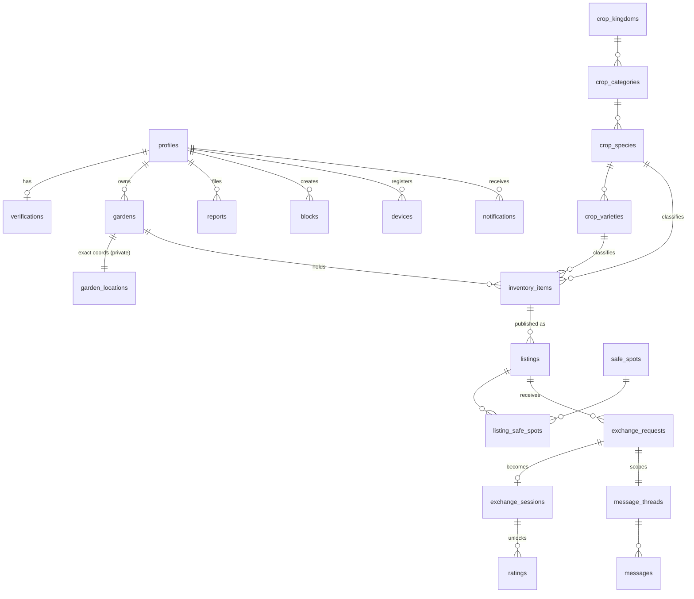

# Data Model

**Status:** Review · **Version:** 1.1.0 · **Owner:** Architecture

This document is **authoritative for the schema**. Specs reference it; they never redefine types. Every table listed here has a corresponding migration under `supabase/migrations/`, RLS policies in [RLS Design](05-rls-design.md), and pgTAP tests in [RLS Test Plan](../04-testing/02-rls-test-plan.md).

---

## 1. Conventions

| Rule | Value |
| --- | --- |
| Primary keys | `uuid`, default `gen_random_uuid()`. Never sequential integers on user-visible entities — enumeration is an attack. |
| Timestamps | `timestamptz` only, stored UTC. `created_at` / `updated_at` on every table. `updated_at` maintained by trigger, never by the client. |
| Soft delete | `deleted_at timestamptz` on user-visible entities. RLS filters `deleted_at IS NULL`. |
| Naming | `snake_case`; tables plural; join tables `a_b`; booleans read as assertions (`is_verified`, not `verified_flag`). |
| Enums | Native Postgres `ENUM` when the set is closed and rarely changes; lookup table when it's curated data (crop taxonomy). |
| Money | None. There is no currency column anywhere and adding one requires an ADR. |
| Geography | `geography(Point, 4326)` — geography, not geometry, so distance is in metres on a sphere without projection choices. |
| Foreign keys | Always declared, always indexed, `ON DELETE` behaviour always explicit. |
| Text limits | Every user-supplied `text` column has a `CHECK (length(col) <= n)`. Unbounded text is a denial-of-service vector. |

### PII classification

| Class | Meaning | Handling |
| --- | --- | --- |
| **P0 — Critical** | Exact location, identity documents, government IDs | `private` schema only. Never leaves the database in raw form. Never logged. |
| **P1 — Sensitive** | Email, phone, real name, precise timestamps of physical meetings | `public` schema, RLS-restricted to self + necessary counterparties. Scrubbed from telemetry. |
| **P2 — Personal** | Display name, avatar, city, ratings, bio | Visible to counterparties by design. |
| **P3 — Non-personal** | Crop taxonomy, safe spots, aggregate counts | Public. |

---

## 2. Entity relationship overview



---

## 3. Schemas

```sql
CREATE SCHEMA IF NOT EXISTS app;      -- SECURITY DEFINER helpers
CREATE SCHEMA IF NOT EXISTS private;  -- never client-reachable
CREATE SCHEMA IF NOT EXISTS audit;    -- append-only

REVOKE ALL ON SCHEMA private FROM anon, authenticated;
REVOKE ALL ON SCHEMA audit   FROM anon, authenticated;
REVOKE ALL ON SCHEMA app     FROM anon, authenticated;
GRANT USAGE ON SCHEMA app TO authenticated;  -- EXECUTE granted per-function only

CREATE EXTENSION IF NOT EXISTS postgis;
CREATE EXTENSION IF NOT EXISTS pgcrypto;
CREATE EXTENSION IF NOT EXISTS pg_cron;
CREATE EXTENSION IF NOT EXISTS h3;
CREATE EXTENSION IF NOT EXISTS pg_trgm;      -- species search
CREATE EXTENSION IF NOT EXISTS citext;       -- case-insensitive email
```

---

## 4. Enums

```sql
CREATE TYPE verification_status  AS ENUM ('unstarted','pending_vendor','passed','failed','expired','revoked');
CREATE TYPE garden_status        AS ENUM ('draft','pending_review','verified','rejected','archived');
CREATE TYPE trust_tier           AS ENUM ('unverified','email_verified','id_verified','trusted');
CREATE TYPE quantity_unit        AS ENUM ('each','bunch','pound','kilogram','ounce','gram','quart','pint','gallon','liter','dozen');
CREATE TYPE item_condition       AS ENUM ('just_picked','fresh','ripe','very_ripe','preserved','seed');
CREATE TYPE inventory_status     AS ENUM ('available','listed','reserved','exchanged','composted','archived');
CREATE TYPE listing_status       AS ENUM ('draft','active','reserved','completed','withdrawn','expired');
CREATE TYPE request_status       AS ENUM ('pending','accepted','declined','withdrawn','expired','cancelled');
CREATE TYPE session_state        AS ENUM ('scheduling','scheduled','in_progress','completed','cancelled','disputed','no_show');
CREATE TYPE safe_spot_category   AS ENUM ('public_library','police_station','city_hall','community_center','college_campus','fire_station','farmers_market','park_pavilion','other_municipal');
CREATE TYPE safe_spot_status     AS ENUM ('proposed','under_review','active','suspended','retired');
CREATE TYPE message_kind         AS ENUM ('user','system','safety_notice');
CREATE TYPE report_reason        AS ENUM ('no_show','misrepresented_goods','harassment','unsafe_meeting','spam','impersonation','underage','other');
CREATE TYPE report_status        AS ENUM ('open','triaged','actioned','dismissed','escalated');
CREATE TYPE moderation_action    AS ENUM ('none','warning','content_removed','listing_removed','suspension','permanent_ban','law_enforcement_referral');
CREATE TYPE notification_kind    AS ENUM ('request_received','request_accepted','request_declined','message_received','exchange_reminder','exchange_cancelled','verification_result','garden_review_result','moderation_outcome','safety_alert','surplus_alert');
CREATE TYPE device_platform      AS ENUM ('ios','android');
```

---

## 5. Identity & profiles

### `public.profiles`

One row per authenticated user, keyed to `auth.users`. Created by trigger on signup.

| Column | Type | Constraints | PII | Notes |
| --- | --- | --- | --- | --- |
| `id` | `uuid` | PK, FK → `auth.users(id)` ON DELETE CASCADE | — | Same id as the auth user |
| `display_name` | `text` | NOT NULL, `length BETWEEN 2 AND 40` | P2 | Shown to counterparties |
| `handle` | `citext` | UNIQUE, `~ '^[a-z0-9_]{3,20}$'` | P2 | Stable public identifier |
| `avatar_path` | `text` | NULL, `length <= 300` | P2 | Storage object path, not a URL |
| `bio` | `text` | NULL, `length <= 280` | P2 | |
| `city_label` | `text` | NULL, `length <= 80` | P2 | Coarse, e.g. "Ann Arbor, MI". Derived from garden, never street-level |
| `home_h3_r7` | `text` | NULL | P1 | ~5 km² cell. Used for matching and analytics. Never a point. |
| `trust_tier` | `trust_tier` | NOT NULL DEFAULT `'unverified'` | P2 | Derived; maintained by trigger |
| `trust_score` | `numeric(5,2)` | NOT NULL DEFAULT 0, CHECK 0–100 | P1 | **Internal only.** Never selectable by other users. |
| `rating_avg` | `numeric(3,2)` | NULL, CHECK 1–5 | P2 | Denormalized from `ratings` |
| `rating_count` | `integer` | NOT NULL DEFAULT 0 | P2 | |
| `completed_exchanges` | `integer` | NOT NULL DEFAULT 0 | P2 | |
| `cancellation_count_90d` | `integer` | NOT NULL DEFAULT 0 | P1 | Rolling; recomputed nightly |
| `is_suspended` | `boolean` | NOT NULL DEFAULT false | P1 | |
| `suspended_until` | `timestamptz` | NULL | P1 | |
| `locale` | `text` | NOT NULL DEFAULT `'en-US'` | P3 | |
| `timezone` | `text` | NOT NULL DEFAULT `'UTC'` | P2 | IANA name |
| `onboarding_completed_at` | `timestamptz` | NULL | P3 | |
| `deleted_at` | `timestamptz` | NULL | — | Soft delete; 30-day grace |
| `created_at` / `updated_at` | `timestamptz` | NOT NULL DEFAULT `now()` | — | |

```sql
CREATE UNIQUE INDEX profiles_handle_key ON public.profiles (handle) WHERE deleted_at IS NULL;
CREATE INDEX profiles_home_h3_r7_idx  ON public.profiles (home_h3_r7) WHERE deleted_at IS NULL;
CREATE INDEX profiles_trust_tier_idx  ON public.profiles (trust_tier);
```

> **Column-level protection.** `trust_score` and `cancellation_count_90d` are internal. Because Postgres RLS is row-level, not column-level, these are protected by revoking column `SELECT` from `authenticated` and exposing profiles to *other* users through the `public.profile_cards` view instead. See [RLS Design §4](05-rls-design.md).

### `public.verifications`

The **only** identity-verification data in a client-reachable schema. Deliberately thin.

| Column | Type | Constraints | PII | Notes |
| --- | --- | --- | --- | --- |
| `user_id` | `uuid` | PK, FK → `profiles(id)` ON DELETE CASCADE | — | |
| `status` | `verification_status` | NOT NULL DEFAULT `'unstarted'` | P1 | |
| `is_over_18` | `boolean` | NULL | P1 | **Only** age fact retained. No date of birth. |
| `document_country` | `char(2)` | NULL | P1 | ISO-3166-1 alpha-2, coarse |
| `verified_at` | `timestamptz` | NULL | P1 | |
| `expires_at` | `timestamptz` | NULL | P1 | Re-verification after 24 months |
| `failure_reason_code` | `text` | NULL, `length <= 60` | P1 | Vendor code, not free text |
| `attempt_count` | `smallint` | NOT NULL DEFAULT 0, CHECK ≤ 5 | P1 | Hard cap; controls vendor cost |
| `created_at` / `updated_at` | `timestamptz` | NOT NULL | — | |

### `private.verification_vendor_refs`

**Never client-reachable.**

| Column | Type | Notes |
| --- | --- | --- |
| `user_id` | `uuid` PK | |
| `vendor` | `text` NOT NULL | `'persona'` \| `'stripe_identity'` |
| `inquiry_id` | `text` NOT NULL | Vendor reference for support and audit |
| `webhook_idempotency_key` | `text` UNIQUE | Replay protection |
| `raw_decision` | `jsonb` | Vendor decision payload. **Must not contain images or document numbers** — enforced by a CHECK on key presence. |
| `created_at` | `timestamptz` | |

> **What we never store:** ID images, document numbers, full date of birth, selfie images, biometric templates. The vendor holds them under their retention policy; we hold a pointer. This is the entire reason for choosing a hosted vendor flow — see [ADR-0010](adr/ADR-0010-kyc-vendor.md).

### `private.review_bypass_accounts`

App-store reviewer accounts that skip KYC. Server-side allowlist, never a build flag — a build flag ships to production.

| Column | Type |
| --- | --- |
| `user_id` | `uuid` PK |
| `reason` | `text` NOT NULL |
| `expires_at` | `timestamptz` NOT NULL |

---

## 6. Gardens & location

This is the heart of the privacy model. Read [Location Privacy](04-location-privacy.md) alongside this section.

### `public.gardens`

| Column | Type | Constraints | PII | Notes |
| --- | --- | --- | --- | --- |
| `id` | `uuid` | PK | — | |
| `owner_id` | `uuid` | NOT NULL, FK → `profiles(id)` ON DELETE CASCADE | — | |
| `name` | `text` | NOT NULL, `length BETWEEN 1 AND 60` | P2 | |
| `description` | `text` | NULL, `length <= 500` | P2 | |
| `status` | `garden_status` | NOT NULL DEFAULT `'draft'` | P2 | |
| `display_point` | `geography(Point,4326)` | NULL | P2 | **Fuzzed.** Derived by trigger. Never client-writable. |
| `h3_r7` | `text` | NULL | P2 | ~5 km² cell for coarse matching |
| `h3_r9` | `text` | NULL | P1 | ~0.1 km² cell for proximity queries. Never returned to clients. |
| `grow_zone` | `text` | NULL, `length <= 8` | P3 | USDA hardiness zone |
| `size_band` | `text` | NULL | P3 | `'containers'`\|`'small'`\|`'medium'`\|`'large'`\|`'allotment'` |
| `verified_at` | `timestamptz` | NULL | P2 | |
| `rejection_reason` | `text` | NULL, `length <= 200` | P2 | |
| `deleted_at` | `timestamptz` | NULL | — | |
| `created_at` / `updated_at` | `timestamptz` | NOT NULL | — | |

```sql
CREATE INDEX gardens_owner_idx      ON public.gardens (owner_id) WHERE deleted_at IS NULL;
CREATE INDEX gardens_display_gix    ON public.gardens USING GIST (display_point);
CREATE INDEX gardens_h3_r9_idx      ON public.gardens (h3_r9);
CREATE INDEX gardens_status_idx     ON public.gardens (status) WHERE deleted_at IS NULL;

-- MVP: one garden per user
CREATE UNIQUE INDEX gardens_one_per_owner ON public.gardens (owner_id)
  WHERE deleted_at IS NULL AND status <> 'archived';
```

### `private.garden_locations`

**The most sensitive table in the system.** Its `geography` column is the thing the entire privacy architecture exists to protect.

| Column | Type | PII | Notes |
| --- | --- | --- | --- |
| `garden_id` | `uuid` PK, FK → `gardens(id)` ON DELETE CASCADE | — | |
| `exact_point` | `geography(Point,4326)` NOT NULL | **P0** | The real coordinate |
| `accuracy_m` | `real` | P1 | Device-reported horizontal accuracy at capture |
| `captured_at` | `timestamptz` NOT NULL | P1 | |
| `capture_source` | `text` NOT NULL | P1 | `'device_gps'` \| `'manual_pin'` |
| `fuzz_seed` | `uuid` NOT NULL DEFAULT `gen_random_uuid()` | P0 | **Per-garden, stable.** Makes the fuzz offset deterministic so repeated reads cannot be averaged to recover the true point. |

```sql
CREATE INDEX garden_locations_gix ON private.garden_locations USING GIST (exact_point);
REVOKE ALL ON private.garden_locations FROM anon, authenticated;
```

> **Why `fuzz_seed` matters.** Naive random fuzzing is broken: an attacker who reads a fuzzed point 200 times averages the noise away and recovers the true location to within metres. A stable per-garden seed means the offset is computed once and never varies, so repeated reads yield identical output and averaging gains nothing. This is [SPEC-004-R21](../03-specs/SPEC-004-garden-verification.md) and is tested by the quantization-invariance case in the [Geospatial Test Plan](../04-testing/03-geospatial-test-plan.md).

### `public.garden_verification_submissions`

| Column | Type | PII | Notes |
| --- | --- | --- | --- |
| `id` | `uuid` PK | — | |
| `garden_id` | `uuid` NOT NULL FK | — | |
| `photo_path` | `text` NOT NULL | P1 | Storage path; EXIF stripped before write |
| `captured_h3_r9` | `text` NOT NULL | P1 | Cell where the photo was taken — compared against the garden's cell |
| `distance_from_garden_m` | `real` | P1 | Computed server-side at submission |
| `ml_confidence` | `real` | P3 | Garden-likeness score, advisory only |
| `reviewed_by` | `uuid` NULL | P1 | Moderator |
| `reviewed_at` | `timestamptz` NULL | P1 | |
| `decision` | `text` NULL | P2 | `'approved'` \| `'rejected'` |
| `created_at` | `timestamptz` NOT NULL | — | |

---

## 7. Crop taxonomy

Curated reference data. Four levels, so a specific tomato variety resolves cleanly and browsing works the way people actually think about food.

```
crop_kingdoms   → 'Plant', 'Fungus'
crop_categories → 'Vegetable', 'Fruit', 'Herb', 'Leafy Green', 'Root', 'Legume', 'Grain', 'Nut', 'Flower', 'Mushroom'
crop_species    → 'Tomato', 'Zucchini', 'Basil'
crop_varieties  → 'Cherokee Purple', 'Black Beauty', 'Genovese'
```

> **Culinary beats botanical.** A tomato is a fruit botanically and a vegetable in every kitchen. Browsing uses the culinary category (`category_id`), and the botanical fact is retained in `botanical_category_id` for correctness and for future filters. Getting this backwards makes the app feel broken to normal people. See [SPEC-005](../03-specs/SPEC-005-crop-taxonomy.md).

### `public.crop_kingdoms`

| Column | Type | Notes |
| --- | --- | --- |
| `id` | `smallint` PK | Small, stable — bundled in the app |
| `slug` | `text` UNIQUE NOT NULL | |
| `name` | `text` NOT NULL | |

### `public.crop_categories`

| Column | Type | Notes |
| --- | --- | --- |
| `id` | `smallint` PK | |
| `kingdom_id` | `smallint` NOT NULL FK | |
| `slug` | `text` UNIQUE NOT NULL | `'vegetable'`, `'fruit'`, … |
| `name` | `text` NOT NULL | |
| `icon_key` | `text` NOT NULL | Client asset key |
| `sort_order` | `smallint` NOT NULL | |

### `public.crop_species`

| Column | Type | Notes |
| --- | --- | --- |
| `id` | `integer` PK | |
| `category_id` | `smallint` NOT NULL FK | **Culinary** category — authoritative for browsing |
| `botanical_category_id` | `smallint` NULL FK | Botanical truth, retained |
| `slug` | `text` UNIQUE NOT NULL | |
| `common_name` | `text` NOT NULL | |
| `scientific_name` | `text` NULL | |
| `aliases` | `text[]` NOT NULL DEFAULT `'{}'` | "courgette" finds Zucchini |
| `allergen_tags` | `text[]` NOT NULL DEFAULT `'{}'` | Pre-wired for [SPEC-023](../03-specs/SPEC-023-crop-id-and-food-safety.md) |
| `typical_units` | `quantity_unit[]` NOT NULL | Drives sensible unit defaults |
| `season_months` | `smallint[]` NOT NULL DEFAULT `'{}'` | Northern-hemisphere default; per-zone data is Phase 2 |
| `is_active` | `boolean` NOT NULL DEFAULT true | |

```sql
CREATE INDEX crop_species_search_idx ON public.crop_species
  USING GIN ((common_name || ' ' || array_to_string(aliases,' ')) gin_trgm_ops);
CREATE INDEX crop_species_category_idx ON public.crop_species (category_id) WHERE is_active;
```

### `public.crop_varieties`

| Column | Type | Notes |
| --- | --- | --- |
| `id` | `integer` PK | |
| `species_id` | `integer` NOT NULL FK | |
| `slug` | `text` NOT NULL | UNIQUE with `species_id` |
| `name` | `text` NOT NULL | |
| `submitted_by` | `uuid` NULL FK → `profiles` | User-submitted varieties |
| `is_approved` | `boolean` NOT NULL DEFAULT false | Unapproved varieties are visible only to their submitter |

> Users **may** propose a variety under an existing species. They **may not** create a species. Free-text species creation produces "tomatoe", "Tomato ", and "🍅" within a week and destroys search.

---

## 8. Inventory

### `public.inventory_items`

| Column | Type | Constraints | PII | Notes |
| --- | --- | --- | --- | --- |
| `id` | `uuid` | PK | — | |
| `garden_id` | `uuid` | NOT NULL FK ON DELETE CASCADE | — | |
| `owner_id` | `uuid` | NOT NULL FK | — | Denormalized from garden for RLS performance |
| `species_id` | `integer` | NOT NULL FK | P3 | |
| `variety_id` | `integer` | NULL FK | P3 | |
| `custom_label` | `text` | NULL, `length <= 60` | P2 | Free text for display only, never for classification |
| `quantity` | `numeric(8,2)` | NOT NULL, CHECK > 0 | P2 | |
| `unit` | `quantity_unit` | NOT NULL | P2 | |
| `condition` | `item_condition` | NOT NULL | P2 | |
| `harvested_on` | `date` | NULL, CHECK ≤ `current_date` | P2 | |
| `best_by` | `date` | NULL | P2 | |
| `is_organic_claim` | `boolean` | NOT NULL DEFAULT false | P2 | User claim, not a certification |
| `notes` | `text` | NULL, `length <= 300` | P2 | |
| `status` | `inventory_status` | NOT NULL DEFAULT `'available'` | P2 | |
| `deleted_at` | `timestamptz` | NULL | — | |
| `created_at` / `updated_at` | `timestamptz` | NOT NULL | — | |

```sql
CREATE INDEX inventory_owner_idx   ON public.inventory_items (owner_id) WHERE deleted_at IS NULL;
CREATE INDEX inventory_garden_idx  ON public.inventory_items (garden_id) WHERE deleted_at IS NULL;
CREATE INDEX inventory_species_idx ON public.inventory_items (species_id) WHERE status = 'available';
```

### `public.media_assets`

Shared image table for garden, inventory, and profile photos.

| Column | Type | PII | Notes |
| --- | --- | --- | --- |
| `id` | `uuid` PK | — | |
| `owner_id` | `uuid` NOT NULL FK | — | |
| `bucket` | `text` NOT NULL | — | |
| `path` | `text` NOT NULL, `length <= 300` | P1 | |
| `subject_type` | `text` NOT NULL | — | `'inventory_item'`\|`'garden'`\|`'profile'` |
| `subject_id` | `uuid` NOT NULL | — | Polymorphic; integrity enforced by trigger |
| `exif_stripped_at` | `timestamptz` NULL | — | **NULL means not yet processed. Unprocessed assets are never served.** |
| `width` / `height` | `integer` NULL | — | |
| `blurhash` | `text` NULL | — | Placeholder while loading |
| `moderation_state` | `text` NOT NULL DEFAULT `'pending'` | — | `'pending'`\|`'approved'`\|`'rejected'` |
| `created_at` | `timestamptz` NOT NULL | — | |

> **EXIF is a location leak.** A phone photo of a tomato carries the GPS coordinates of the person's back garden. Stripping happens in an Edge Function triggered on upload, and `exif_stripped_at IS NULL` makes the asset invisible to every read path. This is enforced in RLS, not in application code.

---

## 9. Safe spots

### `public.safe_spots`

The only precise coordinates a client ever receives — because they are public buildings.

| Column | Type | PII | Notes |
| --- | --- | --- | --- |
| `id` | `uuid` PK | — | |
| `name` | `text` NOT NULL, `length <= 120` | P3 | |
| `category` | `safe_spot_category` NOT NULL | P3 | |
| `status` | `safe_spot_status` NOT NULL DEFAULT `'proposed'` | P3 | |
| `point` | `geography(Point,4326)` NOT NULL | P3 | **Exact and public** |
| `h3_r8` | `text` NOT NULL | P3 | Generated column for cell queries |
| `address_line` | `text` NOT NULL | P3 | |
| `locality` / `region` / `postal_code` / `country` | `text` | P3 | |
| `hours` | `jsonb` NOT NULL DEFAULT `'{}'` | P3 | Weekly schedule + exceptions |
| `hours_verified_at` | `timestamptz` NULL | P3 | **Stale hours are a no-show generator.** Alert at 90 days. |
| `accessibility_notes` | `text` NULL, `length <= 400` | P3 | Step-free access, restrooms |
| `parking_notes` | `text` NULL, `length <= 400` | P3 | |
| `safety_notes` | `text` NULL, `length <= 400` | P3 | e.g. "Lobby is staffed; exterior lot is not lit after dark" |
| `photo_path` | `text` NULL | P3 | So users recognise the meeting point |
| `is_indoor` | `boolean` NOT NULL DEFAULT true | P3 | |
| `has_cameras` | `boolean` NULL | P3 | |
| `partner_org_id` | `uuid` NULL | P3 | Phase 2 |
| `approved_by` / `approved_at` | `uuid` / `timestamptz` NULL | P3 | |
| `created_at` / `updated_at` | `timestamptz` NOT NULL | — | |

```sql
CREATE INDEX safe_spots_gix    ON public.safe_spots USING GIST (point);
CREATE INDEX safe_spots_h3_idx ON public.safe_spots (h3_r8) WHERE status = 'active';
CREATE INDEX safe_spots_cat_idx ON public.safe_spots (category) WHERE status = 'active';
```

---

## 10. Listings & the exchange

### `public.listings`

| Column | Type | Constraints | Notes |
| --- | --- | --- | --- |
| `id` | `uuid` | PK | |
| `inventory_item_id` | `uuid` | NOT NULL FK | |
| `owner_id` | `uuid` | NOT NULL FK | Denormalized for RLS |
| `species_id` | `integer` | NOT NULL FK | Denormalized for map filtering without a join |
| `title` | `text` | NOT NULL, `length BETWEEN 3 AND 80` | |
| `description` | `text` | NULL, `length <= 500` | |
| `status` | `listing_status` | NOT NULL DEFAULT `'draft'` | |
| `wanted_species_ids` | `integer[]` | NOT NULL DEFAULT `'{}'`, CHECK `array_length <= 10` | Drives match suggestions |
| `accepts_any` | `boolean` | NOT NULL DEFAULT true | Willing to take anything |
| `expires_at` | `timestamptz` | NOT NULL, CHECK ≤ `created_at + interval '21 days'` | |
| `published_at` | `timestamptz` | NULL | |
| `reserved_request_id` | `uuid` | NULL | The request that holds the reservation |
| `created_at` / `updated_at` | `timestamptz` | NOT NULL | |

```sql
-- The status and the pointer move together or not at all. Without this, a
-- release path that clears `status` and forgets `reserved_request_id` leaves an
-- `active` listing carrying a stale reservation pointer — silently wrong, and
-- invisible to the unique index below because that index only sees the pointer.
ALTER TABLE public.listings ADD CONSTRAINT listings_reservation_coherent
  CHECK ((status = 'reserved') = (reserved_request_id IS NOT NULL));

-- A request can hold at most one reservation, and an inventory item can back at
-- most one live listing. These two indexes ARE the concurrency backstop.
--
-- NOTE: indexed on `reserved_request_id`, NOT on `(id) WHERE status = 'reserved'`.
-- The latter is a no-op — `id` is the primary key, so a unique index on it
-- constrains nothing. This is the only correct form; see
-- Exchange State Machine §5 H1.
CREATE UNIQUE INDEX listings_single_reservation
  ON public.listings (reserved_request_id) WHERE reserved_request_id IS NOT NULL;

CREATE UNIQUE INDEX listings_one_active_per_item
  ON public.listings (inventory_item_id)
  WHERE status IN ('draft','active','reserved');

CREATE INDEX listings_active_species_idx ON public.listings (species_id)
  WHERE status = 'active';
CREATE INDEX listings_owner_idx   ON public.listings (owner_id);
CREATE INDEX listings_expiry_idx  ON public.listings (expires_at) WHERE status = 'active';
```

### `public.listing_safe_spots`

A listing is offered at one to three safe spots. Cardinality enforced by trigger.

| Column | Type | Notes |
| --- | --- | --- |
| `listing_id` | `uuid` NOT NULL FK ON DELETE CASCADE | |
| `safe_spot_id` | `uuid` NOT NULL FK | |
| `PRIMARY KEY (listing_id, safe_spot_id)` | | |

```sql
CREATE INDEX listing_safe_spots_spot_idx ON public.listing_safe_spots (safe_spot_id);
```

### `public.exchange_requests`

| Column | Type | Constraints | Notes |
| --- | --- | --- | --- |
| `id` | `uuid` | PK | |
| `listing_id` | `uuid` | NOT NULL FK | |
| `requester_id` | `uuid` | NOT NULL FK | |
| `owner_id` | `uuid` | NOT NULL FK | Denormalized so RLS needs no join |
| `offered_item_id` | `uuid` | NULL FK → `inventory_items` | The counter-offer, if any |
| `message` | `text` | NULL, `length <= 300` | First message, copied into the thread |
| `status` | `request_status` | NOT NULL DEFAULT `'pending'` | |
| `proposed_safe_spot_id` | `uuid` | NULL FK | |
| `idempotency_key` | `uuid` | NOT NULL | |
| `expires_at` | `timestamptz` | NOT NULL DEFAULT `now() + interval '72 hours'` | |
| `responded_at` | `timestamptz` | NULL | |
| `created_at` / `updated_at` | `timestamptz` | NOT NULL | |

```sql
-- One pending request per (requester, listing). Prevents spam and double-send.
CREATE UNIQUE INDEX exchange_requests_one_pending
  ON public.exchange_requests (listing_id, requester_id) WHERE status = 'pending';

CREATE UNIQUE INDEX exchange_requests_idem
  ON public.exchange_requests (requester_id, idempotency_key);

CREATE INDEX exchange_requests_owner_pending_idx
  ON public.exchange_requests (owner_id) WHERE status = 'pending';

ALTER TABLE public.exchange_requests
  ADD CONSTRAINT no_self_request CHECK (requester_id <> owner_id);
```

### `public.exchange_sessions`

Created when a request is accepted. This is the object that represents a real-world meeting.

| Column | Type | Constraints | PII | Notes |
| --- | --- | --- | --- | --- |
| `id` | `uuid` | PK | — | |
| `request_id` | `uuid` | NOT NULL UNIQUE FK | — | One session per accepted request |
| `owner_id` / `requester_id` | `uuid` | NOT NULL FK | — | |
| `state` | `session_state` | NOT NULL DEFAULT `'scheduling'` | — | |
| `safe_spot_id` | `uuid` | NULL FK | P1 | |
| `scheduled_start` | `timestamptz` | NULL | **P1** | A confirmed time + place a specific person will be |
| `scheduled_end` | `timestamptz` | NULL, CHECK > `scheduled_start` | P1 | |
| `handoff_code` | `bytea` | NULL | P1 | Shared six-digit code, **encrypted at rest** with a Vault key ([Exchange State Machine §3.3](07-exchange-state-machine.md)). Encrypted rather than hashed because both parties must be able to *read* it at the meeting — a hash would make it displayable once and lost forever. `SELECT` on this column is `REVOKE`d from `authenticated`; the only decrypt path is `rpc.get_handoff_code`, which is gated on `state = 'scheduled'` and audited |
| `owner_confirmed_at` | `timestamptz` | NULL | P1 | |
| `requester_confirmed_at` | `timestamptz` | NULL | P1 | |
| `completed_at` | `timestamptz` | NULL | P1 | |
| `cancelled_by` | `uuid` | NULL FK | P1 | |
| `cancelled_reason` | `text` | NULL, `length <= 200` | P1 | |
| `cancelled_at` | `timestamptz` | NULL | P1 | |
| `version` | `integer` | NOT NULL DEFAULT 1 | — | Optimistic concurrency |
| `created_at` / `updated_at` | `timestamptz` | NOT NULL | — | |

```sql
CREATE INDEX sessions_participant_idx ON public.exchange_sessions (owner_id, requester_id);
CREATE INDEX sessions_upcoming_idx    ON public.exchange_sessions (scheduled_start)
  WHERE state IN ('scheduled','in_progress');
```

> **`scheduled_start` + `safe_spot_id` together are the highest-value target in the database for a stalker.** They are P1, restricted to the two participants and moderators, excluded from all analytics, and scrubbed from telemetry. Session rows are anonymized 90 days after completion.

---

## 11. Communication & trust

### `public.message_threads`

| Column | Type | Notes |
| --- | --- | --- |
| `id` | `uuid` PK | |
| `request_id` | `uuid` NOT NULL UNIQUE FK | Threads exist only in the context of a request — **this is what prevents cold DMs** |
| `participant_a` / `participant_b` | `uuid` NOT NULL FK | Sorted so `a < b` for a stable pair key |
| `is_closed` | `boolean` NOT NULL DEFAULT false | Closes on completion + 14 days, or on block |
| `last_message_at` | `timestamptz` NULL | |
| `created_at` | `timestamptz` NOT NULL | |

### `public.messages`

| Column | Type | PII | Notes |
| --- | --- | --- | --- |
| `id` | `uuid` PK | — | |
| `thread_id` | `uuid` NOT NULL FK ON DELETE CASCADE | — | |
| `sender_id` | `uuid` NULL FK | — | NULL for system messages |
| `kind` | `message_kind` NOT NULL DEFAULT `'user'` | — | |
| `body` | `text` NOT NULL, `length BETWEEN 1 AND 2000` | P1 | |
| `flagged_reason` | `text` NULL | P1 | Set by `content-scan`: address, phone, payment solicitation |
| `read_at` | `timestamptz` NULL | P2 | |
| `created_at` | `timestamptz` NOT NULL | — | |

```sql
CREATE INDEX messages_thread_time_idx ON public.messages (thread_id, created_at DESC);
CREATE INDEX messages_flagged_idx ON public.messages (created_at) WHERE flagged_reason IS NOT NULL;
```

### `public.ratings`

Double-blind: neither party sees the other's rating until both submit or seven days elapse.

| Column | Type | Notes |
| --- | --- | --- |
| `id` | `uuid` PK | |
| `session_id` | `uuid` NOT NULL FK | |
| `rater_id` / `ratee_id` | `uuid` NOT NULL FK | |
| `stars` | `smallint` NOT NULL CHECK 1–5 | |
| `tags` | `text[]` NOT NULL DEFAULT `'{}'` | Closed vocabulary: `punctual`, `as_described`, `friendly`, `late`, `no_show`, `misrepresented` |
| `comment` | `text` NULL, `length <= 300` | |
| `is_revealed` | `boolean` NOT NULL DEFAULT false | Flipped by trigger or cron |
| `created_at` | `timestamptz` NOT NULL | |

```sql
CREATE UNIQUE INDEX ratings_one_per_rater ON public.ratings (session_id, rater_id);
ALTER TABLE public.ratings ADD CONSTRAINT no_self_rating CHECK (rater_id <> ratee_id);
```

### `public.reports`

| Column | Type | PII | Notes |
| --- | --- | --- | --- |
| `id` | `uuid` PK | — | |
| `reporter_id` | `uuid` NOT NULL FK | P1 | |
| `subject_user_id` | `uuid` NULL FK | P1 | |
| `subject_type` | `text` NOT NULL | — | `'user'`\|`'listing'`\|`'message'`\|`'session'` |
| `subject_id` | `uuid` NOT NULL | — | |
| `reason` | `report_reason` NOT NULL | P1 | |
| `details` | `text` NULL, `length <= 1000` | P1 | |
| `status` | `report_status` NOT NULL DEFAULT `'open'` | — | |
| `severity` | `smallint` NOT NULL DEFAULT 3 CHECK 1–5 | — | `unsafe_meeting` forces 1 |
| `sla_due_at` | `timestamptz` NOT NULL | — | 1 h for severity 1, else 24 h |
| `action_taken` | `moderation_action` NULL | — | |
| `resolved_by` / `resolved_at` | `uuid` / `timestamptz` NULL | P1 | |
| `created_at` | `timestamptz` NOT NULL | — | |

```sql
CREATE INDEX reports_open_sla_idx ON public.reports (sla_due_at) WHERE status IN ('open','triaged');
CREATE INDEX reports_subject_idx  ON public.reports (subject_user_id);
```

### `public.blocks`

| Column | Type | Notes |
| --- | --- | --- |
| `blocker_id` | `uuid` NOT NULL FK | |
| `blocked_id` | `uuid` NOT NULL FK | |
| `reason` | `text` NULL, `length <= 200` | |
| `created_at` | `timestamptz` NOT NULL | |
| `PRIMARY KEY (blocker_id, blocked_id)` | | |

```sql
-- Both directions are queried on every visibility check; index both.
CREATE INDEX blocks_blocked_idx ON public.blocks (blocked_id);
ALTER TABLE public.blocks ADD CONSTRAINT no_self_block CHECK (blocker_id <> blocked_id);
```

> **Blocks are enforced in the database, not the UI.** `app.is_blocked(a, b)` is a `SECURITY DEFINER` predicate used in the RLS policies of listings, requests, messages, and profile cards, so a blocked user's content is not filtered out of a response — it never enters the result set. Blocking also tears down the thread and cancels any in-flight session.

---

## 12. Notifications, devices, audit

### `public.devices`

| Column | Type | PII | Notes |
| --- | --- | --- | --- |
| `id` | `uuid` PK | — | |
| `user_id` | `uuid` NOT NULL FK ON DELETE CASCADE | — | |
| `expo_push_token` | `text` NOT NULL UNIQUE | P1 | |
| `platform` | `device_platform` NOT NULL | P3 | |
| `app_version` | `text` NOT NULL | P3 | **Read by CI to gate destructive migrations** ([ADR-0017](adr/ADR-0017-release-cadence.md)) |
| `os_version` | `text` NULL | P3 | |
| `last_seen_at` | `timestamptz` NOT NULL | P1 | |
| `push_enabled` | `boolean` NOT NULL DEFAULT true | P3 | |

### `public.notification_preferences`

One row per user; a boolean per `notification_kind` plus quiet hours.

| Column | Type | Notes |
| --- | --- | --- |
| `user_id` | `uuid` PK FK | |
| `enabled_kinds` | `notification_kind[]` NOT NULL | |
| `quiet_hours_start` / `quiet_hours_end` | `time` NULL | Local to `profiles.timezone` |
| `updated_at` | `timestamptz` NOT NULL | |

> `safety_alert` is **not** suppressible. It ignores both `enabled_kinds` and quiet hours — enforced in `app.should_deliver()`, not in the client.

### `public.notifications` (in-app inbox — the durable record)

| Column | Type | Notes |
| --- | --- | --- |
| `id` | `uuid` PK | |
| `user_id` | `uuid` NOT NULL FK | |
| `kind` | `notification_kind` NOT NULL | |
| `title` / `body` | `text` NOT NULL | |
| `deep_link` | `text` NULL | |
| `payload` | `jsonb` NOT NULL DEFAULT `'{}'` | **CHECK: must not contain `lat`/`lng`/`point` keys** |
| `read_at` | `timestamptz` NULL | |
| `created_at` | `timestamptz` NOT NULL | |

### `private.notification_outbox`

Transactional outbox. Rows are inserted inside the same transaction as the state change; a cron-driven Edge Function drains them. This is why a push is never lost because an HTTP call failed mid-transaction.

| Column | Type | Notes |
| --- | --- | --- |
| `id` | `bigserial` PK | |
| `notification_id` | `uuid` NOT NULL FK | |
| `attempts` | `smallint` NOT NULL DEFAULT 0 | |
| `next_attempt_at` | `timestamptz` NOT NULL DEFAULT `now()` | Exponential backoff |
| `delivered_at` | `timestamptz` NULL | |
| `last_error` | `text` NULL | |

### `audit.events`

Append-only. No `UPDATE` or `DELETE` grant exists for any role.

| Column | Type | Notes |
| --- | --- | --- |
| `id` | `bigserial` PK | |
| `occurred_at` | `timestamptz` NOT NULL DEFAULT `now()` | |
| `actor_id` | `uuid` NULL | NULL for system actions |
| `actor_role` | `text` NOT NULL | |
| `action` | `text` NOT NULL | `'verification.passed'`, `'block.created'`, … |
| `subject_type` / `subject_id` | `text` / `uuid` | |
| `metadata` | `jsonb` NOT NULL DEFAULT `'{}'` | **Never coordinates.** CHECK enforced. |
| `request_id` | `uuid` NULL | Correlates to the API request |

Audited actions: verification outcomes, garden review decisions, moderation actions, blocks, account deletion, safe-spot changes, admin access to any P0/P1 data, session state transitions.

---

## 13. Future-feature stubs

These tables ship as **empty migrations in MVP** so that Phase 2 and 3 are additive rather than a schema rewrite. Creating them early costs nothing and prevents the "we'd have to restructure inventory" conversation later.

| Table | Spec | Purpose |
| --- | --- | --- |
| `public.plantings` | [SPEC-020](../03-specs/SPEC-020-harvest-planning.md) | What's in the ground, when it was sown, expected yield |
| `public.harvest_forecasts` | SPEC-020 | Predicted harvest windows per planting |
| `public.surplus_alert_subscriptions` | SPEC-020 | "Tell me when someone near me has tomatoes" |
| `public.groups` / `group_members` / `group_posts` | [SPEC-021](../03-specs/SPEC-021-community-groups.md) | Garden clubs |
| `public.partner_orgs` | SPEC-021 | Libraries and clubs that administer their own safe spots |
| `public.badges` / `user_badges` / `streaks` | [SPEC-022](../03-specs/SPEC-022-gamification.md) | Achievement system |
| `public.crop_id_predictions` | [SPEC-023](../03-specs/SPEC-023-crop-id-and-food-safety.md) | ML inference results, kept for model evaluation |
| `public.food_safety_disclosures` | SPEC-023 | Pesticide, allergen, and handling disclosures per listing |

---

## 14. Retention schedule

| Data | Retention | Mechanism |
| --- | --- | --- |
| `private.garden_locations` | Life of garden + 30 days after account deletion | Cascade + deletion pipeline |
| `verifications` | 24 months from `verified_at`, then re-verify | `pg_cron` expiry |
| `private.verification_vendor_refs` | 7 years (fraud/legal defence) | Retained past account deletion, pseudonymized |
| Garden verification photos | 90 days after decision | Storage lifecycle rule |
| `messages` | 90 days after thread close | `pg_cron` purge |
| `exchange_sessions` | Anonymized 90 days after completion (participants and times nulled, aggregates retained) | `pg_cron` |
| `reports` + evidence | 3 years from resolution | — |
| `private.idempotency_keys` | 24 hours | `sweep_idempotency_keys` hourly ([Exchange State Machine §4.1](07-exchange-state-machine.md)) |
| `audit.events` | 7 years | — |
| Analytics events | 25 months, H3 r5 max spatial resolution | PostHog retention setting |
| Deleted accounts | 30-day grace, then hard delete of P0/P1, pseudonymized shell retained for referential integrity | Deletion pipeline |

Full policy and DSAR handling: [Privacy & Data Retention](../02-security/04-privacy-and-data-retention.md).

---

## 15. Migration rules

1. **Forward-only.** No `DOWN` migrations. A mistake is fixed by a new migration, not by rewinding production.
2. **Expand → migrate → contract.** Add the new column, dual-write, backfill, switch reads, then drop — across at least two releases.
3. **A destructive migration (`DROP`, `ALTER TYPE`, `NOT NULL` on an existing column) fails CI** if more than 2% of DAU are on an app version predating the contract phase. Enforced mechanically from `devices.app_version`.
4. **Every migration that creates a table must, in the same file,** enable RLS, create policies, and be accompanied by pgTAP tests in the same PR. CI rejects a new table with `rowsecurity = false`.
5. **No migration may `GRANT` on `private`.** CI greps for it and fails.
6. Migrations run against a production-shaped seed in CI before they can merge.

---

## Change Log

| Date | Version | Author | Change |
| --- | --- | --- | --- |
| 2026-08-08 | 1.0.0 | Architecture | Initial data model |
| 2026-08-09 | 1.1.0 | Architecture | Workflow-architect review fixes ([review](../07-review/01-workflow-architect-review.md)). §10: added `listings_reservation_coherent` so `status` and `reserved_request_id` cannot drift apart, and a comment pinning `listings_single_reservation` to its only correct form. §14: retention entry for `private.idempotency_keys` |
| 2026-08-09 | 1.2.0 | Architecture | `exchange_sessions.handoff_code` is now `bytea`, encrypted at rest ([Exchange State Machine §3.3](07-exchange-state-machine.md)), with `SELECT` revoked from `authenticated`. Added `no_show_contested_by` / `no_show_contested_at` for SPEC-010 R64a |
