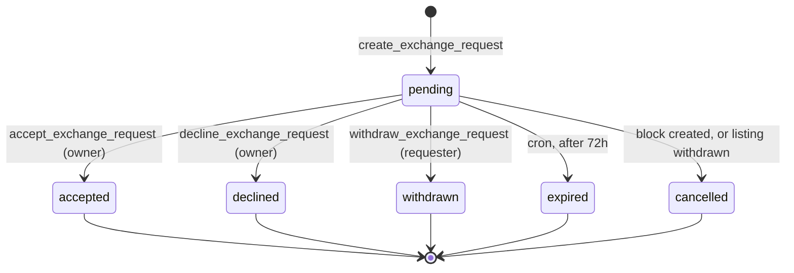
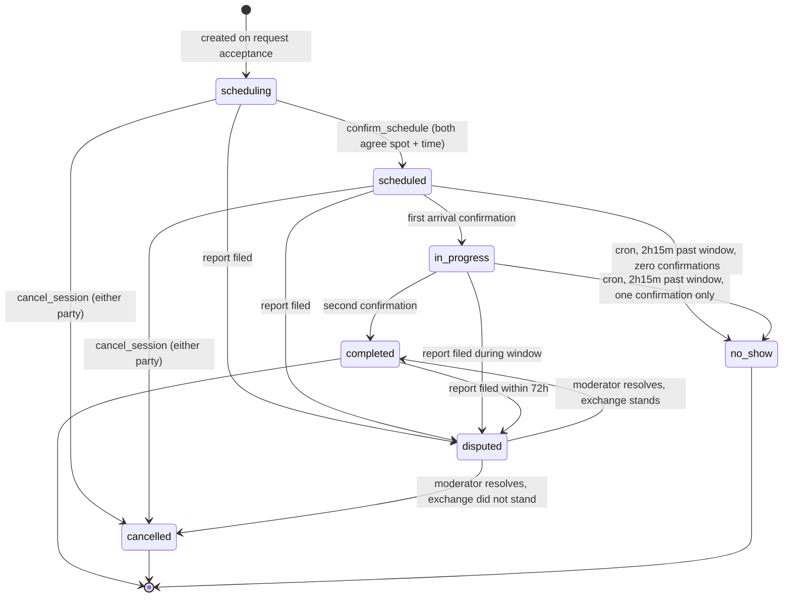

# Exchange State Machine

**Status:** Review · **Version:** 1.1.0 · **Owner:** Architecture

The exchange is the product. Everything else exists to make this sequence safe and reliable. This document is normative: the states, transitions, guards, and concurrency controls below are the contract that [SPEC-010](../03-specs/SPEC-010-exchange-lifecycle.md) implements and that the client's optimistic UI must mirror exactly.

---

## 1. Two coupled machines

An exchange is modelled as two objects rather than one, because they have genuinely different lifetimes:

| Object | Lifetime | Answers |
| --- | --- | --- |
| `exchange_requests` | From "I want this" to accepted / declined / withdrawn / expired | *Is there interest?* |
| `exchange_sessions` | From acceptance to completion / cancellation | *Is a real-world meeting happening?* |

Collapsing them into one table was considered and rejected: a request that is declined has no meeting, and a session needs a state vocabulary (`scheduled`, `in_progress`, `no_show`) that is meaningless before acceptance. One table would mean a status enum where half the values are invalid at any given time — the classic sign of two entities wearing one hat.

A third state machine, on `listings`, is driven by the other two.

---

## 2. Request state machine



| From | To | Actor | Guards |
| --- | --- | --- | --- |
| — | `pending` | Requester | `app.can_transact()`; listing `active` and unexpired; not self; not blocked; no existing pending request for this (requester, listing); requester has < 10 open requests |
| `pending` | `accepted` | Owner | Caller is `owner_id`; request still `pending`; listing still `active`; owner can transact; not blocked |
| `pending` | `declined` | Owner | Caller is `owner_id`; request `pending` |
| `pending` | `withdrawn` | Requester | Caller is `requester_id`; request `pending` |
| `pending` | `expired` | System | `expires_at < now()` |
| `pending` | `cancelled` | System | Block created, listing withdrawn, or either party suspended |

**Terminal states are terminal.** There is no un-decline. A user who changes their mind sends a new request. This removes an entire class of race conditions and is enforced by a transition-guard trigger, not by convention.

---

## 3. Session state machine



| From | To | Actor | Guards & effects |
| --- | --- | --- | --- |
| — | `scheduling` | System | Created atomically with acceptance. `handoff_code` generated and stored; **not returned to the caller** (§3.1). |
| `scheduling` | `scheduled` | Either | `safe_spot_id` set and is in the listing's spot set; `scheduled_start` ≥ `now() + 1h` and ≤ `now() + 14d`; `scheduled_end` ∈ [`scheduled_start + 15m`, `scheduled_start + 2h`]; venue open across the whole window; other party has confirmed |
| `scheduling`/`scheduled` | `cancelled` | Either | Reason required. If < 4h before `scheduled_start`, increments `cancellation_count_90d`. |
| `scheduled` | `in_progress` | Either | Code entered correctly; within `scheduled_start − 30m` … `scheduled_end + 2h` |
| `in_progress` | `completed` | The other party | Second confirmation. Effects: listing → `completed`, inventory → `exchanged`, ratings unlocked, `completed_exchanges` incremented for both, thread scheduled to close in 14 days |
| `scheduled`/`in_progress` | `no_show` | System | Effects: release the reservation (listing → `active`, item → `listed`); notify both; if exactly one confirmed, the *other* accrues a no-show marker |
| any non-terminal, or `completed` within 72h | `disputed` | System | A report against this session freezes it pending moderation. **All four edges are in the transition table** (§6) — a session must be freezable from the state it is actually in, and `scheduled` is the state in which someone has a confirmed time and place with a person they have become afraid of |
| `disputed` | `cancelled` / `completed` | Moderator | §3.2. The only client-unreachable transitions in the machine, and the only exits from `disputed` |

### 3.1 The handoff code

At acceptance the system generates one six-digit code and stores it on the session. Neither party sees it until the session is `scheduled`, at which point **both** read it the same way. At the meeting, each person enters it in their own app.

Why a shared code rather than geofencing:
- It requires physical co-presence without requesting background location, which we refuse to do in MVP.
- It is trivially understandable — people already know this pattern from delivery apps.
- It produces a mutual, timestamped record that both parties showed up, which is what ratings and no-show handling need.

Its weakness: it can be read aloud over the phone, so it proves co-presence only if both parties are honest. It is a **coordination device, not an anti-fraud control**, and should never be described as the latter. Real co-presence proof needs geofencing or BLE proximity, both deferred to Phase 3 with explicit opt-in.

Rules: 6 digits, generated with `gen_random_bytes` by rejection sampling (§4), **encrypted at rest** (§3.3), stored on the session at acceptance, **never returned by `accept_exchange_request`**, and readable by either participant only through `rpc.get_handoff_code` once the session is `scheduled`. Five wrong attempts locks confirmation for 15 minutes and notifies both parties.

**Both parties obtain the code by the same gated read.** There is no path by which one party is told it and the other is not — the accept RPC returns `session_id` alone, and the `request_accepted` notification payload carries `session_id` alone. An earlier draft of this section said the code is "shown to both parties at acceptance"; that was wrong in two ways, and both are now fixed: it is not shown at acceptance, and it is not pushed to anyone.

### 3.2 Leaving `disputed`

A report freezes a session. Something has to unfreeze it, and until it does the session's **reservation is still held** — `listings.status = 'reserved'`, `inventory_items.status = 'reserved'` — which means the owner cannot relist the item and the sweeper cannot expire the listing (§7 never touches `reserved`). A dispute that has no exit is an inventory item withdrawn from the world permanently.

So `disputed` is terminal *to participants* and not terminal to the system. Two edges exist, both reachable only from `moderation-action`:

| Transition | Meaning | Effects |
| --- | --- | --- |
| `disputed` → `cancelled` | The exchange did not stand — it did not happen, or it happened and should not have | `app.release_reservation()`: listing → `active`, item → `listed`, `reserved_request_id` nulled. `cancelled_reason = 'moderation'`, `cancelled_by` = the moderator. **`counts_as_late` is never set** — a moderated outcome is not a party's late cancellation. |
| `disputed` → `completed` | The exchange stands; the report did not change the facts | `app.finalize_completed_session()` if the session had not already completed, otherwise no-op — the function is idempotent for exactly this reason. Ratings unfreeze. |

Both are audited as `exchange.dispute_resolved` with the resolving moderator as actor and the prior state in `metadata`, and both notify the participants via `moderation_outcome`. Neither is reachable with a user JWT: `moderation-action` checks `app.is_moderator()` as its first act, and no participant RPC names either edge.

> **This is a convention, not a constraint.** Both edges are legal in the transition table, so nothing structural stops a future RPC from reaching for them — the control is T59's second clause, which asserts they are unreachable from any participant RPC, plus the generated `PARTICIPANT_TRANSITIONS`. Treat a change to either as a security review ([Development Notes N-05](../07-review/02-development-notes.md#n-05--moderator-only-transitions-are-a-convention-not-a-constraint)).

**The trigger permits these edges; it does not authorize them.** That is the same division of labour every other transition uses — `private.guard_session_transition` says which pairs are legal, and the calling function says who may ask. Adding role awareness to the trigger was considered and rejected: a trigger that reads the JWT is a trigger that behaves differently in a migration than at runtime, which is the precise property §6 exists to prevent.

**Timeout.** A dispute with no moderator decision is a reservation held indefinitely. `dispute_sla_breach` (§7) alerts at 7 days; there is deliberately no automatic resolution, because guessing the outcome of a safety report is worse than a held listing. The alert is the control, and it pages a human.

---

### 3.3 The code at rest

**Encrypted, not hashed.** The obvious instinct for a short secret is to hash it and compare digests, and it is wrong here — hashing is one-way, and both parties must be able to *read* this code, at the meeting, possibly days after acceptance, possibly on a reinstalled app with an empty cache. A hash would mean the code is displayable exactly once at generation and lost forever afterwards, which turns a phone that ran out of battery into an exchange that cannot complete.

So the column is encrypted with a reversible symmetric key held in Supabase Vault, never in the schema and never in a migration:

```sql
-- Column type changes from char(6) to bytea. The plaintext never lands on disk.
ALTER TABLE public.exchange_sessions
  ALTER COLUMN handoff_code TYPE bytea
  USING pgp_sym_encrypt(handoff_code::text, vault.get_secret('handoff_code_key'));

-- Write path (inside accept_exchange_request, §4)
v_enc := pgp_sym_encrypt(v_code, vault.get_secret('handoff_code_key'));

-- Read path — the ONLY decrypt in the codebase.
CREATE OR REPLACE FUNCTION public.get_handoff_code(p_session_id uuid)
RETURNS TABLE (handoff_code text)
LANGUAGE plpgsql STABLE SECURITY DEFINER
SET search_path = pg_catalog, public, vault AS $$
DECLARE v_s public.exchange_sessions;
BEGIN
  SELECT * INTO v_s FROM public.exchange_sessions WHERE id = p_session_id;
  IF NOT FOUND THEN RAISE EXCEPTION 'request_not_found' USING ERRCODE = 'P0002'; END IF;
  IF auth.uid() NOT IN (v_s.owner_id, v_s.requester_id) THEN
    RAISE EXCEPTION 'not_authorized' USING ERRCODE = '42501'; END IF;
  -- The gate that makes the code un-leakable before it is needed.
  IF v_s.state <> 'scheduled' THEN
    RAISE EXCEPTION 'invalid_transition' USING ERRCODE = 'P0001'; END IF;

  INSERT INTO audit.events (actor_id, actor_role, action, subject_type, subject_id)
  VALUES (auth.uid(), 'authenticated', 'exchange.code_read', 'session', p_session_id);

  RETURN QUERY SELECT pgp_sym_decrypt(v_s.handoff_code,
                        vault.get_secret('handoff_code_key'))::text;
END; $$;

REVOKE ALL ON FUNCTION public.get_handoff_code(uuid) FROM PUBLIC, anon;
GRANT EXECUTE ON FUNCTION public.get_handoff_code(uuid) TO authenticated;
REVOKE SELECT (handoff_code) ON public.exchange_sessions FROM authenticated;
```

**What this buys and what it does not.** It removes the code from database dumps, backups, read replicas, PITR snapshots, and anything a support engineer can `SELECT`. It does **not** protect against an attacker who already has `service_role` and the Vault key, and it is not a reason to describe the code as more than it is — it remains a coordination device (§3.1), and encrypting a low-value secret does not raise its value.

Three consequences worth stating because each is a place this can go wrong:

- **The comparison moves.** `app.digest_equals` compared two six-digit strings in constant time. It now decrypts first and compares the plaintext in constant time — the timing property is still required (a comparison is still an oracle) and the encryption adds nothing to it either way.
- **The read is audited.** `get_handoff_code` writes `exchange.code_read`. There is exactly one decrypt path in the system and it leaves a trace, which is what makes "who has seen this code" an answerable question. A spike in `code_read` without a matching handoff attempt is a signal worth an alert.
- **Key rotation needs a runbook.** The key cannot be rotated by re-encrypting lazily, because a session mid-flight must stay readable. Rotation re-encrypts every non-terminal session's column in one transaction against the new key, and terminal sessions are left alone because nobody will ever read them again. See [Runbook 14](../05-operations/05-runbooks.md).
- **Vault is now on the critical path of a physical meeting.** If `vault.get_secret` is unavailable, both `get_handoff_code` and `confirm_handoff` fail, and there is deliberately no cached fallback — caching a decrypted code on the client is what R51 exists to prevent. This failure currently surfaces as `server_error`, which is honest and unhelpful for two people standing in a lobby. A distinct code and string are worth adding before launch ([Development Notes N-03](../07-review/02-development-notes.md#n-03--vault-is-now-on-the-critical-path-of-a-physical-meeting)).

## 4. `accept_exchange_request` — the critical section

This is the most safety-critical function in the codebase. It is where two people can accept the same listing at the same millisecond.

```sql
CREATE OR REPLACE FUNCTION public.accept_exchange_request(
  p_request_id      uuid,
  p_idempotency_key uuid
) RETURNS TABLE (session_id uuid)
LANGUAGE plpgsql
SECURITY DEFINER
SET search_path = pg_catalog, public, vault
AS $$
DECLARE
  v_uid     uuid := auth.uid();
  v_req     public.exchange_requests;
  v_listing public.listings;
  v_session uuid;
  v_code    char(6);   -- plaintext, local only, never persisted
  v_enc     bytea;     -- what actually lands on disk (§3.3)
  v_n       integer;
  v_prior   jsonb;
BEGIN
  --------------------------------------------------------------------
  -- 0. Idempotency, in two layers, both before any lock is taken.
  --    A replay that queues behind a lock is a replay that can deadlock.
  --
  --    Layer 1 — the key. Same key + same arguments returns the original
  --    result; same key + different arguments is a client bug and says so.
  --------------------------------------------------------------------
  v_prior := app.idempotency_probe(v_uid, p_idempotency_key,
                                   'accept_exchange_request',
                                   jsonb_build_object('request_id', p_request_id));
  IF v_prior IS NOT NULL THEN
    RETURN QUERY SELECT (v_prior ->> 'session_id')::uuid;
    RETURN;
  END IF;

  --    Layer 2 — the natural key. A retry with a *new* key against a
  --    request this caller has already accepted is still not a second
  --    acceptance. `exchange_sessions.request_id` is UNIQUE, so this is
  --    a lookup, not a race.
  SELECT s.id INTO v_session
    FROM public.exchange_sessions s
   WHERE s.request_id = p_request_id AND s.owner_id = v_uid;
  IF FOUND THEN
    RETURN QUERY SELECT v_session;
    RETURN;
  END IF;

  --------------------------------------------------------------------
  -- 0b. Rate limit, before the locks for the same reason. A limiter that
  --     queues behind a lock amplifies the load it exists to shed.
  --------------------------------------------------------------------
  IF NOT app.consume_token(v_uid, 'accept_exchange_request', 30, interval '1 hour') THEN
    RAISE EXCEPTION 'rate_limited' USING ERRCODE = 'P0001';
  END IF;

  --------------------------------------------------------------------
  -- 1. LOCK ORDER: listings → exchange_requests. ALWAYS.
  --    Every function touching both takes them in this order.
  --    Violating this is how you get a production deadlock at 2am.
  --------------------------------------------------------------------
  SELECT l.* INTO v_listing
    FROM public.listings l
    JOIN public.exchange_requests r ON r.listing_id = l.id
   WHERE r.id = p_request_id
   FOR UPDATE OF l;

  IF NOT FOUND THEN
    RAISE EXCEPTION 'request_not_found' USING ERRCODE = 'P0002';
  END IF;

  SELECT * INTO v_req FROM public.exchange_requests
   WHERE id = p_request_id FOR UPDATE;

  --------------------------------------------------------------------
  -- 2. Authorization. Definer functions bypass RLS, so this is manual.
  --------------------------------------------------------------------
  IF v_req.owner_id <> v_uid THEN
    RAISE EXCEPTION 'not_authorized' USING ERRCODE = '42501';
  END IF;
  IF NOT app.can_transact(v_uid) THEN
    RAISE EXCEPTION 'not_verified' USING ERRCODE = '42501';
  END IF;
  IF app.is_blocked_either_way(v_req.owner_id, v_req.requester_id) THEN
    RAISE EXCEPTION 'blocked' USING ERRCODE = '42501';
  END IF;
  -- The requester's standing is checked too, and deliberately reports the
  -- same code as a resolved request. R19's suspension fanout cancels these
  -- rows, but the fanout is a trigger and this is the microsecond before it
  -- ran. The owner must not learn from an error code that the person who
  -- asked them for tomatoes has just been suspended.
  IF NOT app.can_transact(v_req.requester_id) THEN
    RAISE EXCEPTION 'request_not_pending' USING ERRCODE = 'P0001';
  END IF;

  --------------------------------------------------------------------
  -- 3. State assertions, now safe because we hold both locks.
  --------------------------------------------------------------------
  IF v_req.status <> 'pending' THEN
    RAISE EXCEPTION 'request_not_pending' USING ERRCODE = 'P0001';
  END IF;
  IF v_req.expires_at <= now() THEN
    RAISE EXCEPTION 'request_expired' USING ERRCODE = 'P0001';
  END IF;
  IF v_listing.status <> 'active' THEN
    -- The other acceptor won. This is the race, resolved.
    RAISE EXCEPTION 'listing_unavailable' USING ERRCODE = 'P0001';
  END IF;
  IF v_listing.expires_at <= now() THEN
    RAISE EXCEPTION 'listing_expired' USING ERRCODE = 'P0001';
  END IF;

  --------------------------------------------------------------------
  -- 4. Transition. Order matters: reserve the scarce resource first.
  --------------------------------------------------------------------
  -- Rejection sampling, not modulo. 2^24 = 16 777 216, which is not a
  -- multiple of 10^6, so a bare `% 1000000` makes codes 000000–777215
  -- exactly 6.25% more likely than the rest. 16 000 000 IS a multiple,
  -- so discarding above it leaves a flat distribution. Expected
  -- iterations: 1.05. Note the explicit ::text — there is no
  -- lpad(integer, integer, text) in Postgres.
  LOOP
    v_n := ('x' || encode(gen_random_bytes(3), 'hex'))::bit(24)::integer;
    EXIT WHEN v_n < 16000000;
  END LOOP;
  v_code := lpad((v_n % 1000000)::text, 6, '0');
  -- §3.3: encrypted before it touches disk. The plaintext lives only in this
  -- local variable, is never returned, and is discarded when the function ends.
  v_enc  := pgp_sym_encrypt(v_code, vault.get_secret('handoff_code_key'));

  UPDATE public.listings
     SET status = 'reserved', reserved_request_id = p_request_id, updated_at = now()
   WHERE id = v_listing.id;
  -- listings_single_reservation (partial unique index) is the backstop
  -- if the lock discipline above is ever violated by new code.

  UPDATE public.exchange_requests
     SET status = 'accepted', responded_at = now(), updated_at = now()
   WHERE id = p_request_id;

  -- Every other pending request on this listing loses, atomically.
  UPDATE public.exchange_requests
     SET status = 'declined', responded_at = now(), updated_at = now()
   WHERE listing_id = v_listing.id
     AND id <> p_request_id
     AND status = 'pending';

  UPDATE public.inventory_items
     SET status = 'reserved', updated_at = now()
   WHERE id = v_listing.inventory_item_id;

  INSERT INTO public.exchange_sessions
    (request_id, owner_id, requester_id, state, handoff_code)
  VALUES (p_request_id, v_req.owner_id, v_req.requester_id, 'scheduling', v_enc)
  RETURNING id INTO v_session;

  INSERT INTO public.message_threads (request_id, participant_a, participant_b)
  VALUES (p_request_id,
          LEAST(v_req.owner_id, v_req.requester_id),
          GREATEST(v_req.owner_id, v_req.requester_id))
  ON CONFLICT (request_id) DO NOTHING;

  --------------------------------------------------------------------
  -- 5. Transactional outbox. Notifications commit with the state change
  --    or not at all. No HTTP call inside a transaction, ever.
  --------------------------------------------------------------------
  PERFORM app.enqueue_notification(v_req.requester_id, 'request_accepted',
            jsonb_build_object('session_id', v_session));
  PERFORM app.enqueue_notification_bulk_declined(v_listing.id, p_request_id);

  INSERT INTO audit.events (actor_id, actor_role, action, subject_type, subject_id)
  VALUES (v_uid, 'authenticated', 'exchange.accepted', 'session', v_session);

  --------------------------------------------------------------------
  -- 6. Record the result against the idempotency key, in this same
  --    transaction. A key recorded outside the transaction is a key that
  --    can outlive a rollback and suppress a legitimate retry.
  --    The stored result carries session_id and NOT handoff_code — see §3.1.
  --------------------------------------------------------------------
  PERFORM app.idempotency_record(v_uid, p_idempotency_key,
            'accept_exchange_request',
            jsonb_build_object('request_id', p_request_id),
            jsonb_build_object('session_id', v_session));

  RETURN QUERY SELECT v_session;
END;
$$;

REVOKE ALL ON FUNCTION public.accept_exchange_request(uuid, uuid) FROM PUBLIC, anon;
GRANT EXECUTE ON FUNCTION public.accept_exchange_request(uuid, uuid) TO authenticated;
```

### 4.1 The idempotency helpers

Every mutating RPC in the exchange takes a `p_idempotency_key uuid` and every one of them routes through the same two helpers, so there is one implementation of "have I already done this?" rather than eight.

```sql
CREATE TABLE private.idempotency_keys (
  user_id    uuid        NOT NULL REFERENCES public.profiles(id) ON DELETE CASCADE,
  key        uuid        NOT NULL,
  rpc_name   text        NOT NULL,
  args_hash  bytea       NOT NULL,
  result     jsonb       NOT NULL,
  created_at timestamptz NOT NULL DEFAULT now(),
  PRIMARY KEY (user_id, key)
);
CREATE INDEX idempotency_keys_sweep_idx ON private.idempotency_keys (created_at);

-- Returns the prior result for a replay, NULL for a first call, and raises
-- when the same key arrives carrying different arguments — which is never a
-- retry and always a client bug worth surfacing loudly.
CREATE OR REPLACE FUNCTION app.idempotency_probe(
  p_user uuid, p_key uuid, p_rpc text, p_args jsonb
) RETURNS jsonb
LANGUAGE plpgsql SECURITY DEFINER SET search_path = pg_catalog, private, public AS $$
DECLARE v_row private.idempotency_keys;
BEGIN
  IF p_key IS NULL THEN
    RAISE EXCEPTION 'validation_failed' USING ERRCODE = '22023';
  END IF;
  SELECT * INTO v_row FROM private.idempotency_keys
   WHERE user_id = p_user AND key = p_key;
  IF NOT FOUND THEN RETURN NULL; END IF;
  IF v_row.rpc_name <> p_rpc
     OR v_row.args_hash <> digest(p_args::text, 'sha256') THEN
    RAISE EXCEPTION 'idempotency_conflict' USING ERRCODE = 'P0001';
  END IF;
  RETURN v_row.result;
END; $$;

CREATE OR REPLACE FUNCTION app.idempotency_record(
  p_user uuid, p_key uuid, p_rpc text, p_args jsonb, p_result jsonb
) RETURNS void
LANGUAGE sql SECURITY DEFINER SET search_path = pg_catalog, private, public AS $$
  INSERT INTO private.idempotency_keys (user_id, key, rpc_name, args_hash, result)
  VALUES (p_user, p_key, p_rpc, digest(p_args::text, 'sha256'), p_result)
  ON CONFLICT (user_id, key) DO NOTHING;
$$;
```

Three properties worth naming:

- **The probe runs before any lock**, in every function that uses it. A replay must never wait on the row it is replaying against.
- **The record happens inside the same transaction as the effect.** A key written by a separate connection is a key that survives a rollback and then silently suppresses the retry that would have fixed it.
- **Keys expire.** `sweep_idempotency_keys` (§7) deletes rows older than 24 hours. The window only has to outlive a client's retry budget, and an unbounded table of uuids is a table that eventually needs a migration.

`private.idempotency_keys` holds no PII beyond a user id and an argument *hash*, which is why the arguments are hashed rather than stored — a stored `args` column on `create_exchange_request` would contain the requester's free-text message.

> **It is also the highest-churn table in the system** — one row per mutating call, deleted an hour later. That is a pure insert-then-delete workload, the classic recipe for bloat, and the moment it stops being harmless is invisible. Set per-table autovacuum and a bloat metric at migration time; both are cheap now and awkward under load ([Development Notes N-04](../07-review/02-development-notes.md#n-04--the-idempotency-table-is-the-highest-churn-table-in-the-system)).

---

## 5. Concurrency hazards

Each of these is a real failure mode with a specific control and a specific test.

### H1 — Two users accept the same listing simultaneously

**Without control:** both succeed, two sessions exist, one person drives to a library for nothing.

**Controls, in depth order:**
1. `SELECT … FOR UPDATE` on the listing row serializes the two transactions.
2. The `status <> 'active'` assertion inside the lock makes the loser fail cleanly with `listing_unavailable`.
3. `CREATE UNIQUE INDEX listings_single_reservation ON listings (reserved_request_id) WHERE reserved_request_id IS NOT NULL` is the backstop if future code takes locks in a different order. (An earlier draft indexed `(id) WHERE status = 'reserved'`, which is a no-op because `id` is already the primary key — a reminder that a "backstop" constraint nobody tested is not a backstop. That draft escaped into SPEC-010 R71 and survived there until the 2026-08-09 review; **this is the only correct form and the only one any document may state.** It is proven by [SPEC-010-T30](../03-specs/SPEC-010-exchange-lifecycle.md).)
4. `CHECK ((status = 'reserved') = (reserved_request_id IS NOT NULL))` ([Data Model §10](03-data-model.md)) makes the two columns move together, so the index above cannot be sidestepped by a release path that clears the status and forgets the pointer.

**Test:** [SPEC-010-T30](../03-specs/SPEC-010-exchange-lifecycle.md) — 50 concurrent acceptors; exactly one succeeds, 49 receive `listing_unavailable`, exactly one session row exists.

### H2 — Inventory double-commit

One item is listed once, but a user could try to list the same item twice, or accept an exchange for an already-committed item.

**Control:** partial unique index — one active listing per inventory item.

```sql
CREATE UNIQUE INDEX listings_one_active_per_item
  ON public.listings (inventory_item_id)
  WHERE status IN ('draft','active','reserved');
```

### H3 — Duplicate requests from retries

Flaky network, user taps twice, client retries.

**Control:** `idempotency_key` unique per `(requester_id, key)`, plus `exchange_requests_one_pending` on `(listing_id, requester_id) WHERE status = 'pending'`. A retry returns the original row rather than creating a second.

### H4 — Both parties confirm handoff at the same instant

**Without control:** a lost update — one confirmation overwrites the other and the session never completes.

**Control:** the confirmation RPC uses a single atomic statement that sets *its own* column and derives state from the result, rather than read-then-write:

```sql
UPDATE public.exchange_sessions
   SET owner_confirmed_at     = CASE WHEN v_uid = owner_id     THEN now() ELSE owner_confirmed_at END,
       requester_confirmed_at = CASE WHEN v_uid = requester_id THEN now() ELSE requester_confirmed_at END,
       state = CASE
                 WHEN (v_uid = owner_id     AND requester_confirmed_at IS NOT NULL)
                   OR (v_uid = requester_id AND owner_confirmed_at     IS NOT NULL)
                 THEN 'completed'::session_state
                 ELSE 'in_progress'::session_state
               END,
       completed_at = CASE
                 WHEN (v_uid = owner_id     AND requester_confirmed_at IS NOT NULL)
                   OR (v_uid = requester_id AND owner_confirmed_at     IS NOT NULL)
                 THEN now() ELSE completed_at END,
       version = version + 1
 WHERE id = p_session_id
   AND state IN ('scheduled','in_progress')
 RETURNING state INTO v_new_state;
```

### H5 — Client sends a stale mutation

User's app has an old view of the session and sends a transition that no longer applies.

**Control:** optimistic concurrency. `propose_schedule`, `confirm_schedule`, and `cancel_session` take a `p_expected_version`; a mismatch raises `stale_state`, and the client refetches and re-renders rather than retrying blindly.

**`confirm_handoff` is exempt, and the exemption is load-bearing.** On that one RPC the version is *advisory*: it is accepted, returned, and never used as a guard. The reason is H4. Two parties confirming in the same instant both read version *N*; the first commits *N+1*; the second's `FOR UPDATE` unblocks, re-reads under `READ COMMITTED`, and finds *N+1* against its expected *N*. A strict check there would reject the second confirmation with `stale_state` — the exact case H4's atomic statement was written to handle — and the elaborate `CASE` derivation below would never execute for the only scenario it exists for.

The two mechanisms are solving the same problem incompatibly, so each gets the one it suits:

| RPC | Version check | Why |
| --- | --- | --- |
| `propose_schedule`, `confirm_schedule`, `cancel_session` | **Strict** | These are *decisions* about state. A decision made against a screen that has moved is the wrong decision, and the user should see the new screen. |
| `confirm_handoff` | **Advisory** | This is not a decision about state. It is a claim that a person is physically standing there, and that claim is true regardless of what version the client holds. The `WHERE state IN ('scheduled','in_progress')` predicate on the atomic statement is this RPC's concurrency control. |

The user-visible difference is one spinner at the worst possible moment: two people in a library lobby on one bar of signal do not need a refetch-and-replay round trip to complete an exchange they have already completed.

### H6 — Cancel racing completion

One party cancels while the other confirms.

**Control:** both paths take `FOR UPDATE` on the session and assert the state inside the lock. Whoever commits first wins; the other gets `invalid_transition`. Product rule: **completion wins ties** — if a confirmation and a cancel arrive in the same instant, the confirmation is processed first, because the goods have physically changed hands and pretending otherwise would be false.

### H7 — Deadlock between two exchanges

A and B each have a pending request against the other's listing, and both accept simultaneously.

**Control:** the global lock order `listings → exchange_requests → exchange_sessions`, documented at the top of every function that touches more than one. Postgres will still detect and abort a genuine deadlock; the client treats SQLSTATE `40P01` as retryable with jitter, up to 3 attempts.

### H8 — A listing expires mid-acceptance

**Control:** the expiry cron never touches rows in `reserved`, and `accept_exchange_request` re-checks `expires_at` inside the lock. Expiry is `UPDATE … WHERE status = 'active' AND expires_at < now()`, so a row that just became `reserved` is invisible to it.

---

## 6. The transition guard trigger

Belt and braces. Even though transitions go through RPCs, a trigger enforces the transition table at the storage layer, so a future migration, an admin script, or a mistaken `service_role` write cannot produce an illegal state.

```sql
CREATE TABLE private.legal_session_transitions (
  from_state session_state NOT NULL,
  to_state   session_state NOT NULL,
  PRIMARY KEY (from_state, to_state)
);

INSERT INTO private.legal_session_transitions VALUES
  ('scheduling','scheduled'), ('scheduling','cancelled'), ('scheduling','disputed'),
  ('scheduled','in_progress'),('scheduled','cancelled'),('scheduled','no_show'),
  ('scheduled','disputed'),
  ('in_progress','completed'),('in_progress','no_show'),('in_progress','disputed'),
  ('completed','disputed'),
  -- §3.2. Moderator-only in practice; the trigger permits, moderation-action
  -- authorizes. A dispute with no exit is a listing withdrawn from the world.
  ('disputed','cancelled'), ('disputed','completed');

CREATE OR REPLACE FUNCTION private.guard_session_transition() RETURNS trigger
LANGUAGE plpgsql AS $$
BEGIN
  IF NEW.state IS DISTINCT FROM OLD.state
     AND NOT EXISTS (SELECT 1 FROM private.legal_session_transitions
                      WHERE from_state = OLD.state AND to_state = NEW.state) THEN
    RAISE EXCEPTION 'invalid_transition: % -> %', OLD.state, NEW.state
      USING ERRCODE = 'P0001';
  END IF;
  RETURN NEW;
END; $$;

CREATE TRIGGER trg_guard_session_transition
BEFORE UPDATE ON public.exchange_sessions
FOR EACH ROW EXECUTE FUNCTION private.guard_session_transition();
```

The transition table is data, not code, which means the [test suite generates its cases from it](../04-testing/01-test-strategy.md): for every ordered pair of states, assert legal pairs succeed and all others raise. `session_state` has **seven** values ([Data Model §4](03-data-model.md)), so that is 7 × 7 = **49** assertions maintained automatically — 13 legal, 36 illegal.

Do not hard-code either number anywhere. The test generator counts rows in `private.legal_session_transitions` and enumerates `pg_enum`; a literal in a test is a literal that goes stale the first time a state is added, and the whole point of putting the table in the database is that nothing has to be told twice. (This document said "6 × 6 = 36" until the 2026-08-09 review, which is what happens when a count is written by hand.)

---

## 7. Scheduled jobs

| Job | Cadence | Action |
| --- | --- | --- |
| `expire_requests` | every 5 min | `pending` → `expired` past `expires_at` |
| `expire_listings` | every 15 min | `active` → `expired` past `expires_at`; never touches `reserved` |
| `detect_no_shows` | every 15 min | **2 h 15 min** past `scheduled_end` without both confirmations → `no_show`. The extra 15 minutes is a deliberate buffer, not a rounding: `confirm_handoff` accepts a code until `scheduled_end + 2 h` exactly, and a sweeper that fires at the same instant can hold the row while a user is confirming against it. A no-show recorded 15 minutes late costs nothing; a confirmation rejected because a cron won a millisecond costs a real completed exchange |
| `remind_upcoming` | every 15 min | Notify both parties 24 h and 2 h before `scheduled_start` |
| `reveal_ratings` | hourly | Reveal after both submit, or 7 days |
| `close_threads` | daily | Close threads 14 days after completion |
| `recompute_trust` | nightly | Trust score and 90-day cancellation window |
| `drain_notification_outbox` | every 30 s | Edge Function; exponential backoff, dead-letter after 6 attempts |
| `anonymize_sessions` | daily | Null participants and times on sessions completed > 90 days ago |
| `sweep_idempotency_keys` | hourly | Delete `private.idempotency_keys` rows older than 24 h (§4.1) |
| `dispute_sla_breach` | hourly | Alert on any session in `disputed` for > 7 days. **Alert only — it never resolves anything** (§3.2) |
| `orphan_reservation_scan` | hourly | Alert on any listing in `reserved` whose session is terminal, or reserved > 21 days. Any occurrence is a released-reservation path that did not run |

---

## 8. Client mirroring

The client implements the same machine in `src/domain/exchange/machine.ts` as a pure function, with no network calls. It is used to:

- Decide which actions to show — a button for an illegal transition should never render.
- Apply optimistic updates that are guaranteed to be legal.
- Roll back cleanly when the server disagrees.

**The client's machine is advisory. The server's is authoritative.** They are kept in sync by generating the TypeScript transition table from `private.legal_session_transitions` at build time, so a drift is a compile error rather than a runtime bug.

```ts
// generated — do not edit
export const LEGAL_SESSION_TRANSITIONS = {
  scheduling:  ['scheduled', 'cancelled', 'disputed'],
  scheduled:   ['in_progress', 'cancelled', 'no_show', 'disputed'],
  in_progress: ['completed', 'no_show', 'disputed'],
  completed:   ['disputed'],
  cancelled:   [],
  no_show:     [],
  disputed:    ['cancelled', 'completed'],
} as const satisfies Record<SessionState, readonly SessionState[]>;

// Also generated: the subset a participant may ask for. The client renders
// actions from this, never from the table above — `disputed`'s two exits are
// legal transitions that no participant can trigger, and a button for one of
// them would be a button that always fails.
export const PARTICIPANT_TRANSITIONS = {
  scheduling:  ['scheduled', 'cancelled'],
  scheduled:   ['in_progress', 'cancelled'],
  in_progress: ['completed'],
  completed:   [],
  cancelled:   [],
  no_show:     [],
  disputed:    [],
} as const satisfies Record<SessionState, readonly SessionState[]>;
```

---

## 9. Error taxonomy

Errors returned to the client are stable codes, never raw Postgres messages — a raw message can contain row data.

**This table is the complete set.** It is normative, [SPEC-010 §7.10](../03-specs/SPEC-010-exchange-lifecycle.md) must mirror it exactly, and `domain/errors/classify.ts` is generated from it. Do not count the rows in prose anywhere; an earlier draft of SPEC-010 promised "eleven stable error codes" while using sixteen.

| Code | HTTP | Meaning | Client behaviour |
| --- | --- | --- | --- |
| `request_not_found` | 404 | Gone or never existed | Refetch, show "no longer available" |
| `not_authorized` | 403 | Caller isn't a party | Refetch; likely a stale screen |
| `not_verified` | 403 | Cannot transact yet | Route to verification |
| `blocked` | 403 | A block exists | Silent removal from the list |
| `request_not_pending` | 409 | Already resolved — **or the requester's standing lapsed** (§4) | Refetch and re-render |
| `listing_unavailable` | 409 | Someone else won | Toast: "Just claimed by someone else", refetch |
| `listing_expired` | 409 | Window closed | Remove from list |
| `invalid_transition` | 409 | Illegal state change | Refetch; a client bug |
| `stale_state` | 409 | Version mismatch (never from `confirm_handoff` — H5) | Refetch, replay if still valid |
| `conflict` | 409 | A uniqueness constraint already holds this slot | Refetch; usually already-done |
| `idempotency_conflict` | 409 | Same key, different arguments (§4.1) | **Never retry.** Client bug; log to Sentry |
| `rate_limited` | 429 | Too many attempts | Backoff with `Retry-After` |
| `venue_closed` | 422 | Proposed time outside opening hours | Show hours, ask for another time |
| `quota_exceeded` | 422 | A structural cap, not a temporal one | Explain the cap; no retry will help |
| `validation_failed` | 400 | Input rejected | Field-level message |
| `handoff_code_invalid` | 400 | Wrong code | Inline error + attempts remaining, announced politely |
| `handoff_window_closed` | 400 | Too early or too late to confirm | Show the window; the server clock is authoritative |
| `server_error` | 5xx | Unhandled | Generic message + Sentry |

`handoff_code_invalid` and `handoff_window_closed` were split out of `validation_failed` because the handoff screen has to render two different strings and an attempts-remaining count, and parsing prose to decide which is not a contract. They are the only two codes in the table that name a specific screen, and that is deliberate: the handoff screen is used standing up, one-handed, next to a stranger.

---

## 10. Open questions

| # | Question | Owner | Needed by |
| --- | --- | --- | --- |
| Q1 | Should partial-quantity reservations be supported (splitting 10 lb of tomatoes between two people)? Requires `FOR UPDATE` plus a sum-check and materially complicates H1. | Product | Phase 2 planning |
| Q2 | Should a no-show automatically file a report, or only prompt one? Automatic filing inflates the moderation queue; prompting under-reports. **This question is asked in three documents** (here, [SPEC-010 Q3](../03-specs/SPEC-010-exchange-lifecycle.md), [SPEC-012 Q6](../03-specs/SPEC-012-trust-and-safety.md)) and must be answered once. This row is the canonical one; the other two now defer to it. | Trust & Safety | Before launch |
| Q3 | Is a 72-hour request expiry right? Too short in peak season when people check the app twice a week. | Product | Post-launch data |

---

## Change Log

| Date | Version | Author | Change |
| --- | --- | --- | --- |
| 2026-08-08 | 1.0.0 | Architecture | Initial state machine |
| 2026-08-09 | 1.1.0 | Architecture | Workflow-architect review fixes ([review](../07-review/01-workflow-architect-review.md)). §3: added `scheduling→disputed` and `scheduled→disputed`; a session must be freezable from the state it is in. §3.1: the handoff code is no longer returned at acceptance, and the self-contradicting "shown to both parties" sentence is gone. **§3.2 is new** — `disputed` now has two moderator-only exits, closing a permanent reservation leak. §4: idempotency is key-based, the accept rate limit is in the body, the requester's standing is re-checked, and the code generator uses rejection sampling (the old one would not compile and was 6.25% biased). **§4.1 is new** — shared idempotency helpers. §5: H5 exempts `confirm_handoff`, which H4 required and the strict version check silently defeated; H1's backstop index is pinned to one correct form. §6: transition table is 13 edges, and the assertion count is 49, not 36. §7: `detect_no_shows` gains a 15-minute buffer; three jobs added. §9: taxonomy completed from 11 codes to 18, with the handoff cases split out |
| 2026-08-09 | 1.2.0 | Architecture | Applied the three deferred review suggestions. **§3.3 is new** — the handoff code is encrypted at rest with a Vault key, read through the single audited `rpc.get_handoff_code`. Encrypted rather than hashed: both parties must be able to *read* the code at the meeting, and a hash makes it displayable once and lost forever. §4 encrypts on write; the plaintext never leaves the function. Key rotation is [Runbook 14](../05-operations/05-runbooks.md) because the naive swap is a silent customer-facing outage |
