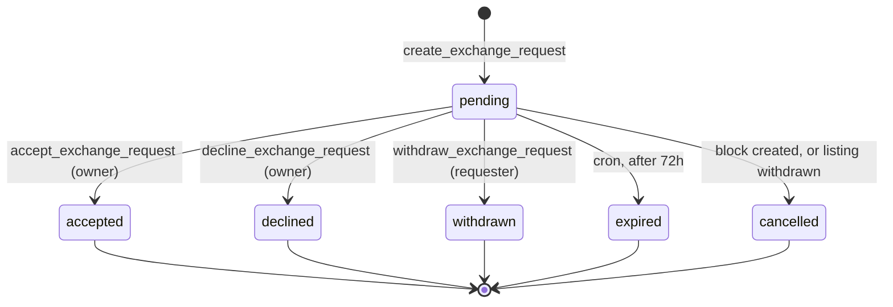
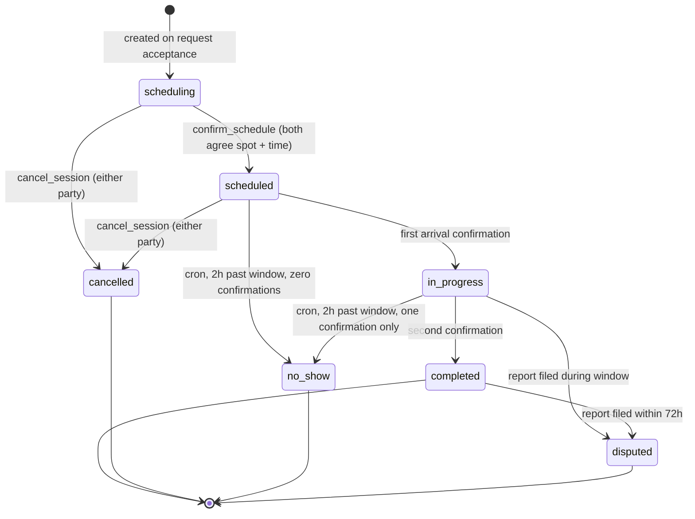

# Exchange State Machine

**Status:** Approved · **Version:** 1.0.0 · **Owner:** Architecture

The exchange is the product. Everything else exists to make this sequence safe and reliable. This document is normative: the states, transitions, guards, and concurrency controls below are the contract that [SPEC-010](../03-specs/SPEC-010-exchange-lifecycle.md) implements and that the client's optimistic UI must mirror exactly.

---

## 1. Two coupled machines

An exchange is modelled as two objects rather than one, because they have genuinely different lifetimes:

| Object | Lifetime | Answers |
| --- | --- | --- |
| `exchange_requests` | From "I want this" to accepted / declined / withdrawn / expired | *Is there interest?* |
| `exchange_sessions` | From acceptance to completion / cancellation | *Is a real-world meeting happening?* |

Collapsing them into one table was considered and rejected: a request that is declined has no meeting, and a session needs a state vocabulary (`scheduled`, `in_progress`, `no_show`) that is meaningless before acceptance. One table would mean a status enum where half the values are invalid at any given time — the classic sign of two entities wearing one hat.

A third state machine, on `listings`, is driven by the other two.

---

## 2. Request state machine



| From | To | Actor | Guards |
| --- | --- | --- | --- |
| — | `pending` | Requester | `app.can_transact()`; listing `active` and unexpired; not self; not blocked; no existing pending request for this (requester, listing); requester has < 10 open requests |
| `pending` | `accepted` | Owner | Caller is `owner_id`; request still `pending`; listing still `active`; owner can transact; not blocked |
| `pending` | `declined` | Owner | Caller is `owner_id`; request `pending` |
| `pending` | `withdrawn` | Requester | Caller is `requester_id`; request `pending` |
| `pending` | `expired` | System | `expires_at < now()` |
| `pending` | `cancelled` | System | Block created, listing withdrawn, or either party suspended |

**Terminal states are terminal.** There is no un-decline. A user who changes their mind sends a new request. This removes an entire class of race conditions and is enforced by a transition-guard trigger, not by convention.

---

## 3. Session state machine



| From | To | Actor | Guards & effects |
| --- | --- | --- | --- |
| — | `scheduling` | System | Created atomically with acceptance. `handoff_code` generated. |
| `scheduling` | `scheduled` | Either | `safe_spot_id` set and is in the listing's spot set; `scheduled_start` ≥ `now() + 1h` and ≤ `now() + 14d`; venue open during window; other party has confirmed |
| `scheduling`/`scheduled` | `cancelled` | Either | Reason required. If < 4h before `scheduled_start`, increments `cancellation_count_90d`. |
| `scheduled` | `in_progress` | Either | Code entered correctly; within `scheduled_start − 30m` … `scheduled_end + 2h` |
| `in_progress` | `completed` | The other party | Second confirmation. Effects: listing → `completed`, inventory → `exchanged`, ratings unlocked, `completed_exchanges` incremented for both, thread scheduled to close in 14 days |
| `scheduled`/`in_progress` | `no_show` | System | Effects: notify both; if exactly one confirmed, the *other* accrues a no-show marker |
| any non-terminal | `disputed` | System | A report against this session freezes it pending moderation |

### 3.1 The handoff code

At acceptance the system generates one six-digit code and shows it to **both** parties. At the meeting, each person enters it in their own app.

Why a shared code rather than geofencing:
- It requires physical co-presence without requesting background location, which we refuse to do in MVP.
- It is trivially understandable — people already know this pattern from delivery apps.
- It produces a mutual, timestamped record that both parties showed up, which is what ratings and no-show handling need.

Its weakness: it can be read aloud over the phone, so it proves co-presence only if both parties are honest. It is a **coordination device, not an anti-fraud control**, and should never be described as the latter. Real co-presence proof needs geofencing or BLE proximity, both deferred to Phase 3 with explicit opt-in.

Rules: 6 digits, generated with `gen_random_bytes`, not displayed until the session is `scheduled`, 5 wrong attempts locks confirmation for 15 minutes and notifies both parties.

---

## 4. `accept_exchange_request` — the critical section

This is the most safety-critical function in the codebase. It is where two people can accept the same listing at the same millisecond.

```sql
CREATE OR REPLACE FUNCTION public.accept_exchange_request(
  p_request_id      uuid,
  p_idempotency_key uuid
) RETURNS TABLE (session_id uuid, handoff_code char(6))
LANGUAGE plpgsql
SECURITY DEFINER
SET search_path = pg_catalog, public
AS $$
DECLARE
  v_uid     uuid := auth.uid();
  v_req     public.exchange_requests;
  v_listing public.listings;
  v_session uuid;
  v_code    char(6);
BEGIN
  --------------------------------------------------------------------
  -- 0. Idempotency. A retried request returns the original result.
  --------------------------------------------------------------------
  SELECT s.id, s.handoff_code INTO v_session, v_code
    FROM public.exchange_sessions s
   WHERE s.request_id = p_request_id AND s.owner_id = v_uid;
  IF FOUND THEN
    RETURN QUERY SELECT v_session, v_code;
    RETURN;
  END IF;

  --------------------------------------------------------------------
  -- 1. LOCK ORDER: listings → exchange_requests. ALWAYS.
  --    Every function touching both takes them in this order.
  --    Violating this is how you get a production deadlock at 2am.
  --------------------------------------------------------------------
  SELECT l.* INTO v_listing
    FROM public.listings l
    JOIN public.exchange_requests r ON r.listing_id = l.id
   WHERE r.id = p_request_id
   FOR UPDATE OF l;

  IF NOT FOUND THEN
    RAISE EXCEPTION 'request_not_found' USING ERRCODE = 'P0002';
  END IF;

  SELECT * INTO v_req FROM public.exchange_requests
   WHERE id = p_request_id FOR UPDATE;

  --------------------------------------------------------------------
  -- 2. Authorization. Definer functions bypass RLS, so this is manual.
  --------------------------------------------------------------------
  IF v_req.owner_id <> v_uid THEN
    RAISE EXCEPTION 'not_authorized' USING ERRCODE = '42501';
  END IF;
  IF NOT app.can_transact(v_uid) THEN
    RAISE EXCEPTION 'not_verified' USING ERRCODE = '42501';
  END IF;
  IF app.is_blocked_either_way(v_req.owner_id, v_req.requester_id) THEN
    RAISE EXCEPTION 'blocked' USING ERRCODE = '42501';
  END IF;

  --------------------------------------------------------------------
  -- 3. State assertions, now safe because we hold both locks.
  --------------------------------------------------------------------
  IF v_req.status <> 'pending' THEN
    RAISE EXCEPTION 'request_not_pending' USING ERRCODE = 'P0001';
  END IF;
  IF v_req.expires_at <= now() THEN
    RAISE EXCEPTION 'request_expired' USING ERRCODE = 'P0001';
  END IF;
  IF v_listing.status <> 'active' THEN
    -- The other acceptor won. This is the race, resolved.
    RAISE EXCEPTION 'listing_unavailable' USING ERRCODE = 'P0001';
  END IF;
  IF v_listing.expires_at <= now() THEN
    RAISE EXCEPTION 'listing_expired' USING ERRCODE = 'P0001';
  END IF;

  --------------------------------------------------------------------
  -- 4. Transition. Order matters: reserve the scarce resource first.
  --------------------------------------------------------------------
  v_code := lpad((get_byte(gen_random_bytes(3),0) * 65536
                + get_byte(gen_random_bytes(3),1) * 256
                + get_byte(gen_random_bytes(3),2)) % 1000000, 6, '0');

  UPDATE public.listings
     SET status = 'reserved', reserved_request_id = p_request_id, updated_at = now()
   WHERE id = v_listing.id;
  -- listings_single_reservation (partial unique index) is the backstop
  -- if the lock discipline above is ever violated by new code.

  UPDATE public.exchange_requests
     SET status = 'accepted', responded_at = now(), updated_at = now()
   WHERE id = p_request_id;

  -- Every other pending request on this listing loses, atomically.
  UPDATE public.exchange_requests
     SET status = 'declined', responded_at = now(), updated_at = now()
   WHERE listing_id = v_listing.id
     AND id <> p_request_id
     AND status = 'pending';

  UPDATE public.inventory_items
     SET status = 'reserved', updated_at = now()
   WHERE id = v_listing.inventory_item_id;

  INSERT INTO public.exchange_sessions
    (request_id, owner_id, requester_id, state, handoff_code)
  VALUES (p_request_id, v_req.owner_id, v_req.requester_id, 'scheduling', v_code)
  RETURNING id INTO v_session;

  INSERT INTO public.message_threads (request_id, participant_a, participant_b)
  VALUES (p_request_id,
          LEAST(v_req.owner_id, v_req.requester_id),
          GREATEST(v_req.owner_id, v_req.requester_id))
  ON CONFLICT (request_id) DO NOTHING;

  --------------------------------------------------------------------
  -- 5. Transactional outbox. Notifications commit with the state change
  --    or not at all. No HTTP call inside a transaction, ever.
  --------------------------------------------------------------------
  PERFORM app.enqueue_notification(v_req.requester_id, 'request_accepted',
            jsonb_build_object('session_id', v_session));
  PERFORM app.enqueue_notification_bulk_declined(v_listing.id, p_request_id);

  INSERT INTO audit.events (actor_id, actor_role, action, subject_type, subject_id)
  VALUES (v_uid, 'authenticated', 'exchange.accepted', 'session', v_session);

  RETURN QUERY SELECT v_session, v_code;
END;
$$;

REVOKE ALL ON FUNCTION public.accept_exchange_request(uuid, uuid) FROM PUBLIC, anon;
GRANT EXECUTE ON FUNCTION public.accept_exchange_request(uuid, uuid) TO authenticated;
```

---

## 5. Concurrency hazards

Each of these is a real failure mode with a specific control and a specific test.

### H1 — Two users accept the same listing simultaneously

**Without control:** both succeed, two sessions exist, one person drives to a library for nothing.

**Controls, in depth order:**
1. `SELECT … FOR UPDATE` on the listing row serializes the two transactions.
2. The `status <> 'active'` assertion inside the lock makes the loser fail cleanly with `listing_unavailable`.
3. `CREATE UNIQUE INDEX listings_single_reservation ON listings (reserved_request_id) WHERE reserved_request_id IS NOT NULL` is the backstop if future code takes locks in a different order. (An earlier draft indexed `(id) WHERE status = 'reserved'`, which is a no-op because `id` is already the primary key — a reminder that a "backstop" constraint nobody tested is not a backstop. This one is proven by [SPEC-010-T30](../03-specs/SPEC-010-exchange-lifecycle.md).)

**Test:** [SPEC-010-T30](../03-specs/SPEC-010-exchange-lifecycle.md) — 50 concurrent acceptors; exactly one succeeds, 49 receive `listing_unavailable`, exactly one session row exists.

### H2 — Inventory double-commit

One item is listed once, but a user could try to list the same item twice, or accept an exchange for an already-committed item.

**Control:** partial unique index — one active listing per inventory item.

```sql
CREATE UNIQUE INDEX listings_one_active_per_item
  ON public.listings (inventory_item_id)
  WHERE status IN ('draft','active','reserved');
```

### H3 — Duplicate requests from retries

Flaky network, user taps twice, client retries.

**Control:** `idempotency_key` unique per `(requester_id, key)`, plus `exchange_requests_one_pending` on `(listing_id, requester_id) WHERE status = 'pending'`. A retry returns the original row rather than creating a second.

### H4 — Both parties confirm handoff at the same instant

**Without control:** a lost update — one confirmation overwrites the other and the session never completes.

**Control:** the confirmation RPC uses a single atomic statement that sets *its own* column and derives state from the result, rather than read-then-write:

```sql
UPDATE public.exchange_sessions
   SET owner_confirmed_at     = CASE WHEN v_uid = owner_id     THEN now() ELSE owner_confirmed_at END,
       requester_confirmed_at = CASE WHEN v_uid = requester_id THEN now() ELSE requester_confirmed_at END,
       state = CASE
                 WHEN (v_uid = owner_id     AND requester_confirmed_at IS NOT NULL)
                   OR (v_uid = requester_id AND owner_confirmed_at     IS NOT NULL)
                 THEN 'completed'::session_state
                 ELSE 'in_progress'::session_state
               END,
       completed_at = CASE
                 WHEN (v_uid = owner_id     AND requester_confirmed_at IS NOT NULL)
                   OR (v_uid = requester_id AND owner_confirmed_at     IS NOT NULL)
                 THEN now() ELSE completed_at END,
       version = version + 1
 WHERE id = p_session_id
   AND state IN ('scheduled','in_progress')
 RETURNING state INTO v_new_state;
```

### H5 — Client sends a stale mutation

User's app has an old view of the session and sends a transition that no longer applies.

**Control:** optimistic concurrency. Every mutating session RPC takes a `p_expected_version`; a mismatch raises `stale_state`, and the client refetches and re-renders rather than retrying blindly.

### H6 — Cancel racing completion

One party cancels while the other confirms.

**Control:** both paths take `FOR UPDATE` on the session and assert the state inside the lock. Whoever commits first wins; the other gets `invalid_transition`. Product rule: **completion wins ties** — if a confirmation and a cancel arrive in the same instant, the confirmation is processed first, because the goods have physically changed hands and pretending otherwise would be false.

### H7 — Deadlock between two exchanges

A and B each have a pending request against the other's listing, and both accept simultaneously.

**Control:** the global lock order `listings → exchange_requests → exchange_sessions`, documented at the top of every function that touches more than one. Postgres will still detect and abort a genuine deadlock; the client treats SQLSTATE `40P01` as retryable with jitter, up to 3 attempts.

### H8 — A listing expires mid-acceptance

**Control:** the expiry cron never touches rows in `reserved`, and `accept_exchange_request` re-checks `expires_at` inside the lock. Expiry is `UPDATE … WHERE status = 'active' AND expires_at < now()`, so a row that just became `reserved` is invisible to it.

---

## 6. The transition guard trigger

Belt and braces. Even though transitions go through RPCs, a trigger enforces the transition table at the storage layer, so a future migration, an admin script, or a mistaken `service_role` write cannot produce an illegal state.

```sql
CREATE TABLE private.legal_session_transitions (
  from_state session_state NOT NULL,
  to_state   session_state NOT NULL,
  PRIMARY KEY (from_state, to_state)
);

INSERT INTO private.legal_session_transitions VALUES
  ('scheduling','scheduled'), ('scheduling','cancelled'),
  ('scheduled','in_progress'),('scheduled','cancelled'),('scheduled','no_show'),
  ('in_progress','completed'),('in_progress','no_show'),('in_progress','disputed'),
  ('completed','disputed');

CREATE OR REPLACE FUNCTION private.guard_session_transition() RETURNS trigger
LANGUAGE plpgsql AS $$
BEGIN
  IF NEW.state IS DISTINCT FROM OLD.state
     AND NOT EXISTS (SELECT 1 FROM private.legal_session_transitions
                      WHERE from_state = OLD.state AND to_state = NEW.state) THEN
    RAISE EXCEPTION 'invalid_transition: % -> %', OLD.state, NEW.state
      USING ERRCODE = 'P0001';
  END IF;
  RETURN NEW;
END; $$;

CREATE TRIGGER trg_guard_session_transition
BEFORE UPDATE ON public.exchange_sessions
FOR EACH ROW EXECUTE FUNCTION private.guard_session_transition();
```

The transition table is data, not code, which means the [test suite generates its cases from it](../04-testing/01-test-strategy.md): for every ordered pair of states, assert legal pairs succeed and all others raise. That is 6 × 6 = 36 assertions maintained automatically.

---

## 7. Scheduled jobs

| Job | Cadence | Action |
| --- | --- | --- |
| `expire_requests` | every 5 min | `pending` → `expired` past `expires_at` |
| `expire_listings` | every 15 min | `active` → `expired` past `expires_at`; never touches `reserved` |
| `detect_no_shows` | every 15 min | 2 h past `scheduled_end` without both confirmations → `no_show` |
| `remind_upcoming` | every 15 min | Notify both parties 24 h and 2 h before `scheduled_start` |
| `reveal_ratings` | hourly | Reveal after both submit, or 7 days |
| `close_threads` | daily | Close threads 14 days after completion |
| `recompute_trust` | nightly | Trust score and 90-day cancellation window |
| `drain_notification_outbox` | every 30 s | Edge Function; exponential backoff, dead-letter after 6 attempts |
| `anonymize_sessions` | daily | Null participants and times on sessions completed > 90 days ago |

---

## 8. Client mirroring

The client implements the same machine in `src/domain/exchange/machine.ts` as a pure function, with no network calls. It is used to:

- Decide which actions to show — a button for an illegal transition should never render.
- Apply optimistic updates that are guaranteed to be legal.
- Roll back cleanly when the server disagrees.

**The client's machine is advisory. The server's is authoritative.** They are kept in sync by generating the TypeScript transition table from `private.legal_session_transitions` at build time, so a drift is a compile error rather than a runtime bug.

```ts
// generated — do not edit
export const LEGAL_SESSION_TRANSITIONS = {
  scheduling:  ['scheduled', 'cancelled'],
  scheduled:   ['in_progress', 'cancelled', 'no_show'],
  in_progress: ['completed', 'no_show', 'disputed'],
  completed:   ['disputed'],
  cancelled:   [],
  no_show:     [],
  disputed:    [],
} as const satisfies Record<SessionState, readonly SessionState[]>;
```

---

## 9. Error taxonomy

Errors returned to the client are stable codes, never raw Postgres messages — a raw message can contain row data.

| Code | HTTP | Meaning | Client behaviour |
| --- | --- | --- | --- |
| `request_not_found` | 404 | Gone or never existed | Refetch, show "no longer available" |
| `not_authorized` | 403 | Caller isn't a party | Refetch; likely a stale screen |
| `not_verified` | 403 | Cannot transact yet | Route to verification |
| `blocked` | 403 | A block exists | Silent removal from the list |
| `request_not_pending` | 409 | Already resolved | Refetch and re-render |
| `listing_unavailable` | 409 | Someone else won | Toast: "Just claimed by someone else", refetch |
| `listing_expired` | 409 | Window closed | Remove from list |
| `invalid_transition` | 409 | Illegal state change | Refetch; a client bug |
| `stale_state` | 409 | Version mismatch | Refetch, replay if still valid |
| `rate_limited` | 429 | Too many attempts | Backoff with `Retry-After` |
| `venue_closed` | 422 | Proposed time outside opening hours | Show hours, ask for another time |

---

## 10. Open questions

| # | Question | Owner | Needed by |
| --- | --- | --- | --- |
| Q1 | Should partial-quantity reservations be supported (splitting 10 lb of tomatoes between two people)? Requires `FOR UPDATE` plus a sum-check and materially complicates H1. | Product | Phase 2 planning |
| Q2 | Should a no-show automatically file a report, or only prompt one? Automatic filing inflates the moderation queue; prompting under-reports. | Trust & Safety | Before launch |
| Q3 | Is a 72-hour request expiry right? Too short in peak season when people check the app twice a week. | Product | Post-launch data |

---

## Change Log

| Date | Version | Author | Change |
| --- | --- | --- | --- |
| 2026-08-08 | 1.0.0 | Architecture | Initial state machine |
