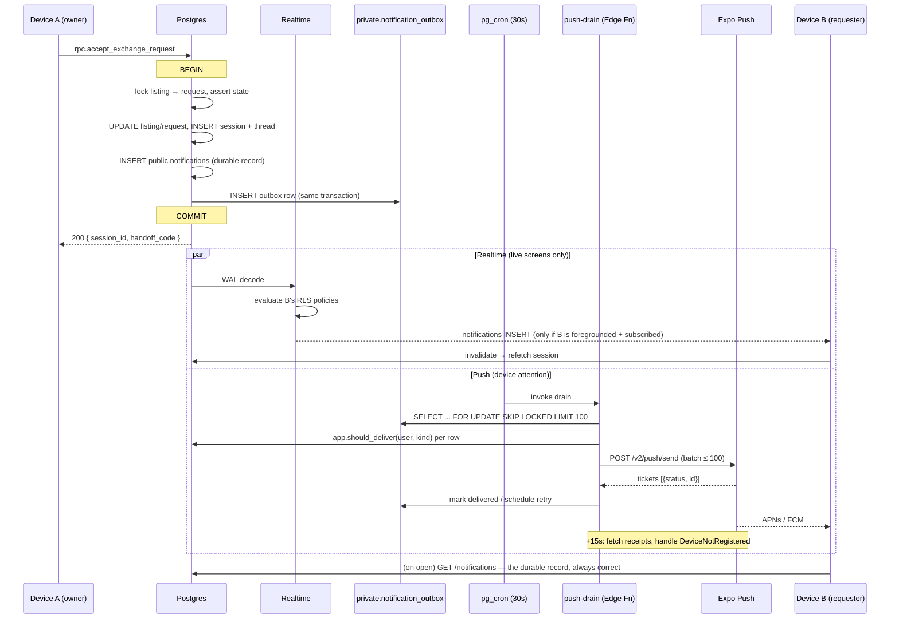

# Realtime & Notifications

**Status:** Approved · **Version:** 1.0.0 · **Owner:** Architecture

Two mechanisms, two jobs, and a hard separation between them:

| | Realtime (WebSocket) | Push (Expo → APNs/FCM) |
| --- | --- | --- |
| **For** | Making a screen the user is *currently looking at* feel live | Getting the user's attention when the app is closed |
| **Guarantee** | None. It is an invalidation hint. | At-least-once to the in-app inbox; **best-effort** to the device |
| **Durability** | Zero — a dropped socket loses events silently | The `notifications` row is the durable record |
| **Correctness role** | None | None |
| **If it fails** | The screen is stale until the next focus refetch | The user sees everything on next open |

**Neither is a source of truth.** The in-app inbox (`public.notifications`) is the durable record and push is explicitly best-effort — stated in [PRD C13](../00-foundation/02-prd.md) and in [System Architecture §2](01-system-architecture.md). Any feature that becomes incorrect when a push is dropped is a feature designed wrong.

---

## 1. Realtime channel design

Three channel shapes. There is no fourth, and a proposal for one needs to answer "why can't this be a refetch?"

| Channel | Topic | Subscribed while | Publishes | Typical lifetime |
| --- | --- | --- | --- | --- |
| **Per-user** | `user:{user_id}` | Session active **and** app foregrounded | `notifications` INSERT · `verifications` UPDATE · `gardens` UPDATE (status only) · `profiles` UPDATE (self) | Whole foreground session |
| **Per-thread** | `thread:{thread_id}` | The thread screen is focused | `messages` INSERT · `message_threads` UPDATE (`is_closed`) | Seconds to minutes |
| **Per-session** | `session:{session_id}` | An exchange or session detail screen is focused | `exchange_sessions` UPDATE · `exchange_requests` UPDATE | Seconds to minutes |

Only the per-user channel is long-lived. That is deliberate: **one always-on channel per device is a cost we can model; N channels per device is not.** A user with 12 active exchanges would otherwise hold 13 subscriptions, and the WAL-to-socket fanout cost is per subscription.

The per-user channel therefore carries *notification rows*, which are the coarse "something happened to you" signal, and the fine-grained channels exist only for the screen in front of the user.

### 1.1 RLS awareness

Supabase Realtime evaluates the subscriber's RLS policies before emitting a `postgres_changes` event. A client receives change events **only for rows it could `SELECT`**. This is not incidental — it is what makes per-thread and per-session channels safe to name with a guessable id.

Two consequences we depend on:

1. **Subscribing to `thread:{id}` for a thread you are not in yields nothing.** `app.is_thread_participant()` returns false, the policy filters, the socket stays silent. Verified explicitly: a synthetic user subscribes to a stranger's thread topic and asserts zero events over 30 seconds.
2. **A block takes effect on the stream immediately.** `on_block_created` sets `is_closed = true`, `app.is_thread_participant` starts returning false, and further inserts stop reaching either party — without any client-side filtering ([RLS Design §6](05-rls-design.md)).

What RLS-awareness does **not** give us: column-level filtering. That is configured on the publication, not the policy.

```sql
-- Publications are column-scoped. handoff_code is P1 and must never ride a socket.
ALTER PUBLICATION supabase_realtime ADD TABLE public.exchange_sessions
  (id, request_id, owner_id, requester_id, state, version,
   safe_spot_id, scheduled_start, scheduled_end,
   owner_confirmed_at, requester_confirmed_at, completed_at,
   cancelled_by, cancelled_reason, cancelled_at, updated_at);

ALTER PUBLICATION supabase_realtime ADD TABLE public.messages
  (id, thread_id, sender_id, kind, body, read_at, created_at);
  -- flagged_reason excluded: moderator-only

ALTER PUBLICATION supabase_realtime ADD TABLE public.notifications
  (id, user_id, kind, title, body, deep_link, payload, read_at, created_at);

ALTER TABLE public.messages REPLICA IDENTITY FULL;           -- needed for `old` on UPDATE
ALTER TABLE public.exchange_sessions REPLICA IDENTITY FULL;
```

A pgTAP assertion over `pg_publication_tables` fails the build if any published column matches the coordinate regex or is named `handoff_code`, `trust_score`, `flagged_reason`, or `cancellation_count_90d` ([API Contract §9.1, API-08](06-api-contract.md)).

### 1.2 Subscription lifecycle

Subscriptions are tied to **screen focus**, not to component mount. A backgrounded stack of five screens holding five open channels is a battery and connection-count problem, and Expo Router keeps screens mounted.

```ts
// src/api/realtime.ts
export function useChannel(topic: string | null, handlers: Handlers, enabled = true) {
  const isFocused = useIsFocused();
  const appState = useAppState();

  useEffect(() => {
    if (!topic || !enabled || !isFocused || appState !== 'active') return;

    const channel = supabase.channel(topic, { config: { private: true } });
    for (const h of handlers) {
      channel.on('postgres_changes',
        { event: h.event, schema: 'public', table: h.table, filter: h.filter }, h.fn);
    }

    channel.subscribe((status, err) => {
      if (status === 'SUBSCRIBED') {
        // Refetch on (re)subscribe. Anything that happened while we were
        // detached is invisible to us — realtime has no replay.
        void queryClient.invalidateQueries({ queryKey: h.invalidate });
      }
      if (status === 'CHANNEL_ERROR' || status === 'TIMED_OUT') {
        Sentry.captureMessage('realtime.channel_error', { extra: { topic, status } });
      }
    });

    return () => { void supabase.removeChannel(channel); };
  }, [topic, enabled, isFocused, appState]);
}
```

| Event | Behaviour |
| --- | --- |
| Screen gains focus | Subscribe, then invalidate that screen's query prefix |
| Screen loses focus | Unsubscribe immediately. No grace period — the user's data is refetched on return anyway. |
| App backgrounds | Unsubscribe **all** channels, including per-user. iOS suspends the socket within seconds regardless; holding it open just produces a phantom connection the server has to time out. |
| App foregrounds | Resubscribe, then run the resync (§1.4) |
| Sign-out | `supabase.removeAllChannels()` before clearing storage |
| Token refresh | `supabase.realtime.setAuth(newAccessToken)` — otherwise the socket keeps the old JWT and starts silently dropping events when it expires |

That last row is the one that produces the ugliest bug in this area: the HTTP client refreshes, everything keeps working, and realtime quietly stops delivering. It is invisible in testing (sessions are short) and appears in production an hour after launch.

### 1.3 Reconnection

The Supabase client reconnects on its own, but its default backoff is aggressive enough to make a partial outage worse. We override it:

```ts
realtime: {
  params: { eventsPerSecond: 5 },
  heartbeatIntervalMs: 25_000,
  reconnectAfterMs: (tries) =>
    Math.min(1000 * 2 ** tries, 30_000) + Math.floor(Math.random() * 1000),
  // 1s, 2s, 4s, 8s, 16s, 30s, 30s… each with up to 1s of jitter.
}
```

The jitter is not decorative. Without it, a Realtime restart makes every client in the fleet reconnect on the same schedule, and the thundering herd takes the service down again on the second attempt. This is the classic way a 30-second blip becomes a 20-minute outage.

After 6 consecutive failures the client stops trying, shows a subtle "Live updates paused" indicator on the affected screen, and falls back to a **20-second polling refetch** for the focused screen only. Polling one screen is a bounded cost; polling everything is a self-inflicted denial of service.

### 1.4 Resync — realtime is not a sync protocol

> **This is the single most important idea in this document.** A websocket that drops loses events with no gap detection, no sequence numbers, and no replay. A client that treats the stream as authoritative will silently show a stale exchange state, and the user will act on it.

So the contract is inverted: **realtime never carries state the client needs. It carries permission to refetch.**

```ts
// The handler for a session update. Note what it does NOT do.
channel.on('postgres_changes',
  { event: 'UPDATE', schema: 'public', table: 'exchange_sessions', filter: `id=eq.${sessionId}` },
  (payload) => {
    // We do NOT write payload.new into the cache. The payload is column-filtered,
    // may lag the row we would fetch, and is not guaranteed to arrive at all.
    queryClient.invalidateQueries({ queryKey: qk.session(sessionId) });
  });
```

The one exception is `messages` INSERT, which is appended optimistically to the thread cache because a chat that waits for a round trip feels broken. Even there, the append is reconciled against a refetch on next focus, and message ids are client-generated so a duplicate append is idempotent.

**Resync triggers**, in every case a full refetch of the relevant query prefix:

| Trigger | Refetches |
| --- | --- |
| App foreground | `qk.exchanges()`, `qk.threads()`, `qk.notifications()`, unread count |
| Network reconnect (`onlineManager`) | Everything stale (TanStack Query's `refetchOnReconnect`) |
| Channel `SUBSCRIBED` (including resubscribe) | That channel's query prefix |
| Screen focus | That screen's queries |
| Push notification tapped | The target resource, **before** navigation resolves ([Mobile Architecture §3.1](02-mobile-architecture.md)) |
| Push received in foreground | Unread count + the prefix implied by `kind` |



---

## 2. Push vs. inbox, restated

| Property | `public.notifications` (inbox) | Expo Push |
| --- | --- | --- |
| Delivery | At-least-once, transactional with the state change | Best-effort |
| Ordering | `created_at` | None |
| Retention | Per [Data Model §14](03-data-model.md) | None — a dropped push is gone |
| User can disable | Per-kind toggles, except `safety_alert` | Per-kind, plus OS-level, plus quiet hours |
| Contains | Title, body, deep link, `payload` (coordinate-key `CHECK`ed) | Title, body, `data.notification_id`, `data.deep_link` |
| Failure visible to user | Would be a bug | Normal and expected |

The consequence for product decisions: **anything the user must know goes in the inbox first**, and push is the doorbell. A `safety_alert` that cannot be suppressed still lands in the inbox even if the device has notifications disabled at the OS level, because that is the only delivery we actually control.

---

## 3. The transactional outbox

### 3.1 Why

An HTTP call cannot happen inside a database transaction. The two failure modes are both unacceptable:

- **Send before commit** → the transaction rolls back and the user is notified that their request was accepted when it wasn't.
- **Send after commit, in-process** → the process dies between commit and send, and the notification is lost with no record that it should have existed.

There is no ordering that fixes this, because there is no distributed transaction between Postgres and Expo. The outbox sidesteps it: **the intent to notify is written in the same transaction as the state change**, and a separate process is responsible for turning intent into delivery.

```sql
-- Called from inside every state-transition RPC. Never makes a network call.
CREATE OR REPLACE FUNCTION app.enqueue_notification(
  p_user_id uuid,
  p_kind    notification_kind,
  p_payload jsonb DEFAULT '{}'::jsonb
) RETURNS uuid
LANGUAGE plpgsql SECURITY DEFINER SET search_path = pg_catalog, public, private AS $$
DECLARE v_id uuid; v_title text; v_body text; v_link text;
BEGIN
  -- Templates are data, reviewed, and cannot interpolate a location.
  SELECT t.title, t.body, t.deep_link
    INTO v_title, v_body, v_link
    FROM private.notification_templates t
   WHERE t.kind = p_kind;

  INSERT INTO public.notifications (user_id, kind, title, body, deep_link, payload)
  VALUES (p_user_id, p_kind,
          app.render_template(v_title, p_payload),
          app.render_template(v_body,  p_payload),
          app.render_template(v_link,  p_payload),
          p_payload)
  RETURNING id INTO v_id;

  -- Same transaction. Commits with the state change or not at all.
  INSERT INTO private.notification_outbox (notification_id) VALUES (v_id);
  RETURN v_id;
END; $$;
```

`notifications.payload` carries a `CHECK` forbidding `lat`/`lng`/`point`/`coordinates` keys ([Data Model §12](03-data-model.md)), and templates are rows in `private.notification_templates` rather than string concatenation in PL/pgSQL — so "can this notification leak a location?" is answered by reviewing a table, not by auditing every call site ([Location Privacy §8](04-location-privacy.md)).

### 3.2 The drain

`pg_cron` invokes `push-drain` every 30 seconds.

```sql
SELECT cron.schedule('drain_notification_outbox', '30 seconds', $$
  SELECT net.http_post(
    url     := app.setting('edge_url') || '/push-drain',
    headers := jsonb_build_object('Authorization', 'Bearer ' || app.setting('service_key')),
    timeout_milliseconds := 20000
  );
$$);
```

```ts
// supabase/functions/push-drain/index.ts — core loop
const { data: batch } = await db.rpc('claim_outbox_batch', { p_limit: 100 });
// claim_outbox_batch:
//   SELECT ... FROM private.notification_outbox
//    WHERE delivered_at IS NULL AND attempts < 6 AND next_attempt_at <= now()
//    ORDER BY id
//    FOR UPDATE SKIP LOCKED
//    LIMIT p_limit;
// SKIP LOCKED is what makes overlapping drains safe. Two concurrent invocations
// claim disjoint rows instead of double-sending or deadlocking.

const deliverable = batch.filter((r) => r.should_deliver);   // app.should_deliver(), §5
const messages = deliverable.flatMap(toExpoMessages);        // one per device

for (const chunk of expo.chunkPushNotifications(messages)) {  // ≤ 100 per HTTP call
  const tickets = await expo.sendPushNotificationsAsync(chunk);
  await db.rpc('record_push_tickets', { p_tickets: tickets });
}
```

| Property | Value |
| --- | --- |
| Cadence | 30 s |
| Batch size | 100 outbox rows per invocation, ≤ 100 messages per Expo HTTP call |
| Claim | `FOR UPDATE SKIP LOCKED` — overlapping invocations are safe |
| Backoff | `next_attempt_at = now() + (30 s × 2^attempts)` → 30 s, 1 m, 2 m, 4 m, 8 m, 16 m |
| Dead-letter | After **6 attempts**, `attempts = 6` excludes the row from every claim. `last_error` retained. |
| Suppressed rows | `should_deliver = false` → `delivered_at = now()`, `last_error = 'suppressed:quiet_hours'`. **The inbox row still exists.** Suppression means "don't buzz the phone", never "don't tell the user". |
| Timeout | 20 s per invocation; unfinished rows are simply reclaimed next tick |

Dead-lettered rows are counted and alerted on. A dead-letter rate above **0.5% over 15 minutes** pages, because it usually means an Expo credential expired or a whole platform's tokens went stale — both of which are silent from the user's side ([Observability](../05-operations/04-observability.md)).

### 3.3 Idempotency on receipts

Expo returns a **ticket** synchronously (accepted for delivery) and a **receipt** asynchronously (what actually happened). They are separate facts and both matter.

```
send → ticket { status: 'ok', id: 'XXXX-…' }        → row is "sent", not "delivered"
     → ticket { status: 'error', details: { error } } → handle immediately, see §4.3

+15 min later:
getPushNotificationReceiptsAsync([ticketIds])
     → receipt { status: 'ok' }                       → delivered_at set
     → receipt { status: 'error', details: { error: 'DeviceNotRegistered' } }
                                                      → delete the device row, do NOT retry
```

Idempotency, at three layers, because a duplicate push is a real and common failure:

1. **The outbox row is the unit of work.** `delivered_at IS NOT NULL` excludes it from every future claim.
2. **`FOR UPDATE SKIP LOCKED`** means two overlapping drains never claim the same row.
3. **`data.notification_id` is on every push**, and the client dedupes on it — see §6.3. This is the layer that survives a genuine double-send from a retry after a timeout, where the first send succeeded but we never saw the response.

Receipts are checked by a second cron job (`check_push_receipts`, every 5 minutes) over tickets older than 15 minutes. Expo retains receipts for 24 hours; a ticket unresolved after that is marked `receipt_unknown` and not retried — retrying a possibly-delivered notification is worse than dropping a possibly-lost one.

---

## 4. Expo Push specifics

### 4.1 Token registration and rotation

```ts
// src/lib/push.ts
export async function registerForPush(): Promise<void> {
  // Permission is requested contextually — after the first exchange request is
  // sent, never at launch (PRD C13, Location Privacy §9).
  const { status } = await Notifications.requestPermissionsAsync();
  if (status !== 'granted') return;

  const token = (await Notifications.getExpoPushTokenAsync({
    projectId: Constants.expoConfig!.extra!.eas.projectId,
  })).data;

  await api.registerDevice({
    p_expo_push_token: token,
    p_platform: Platform.OS as 'ios' | 'android',
    p_app_version: Application.nativeApplicationVersion!,
    p_os_version: Device.osVersion ?? undefined,
    p_idempotency_key: uuid(),
  });
}
```

| Event | Handling |
| --- | --- |
| First grant | `register_device` inserts a `devices` row |
| Every cold start with permission granted | Re-register. Tokens rotate on app reinstall, OS restore, and occasionally for no visible reason. Re-registering is cheap and idempotent on `(user_id, expo_push_token)`. |
| `addPushTokenListener` fires | Re-register immediately |
| Token already belongs to another user | **Reassigned to the newest user**, old row deleted. A shared or handed-down device otherwise delivers A's notifications to B, which is a privacy incident, not an inconvenience. ([API Contract §5.6](06-api-contract.md)) |
| `DeviceNotRegistered` receipt | Delete the `devices` row. Do not retry; do not soft-flag. The token is permanently dead. |
| Sign-out | Delete the device row **before** clearing the session, so the next user of the phone does not inherit the subscription |
| `push_enabled = false` (in-app toggle) | Row retained, excluded from fanout. Distinct from OS-level denial, which we cannot observe server-side. |

`devices.app_version` is also read by CI to gate destructive migrations ([Data Model §12](03-data-model.md)) — registration keeps it fresh, which is a second reason not to let it go stale.

### 4.2 Batching and limits

| Limit | Value | Consequence |
| --- | --- | --- |
| Messages per HTTP request | 100 | `expo.chunkPushNotifications()` handles it |
| Receipt ids per request | 1000 | `chunkPushNotificationReceiptIds()` |
| Total payload | 4 KB per message | Our payloads are ~200 bytes: `notification_id`, `deep_link`, `kind` |
| Expo rate limit | 600 notifications/second per project | At two metros this is not close; alerted at 60% |
| Receipt retention | 24 h | Beyond that a ticket is unresolvable |

We send **one message per device**, not one per user. A user with a phone and a tablet gets two, deduped client-side by `notification_id` if both are open.

### 4.3 Ticket errors

| Error | Meaning | Action |
| --- | --- | --- |
| `DeviceNotRegistered` | Token dead | Delete the device row. Never retry. |
| `MessageTooBig` | > 4 KB | Truncate body to 178 chars, log an error — our templates should make this impossible, so it means a template regressed |
| `MessageRateExceeded` | Too fast to one device | Backoff and retry (counts as an attempt) |
| `MismatchSenderId` | FCM credentials wrong for this token | **Page immediately.** Every Android push is failing. |
| `InvalidCredentials` | APNs key or FCM service account invalid | **Page immediately.** Every push on that platform is failing. |
| Network / 5xx from Expo | Transient | Retry with backoff |

The two paging cases share a property that makes them dangerous: **they fail silently from the user's perspective**. Nobody reports "I didn't get a notification." The alert is the only way we find out, so it is a page and not a ticket.

### 4.4 APNs vs. FCM

| Concern | iOS (APNs) | Android (FCM) |
| --- | --- | --- |
| Priority | `priority: 'high'` → APNs priority 10 | `priority: 'high'` → FCM high, wakes Doze |
| Collapse | `collapseId` (`apns-collapse-id`), max 64 bytes | `collapseKey` (FCM `collapse_key`) |
| Badge | Server sets `badge: <unread_count>`, computed at drain time | No OS badge concept; launchers vary. We do not rely on it. |
| Channels | N/A | **Channels are mandatory** and their importance is user-controlled per channel. Created at first launch (§4.6). |
| Sound | `sound: 'default'`; `safety_alert` uses a distinct sound | Per-channel, set at channel creation and **immutable afterwards** — getting a channel's importance wrong at launch requires a new channel id |
| Silent/data-only | `_contentAvailable: true` (badge refresh) | `priority: 'normal'`, data-only |
| Delivery when force-quit | Delivered | **Not delivered** on many OEM builds (Xiaomi, Huawei, Oppo aggressive battery management) |
| Grouping | `threadId` groups in Notification Center | `groupKey` |

That "not delivered when force-quit" row is why the inbox is the record and not a convenience. On a meaningful share of Android devices, push simply does not arrive, and no amount of correct implementation changes it.

### 4.5 Priority and collapse keys

| Kind | Priority | Collapse key | Reasoning |
| --- | --- | --- | --- |
| `safety_alert` | high | none | Never collapsed. Every one is distinct and must be seen. |
| `request_received` | high | `req:{listing_id}` | Five requests on one listing collapse to the latest; the inbox has all five. |
| `request_accepted` | high | none | Singular, actionable, time-sensitive |
| `request_declined` | normal | `req:{listing_id}` | |
| `message_received` | high | `thread:{thread_id}` | Standard chat behaviour: one line per conversation, not per message |
| `exchange_reminder` | high | `session:{session_id}` | The 2 h reminder replaces the 24 h reminder |
| `exchange_cancelled` | high | `session:{session_id}` | |
| `verification_result` | normal | none | |
| `garden_review_result` | normal | none | |
| `moderation_outcome` | normal | none | |
| `surplus_alert` (Phase 2) | normal | `surplus:{species_id}` | |

High priority is used sparingly and honestly. Marking everything high is how an app gets throttled by FCM and muted by users.

### 4.6 Android channels

Created once at first launch, before any push can arrive. Channel importance is **user-controlled and immutable after creation**, so the initial values matter and a mistake costs a channel-id migration.

```ts
await Notifications.setNotificationChannelAsync('safety', {
  name: 'Safety alerts',
  importance: Notifications.AndroidImportance.MAX,
  sound: 'safety.wav',
  bypassDnd: true,                 // matches the server-side non-suppressibility of safety_alert
  lockscreenVisibility: Notifications.AndroidNotificationVisibility.PUBLIC,
});
await Notifications.setNotificationChannelAsync('exchanges', {
  name: 'Exchanges',
  importance: Notifications.AndroidImportance.HIGH,
});
await Notifications.setNotificationChannelAsync('messages', {
  name: 'Messages',
  importance: Notifications.AndroidImportance.HIGH,
});
await Notifications.setNotificationChannelAsync('account', {
  name: 'Account & verification',
  importance: Notifications.AndroidImportance.DEFAULT,
});
```

A user can still mute the safety channel at the OS level. We cannot prevent that, and we do not pretend to — `bypassDnd` covers Do Not Disturb, not a disabled channel. The inbox remains the guarantee.

---

## 5. Notification catalog

Every `notification_kind` from [Data Model §4](03-data-model.md). Templates live in `private.notification_templates` as rows; the `{}` placeholders are filled from the outbox row's `payload`.

| Kind | Trigger | Title | Body | Deep link | Default on | Quiet-hours suppressible | Channel |
| --- | --- | --- | --- | --- | --- | --- | --- |
| `request_received` | `create_exchange_request` commits | `New exchange request` | `{requester_name} wants your {listing_title}` | `sharecropr://exchanges/{request_id}` | Yes | Yes | exchanges |
| `request_accepted` | `accept_exchange_request` commits | `Request accepted` | `{owner_name} accepted your request for {listing_title}. Pick a time and place.` | `sharecropr://exchanges/session/{session_id}` | Yes | Yes | exchanges |
| `request_declined` | `decline_exchange_request`, or auto-decline on someone else's acceptance | `Request declined` | `{owner_name} declined your request for {listing_title}` | `sharecropr://exchanges/{request_id}` | Yes | Yes | exchanges |
| `message_received` | `messages` INSERT where `kind='user'` | `{sender_name}` | `{body_preview}` (≤ 140 chars, truncated on a word boundary) | `sharecropr://thread/{thread_id}` | Yes | Yes | messages |
| `exchange_reminder` | `remind_upcoming` cron, 24 h and 2 h before `scheduled_start` | `Exchange {when}` | `{item_title} with {other_name} at {safe_spot_name}, {time}` | `sharecropr://exchanges/session/{session_id}` | Yes | **No** at the 2 h mark, yes at 24 h | exchanges |
| `exchange_cancelled` | `cancel_session`, `on_block_created`, or `detect_no_shows` | `Exchange cancelled` | `Your exchange with {other_name} was cancelled.` (**reason is never in the push body** — it is in the inbox row) | `sharecropr://exchanges/session/{session_id}` | Yes | **No** — someone may be about to drive somewhere | exchanges |
| `verification_result` | `kyc-webhook` writes a terminal status | `Identity verification {outcome}` | pass: `You can now list and exchange crops.` fail: `We couldn't verify your ID. Tap for next steps.` | pass: `sharecropr://notifications` · fail: `sharecropr://onboarding/identity` | Yes | Yes | account |
| `garden_review_result` | Moderator decision on a submission | `Garden {outcome}` | approved: `Your garden is verified. You're ready to trade.` rejected: `{rejection_reason}` | `sharecropr://profile/garden` | Yes | Yes | account |
| `moderation_outcome` | `moderation-action` resolves a report | `Update on your report` / `Account notice` | Templated per `moderation_action`. Never names the other party. | `sharecropr://notifications` | Yes | Yes | account |
| `safety_alert` | Trust & Safety, manually or by rule | `Important safety notice` | Templated, reviewed per incident | `sharecropr://notifications` | **Yes, and not disableable** | **Never** | safety |
| `surplus_alert` (Phase 2) | SPEC-020 subscription match | `{species_name} available nearby` | `{count} new listings within {radius} km` | `sharecropr://map` | No (opt-in) | Yes | exchanges |

Rules that hold across the whole table:

1. **No push body contains a location beyond a safe spot's name.** Safe spots are public buildings; a home is never named because a home is never known to this layer.
2. **No push body contains a handoff code.** Lock-screen previews are readable by anyone holding the phone.
3. **Cancellation reasons stay in the inbox.** A reason on a lock screen is a harassment vector.
4. **`safety_alert` ignores `enabled_kinds` and quiet hours entirely**, enforced in `app.should_deliver()` and never in the client ([Data Model §12](03-data-model.md), [PRD C13](../00-foundation/02-prd.md)).
5. **The 2-hour exchange reminder is not quiet-hours suppressible.** A 7 a.m. meeting means a 5 a.m. reminder for someone with quiet hours until 8. Suppressing it produces a no-show, and a no-show is a trust event that damages a real person's score. This is a deliberate exception and it is narrow: only the 2 h reminder, only for a `scheduled` session.

---

## 6. Preference evaluation

### 6.1 `app.should_deliver()` — server-side, always

```sql
CREATE OR REPLACE FUNCTION app.should_deliver(
  p_user_id uuid,
  p_kind    notification_kind,
  p_at      timestamptz DEFAULT now()
) RETURNS boolean
LANGUAGE plpgsql STABLE SECURITY DEFINER
SET search_path = pg_catalog, public AS $$
DECLARE
  v_prefs public.notification_preferences;
  v_tz    text;
  v_local time;
BEGIN
  -- 1. safety_alert is unconditional. First check, no exceptions below it.
  IF p_kind = 'safety_alert' THEN
    RETURN true;
  END IF;

  SELECT * INTO v_prefs FROM public.notification_preferences WHERE user_id = p_user_id;

  -- 2. No preferences row yet: defaults apply (everything except surplus_alert).
  IF NOT FOUND THEN
    RETURN p_kind <> 'surplus_alert';
  END IF;

  -- 3. Per-kind toggle.
  IF NOT (p_kind = ANY (v_prefs.enabled_kinds)) THEN
    RETURN false;
  END IF;

  -- 4. Non-suppressible kinds skip quiet hours.
  IF p_kind IN ('exchange_cancelled') THEN
    RETURN true;
  END IF;

  -- 5. Quiet hours, evaluated in the USER's timezone, not the server's.
  IF v_prefs.quiet_hours_start IS NULL OR v_prefs.quiet_hours_end IS NULL THEN
    RETURN true;
  END IF;

  SELECT timezone INTO v_tz FROM public.profiles WHERE id = p_user_id;
  v_local := (p_at AT TIME ZONE COALESCE(v_tz, 'UTC'))::time;

  -- Windows wrap midnight (22:00 → 07:00), which is the common case.
  IF v_prefs.quiet_hours_start <= v_prefs.quiet_hours_end THEN
    RETURN NOT (v_local >= v_prefs.quiet_hours_start AND v_local < v_prefs.quiet_hours_end);
  ELSE
    RETURN NOT (v_local >= v_prefs.quiet_hours_start OR  v_local < v_prefs.quiet_hours_end);
  END IF;
END; $$;
```

The 2-hour `exchange_reminder` exception is applied at the call site rather than inside this function, because it depends on *which* reminder is being sent — the outbox row's payload carries `{"lead":"2h"}` and the drain passes `p_kind` only for the 24 h variant.

### 6.2 Why never client-side

A client-side quiet-hours check would mean the push is delivered — buzzing the phone — and then hidden. The phone has already lit up. It also means:

- The check runs on a device whose clock and timezone the user controls.
- It cannot be audited.
- It stops working the moment a second device is added.
- Turning off a category still costs Expo delivery and APNs/FCM quota.

Server-side evaluation also means a suppressed notification still writes its inbox row, so the user loses nothing but the buzz. That distinction — **suppress the interrupt, never the record** — is the whole design.

### 6.3 Client dedupe

Every push carries `data.notification_id`. The client keeps a bounded MMKV ring of the last 200 seen ids and drops repeats before rendering or navigating.

```ts
Notifications.setNotificationHandler({
  handleNotification: async (n) => {
    const id = n.request.content.data?.notification_id as string | undefined;
    if (id && seenIds.has(id)) {
      return { shouldShowAlert: false, shouldPlaySound: false, shouldSetBadge: false };
    }
    if (id) seenIds.add(id);
    // In-foreground: no banner. Update the inbox badge and let the live screen
    // reflect it. A banner over the screen you're already looking at is noise.
    return {
      shouldShowAlert: !isAppForegrounded(),
      shouldPlaySound: !isAppForegrounded(),
      shouldSetBadge: true,
    };
  },
});
```

This is what makes rendering exactly-once even when delivery is at-least-once — and it is the layer that survives the case the outbox cannot cover: a drain that sends successfully, times out before recording the ticket, and retries.

---

## 7. Delivery guarantees

| Path | Guarantee | Mechanism | What breaks it |
| --- | --- | --- | --- |
| State change → `notifications` row | **Exactly-once** | Same transaction as the state change | Nothing short of data loss |
| State change → outbox row | **Exactly-once** | Same transaction | Nothing |
| Outbox → Expo | **At-least-once** | `FOR UPDATE SKIP LOCKED`, retry ×6 with backoff | Dead-letter after 6 attempts (counted, alerted) |
| Expo → device | **Best-effort** | None available | Force-quit on Android, OS-level mute, dead token, airplane mode |
| Push → user-visible alert | **At-most-once per `notification_id`** | Client dedupe ring (§6.3) | Cache cleared → a stale duplicate can render once |
| Inbox → user | **Exactly-once, eventually** | Durable rows, read on open, `read_at` tracked | Nothing |
| Realtime → live screen | **At-most-once, no guarantee** | RLS-filtered WAL stream | Any disconnect. Covered by resync (§1.4). |

Read as a chain: **the only link with a real guarantee is the database row.** Everything downstream degrades, and the design's job is to make sure a degradation costs the user a buzz rather than a fact.

---

## 8. Failure modes

| Failure | Detection | User-visible effect | Response |
| --- | --- | --- | --- |
| Realtime service down | Client `CHANNEL_ERROR`; server-side connection-count drop | Screens are not live; a "Live updates paused" chip appears | Client falls back to 20 s polling on the focused screen only. No action needed. |
| Websocket drops silently (dead connection, no error) | 25 s heartbeat fails | Same as above, within ~30 s | Automatic reconnect with jittered backoff |
| Realtime auth desync after token refresh | Events stop, no error surfaces | Screens silently stale — **the worst failure in this doc** | `setAuth()` on every refresh (§1.2). Detected by a synthetic canary that refreshes a token and asserts an event still arrives. |
| `push-drain` failing | Outbox depth alert (> 500 undelivered, or oldest > 5 min) | Push delayed; inbox unaffected | Page. Rows accumulate and drain when fixed; nothing is lost. |
| Expo Push down | 5xx from Expo, ticket failures | No push at all; inbox unaffected | Retry with backoff. Beyond 16 min, rows dead-letter — accepted, because a 20-minute-old "you have a message" is noise. |
| APNs/FCM credentials expired | `InvalidCredentials` / `MismatchSenderId` tickets | **Zero** pushes on one platform, silently | **Page immediately.** No user reports this. |
| Dead-letter rate spike | > 0.5% over 15 min | Some users get no push | Page; inspect `last_error` distribution |
| Token stale after reinstall | `DeviceNotRegistered` receipt | That device gets nothing until next launch | Delete the device row; re-registration on next cold start fixes it |
| Two users on one device | Token collision on `register_device` | Would be A's notifications to B | Reassignment on registration + delete-on-sign-out |
| Quiet hours misconfigured (server timezone used) | Would be invisible in production | 3 a.m. buzzes | pgTAP over 8 timezones × wrapping and non-wrapping windows |
| `pg_cron` job not scheduled after a migration | Outbox depth grows monotonically | No push at all | Depth alert, plus a post-migration smoke check asserting all 9 cron jobs exist ([Exchange State Machine §7](07-exchange-state-machine.md)) |
| Notification template regression (unfilled `{placeholder}`) | Contract test over every kind × a synthetic payload | Push reads `{requester_name} wants your {listing_title}` | Template render is tested per kind in CI; a missing key raises rather than rendering a brace |
| A push leaks a coordinate | Would be a P0 privacy incident | — | Structurally prevented: templates are data, reviewed, and cannot interpolate a location; `payload` has a coordinate-key `CHECK` (LP-11) |

### 8.1 What the user sees when it all fails

Push down, realtime down, everything else fine — the app must still be correct:

- The map, inventory, and exchanges load normally over HTTPS.
- The inbox shows every notification, in order, with correct unread state.
- Exchange screens show current state on focus, because focus triggers a refetch.
- The only loss is liveness: a message arriving while the thread is open does not appear until the next focus or pull-to-refresh.

That is the design target. **A total notification outage degrades the product to "not live", never to "wrong".** If a failure in this document can make a screen show something false, that is a bug in the design and not in the implementation.

---

## 9. Open questions

| # | Question | Owner | Needed by |
| --- | --- | --- | --- |
| Q1 | Should `message_received` include a body preview at all? It is useful, and it puts user-generated text on a lock screen where a third party can read it. Options: preview, sender-only, or a user preference. | Product + Security | Before launch |
| Q2 | Is 6 attempts / ~30 minutes the right dead-letter point? A push about a meeting in 2 hours is worth retrying for an hour; one about a declined request is not. Per-kind budgets add complexity. | Architecture | Post-launch data |
| Q3 | Should a suppressed-by-quiet-hours notification be re-sent when quiet hours end, or stay inbox-only? Re-sending produces a 7 a.m. burst; not re-sending means a time-sensitive item waits for the user to open the app. | Product | Before launch |
| Q4 | Do we need presence ("online now") for the handoff window? It would help two people find each other at a library. It also tells a stalker when their target is active, which is exactly the class of signal [Location Privacy §1](04-location-privacy.md) exists to deny. Currently a firm no. | Product + Security | Phase 3 |

---

## Change Log

| Date | Version | Author | Change |
| --- | --- | --- | --- |
| 2026-08-08 | 1.0.0 | Architecture | Initial realtime and notification design |
