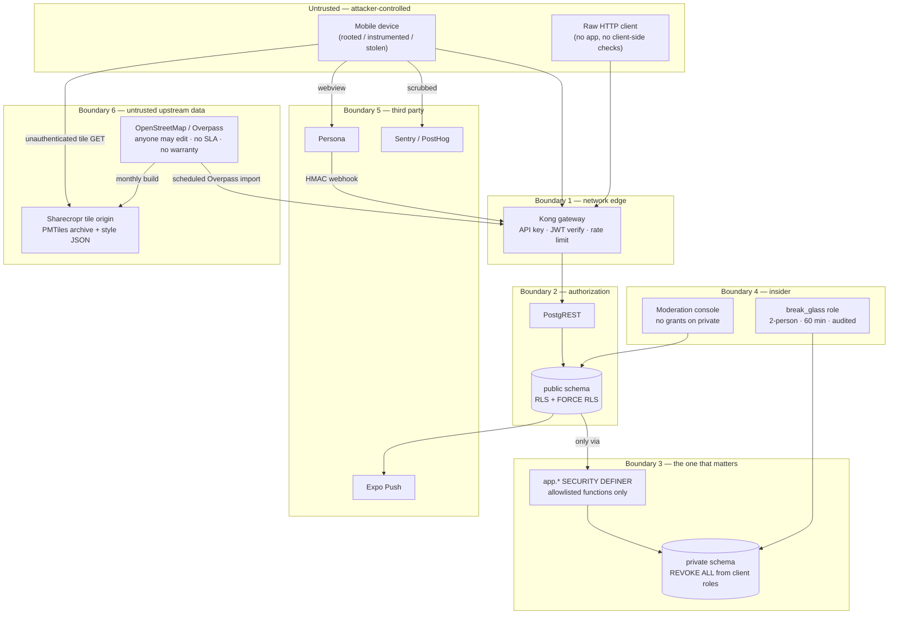

# Threat Model

**Status:** Review · **Version:** 1.1.0 · **Owner:** Security

> **Identifier change (2026-08-09):** threat IDs are now `THR-##`, renamed from `T-##` throughout this document and every citation of it. `T-26` (a threat) and `T30` (a SPEC-010 test) differed by one hyphen and were both cited across documents; a reader resolving one as the other would have followed a mitigation to a concurrency test. IDs are otherwise stable and the numbers are unchanged.

Sharecropr stores the home locations of its users and then introduces them to strangers in physical space. That combination is the reason this document exists and the reason it is longer than a threat model for an app of this size would normally be.

Threat IDs are `THR-##`, permanent and never reused. Other documents reference them, always with the prefix — see [Doc Conventions §3](../00-foundation/06-doc-conventions.md).

---

## 1. Scope and method

STRIDE for the system, plus attacker-narrative abuse cases for the things STRIDE handles badly — social engineering, physical harm, and the abuse of features working exactly as designed.

**In scope:** the mobile app, the Supabase backend, Edge Functions, the moderation console, the Persona integration, and the physical meeting the software arranges.

**Out of scope:** Apple's and Google's platform security, Supabase's own infrastructure compromise (accepted vendor risk, mitigated by PITR and the [escape hatch](../01-architecture/01-system-architecture.md#8-the-escape-hatch)), and nation-state adversaries.

**Something worth stating up front:** the highest-impact threats here are not exploits. They are ordinary users using the product exactly as designed, for a purpose we didn't intend. A stalker with a verified account and a valid ID is not attacking our software.

---

## 2. Assets

| Asset | Class | Why an attacker wants it | Blast radius if lost |
| --- | --- | --- | --- |
| `private.garden_locations.exact_point` | **P0** | Home address of a named, photographed person | Catastrophic. Physical danger to a specific individual; existential for the company. |
| `exchange_sessions.scheduled_start` + `safe_spot_id` | **P1** | A named person will be at a known place at a known time — and *not at home* | Severe. Enables both interception and burglary. The sleeper asset in this system. |
| `private.garden_locations` in bulk | **P0** | A saleable dataset of home addresses tied to identities | Catastrophic and unrecoverable |
| `gardens.h3_r9` | P1 | ~0.1 km² box around a home | High. Not a point, but small enough to walk. |
| Verification records + `private.verification_vendor_refs` | P1 | Confirms a real identity behind a display name | High. We hold pointers, not documents — deliberately. |
| `messages.body` | P1 | Conversation content; users volunteer addresses and phone numbers here | Moderate–high |
| Email, `profiles.timezone`, device tokens | P1 | Contact, correlation, targeting | Moderate |
| `profiles.trust_score` | P1 | Gaming the trust system; also a proxy for behaviour | Low–moderate |
| `safe_spots.point` | P3 | Public buildings — genuinely public data | None |
| Crop taxonomy | P3 | — | None |
| `service_role` key | **P0** | Bypasses all RLS | Catastrophic |
| Persona API key | P1 | Vendor cost abuse; forged verification | High |
| Moderator credentials | **P0-equivalent** | Legitimate-looking access to all P1 data | Severe |

> The single most under-appreciated row is the second one. Everyone protects the address; almost no one notices that "Maya will be at the Ann Arbor District Library at 4pm Thursday, and therefore not at home" is a burglary and interception primitive that the product generates by design.

---

## 3. Trust boundaries

**Boundary 3 is the one the whole design leans on.** Boundaries 1 and 2 are conventional and will eventually have a bug in them. Boundary 3 is enforced by a `REVOKE`, which has no logic to get wrong.

**Boundary 6 is new and is a different shape from the others.** It is not a place an attacker breaks in; it is a place *data* comes in. OpenStreetMap is world-editable, has no warranty, and now feeds two things we ship: the tiles a user looks at and the candidate rows a reviewer promotes into a place we tell a stranger to meet another stranger. The control on that boundary is not a `REVOKE` — it is a human, which makes it the weakest control in this document by construction (THR-47, THR-48).

---

## 4. Threat catalogue

### 4.1 Information disclosure — the primary category

| ID | Threat | Asset | Attacker | L | I | Mitigations | Residual |
| --- | --- | --- | --- | --- | --- | --- | --- |
| **THR-01** | Direct query of `private.garden_locations` via PostgREST | P0 | Any user | L | Catastrophic | `REVOKE ALL ON SCHEMA private`; schema excluded from PostgREST's exposed list; [LP-01](../01-architecture/04-location-privacy.md#11-verification--how-we-prove-this-holds) pgTAP on every migration | Very low |
| **THR-02** | **Averaging attack** — read a fuzzed point N times, average away the noise, recover the true location to within metres | P0 | Motivated individual | M | Catastrophic | Stable per-garden `fuzz_seed` makes the offset deterministic: 1,000 reads return byte-identical output. [LP-05](../01-architecture/04-location-privacy.md), [LP-06](../01-architecture/04-location-privacy.md) | Very low |
| **THR-03** | A new `SECURITY DEFINER` function accidentally returns a coordinate | P0 | Us, under deadline pressure | **M** | Catastrophic | Return types have no coordinate column; CI static check LP-03; definer-function allowlist; `CODEOWNERS` on `supabase/migrations/**` | **Low but real — this is the most likely way we leak** |
| **THR-04** | EXIF GPS in a crop or garden photo | P0 | Passive | H if unmitigated | Catastrophic | Server-side strip in `media-process`; `exif_stripped_at IS NULL` makes the asset unreadable through every RLS policy | Very low |
| **THR-05** | Coordinate reaches Sentry or PostHog in a breadcrumb or event property | P0 | Us | **M** | High | `beforeSend` scrubber; analytics capped at H3 r5; synthetic-event test | **Low — but this class of leak is how it usually happens in the wild** |
| **THR-06** | `gardens.h3_r9` selectable by its owner over PostgREST | P1 | Curious user; scraper with many accounts | M | Moderate | Column-level `REVOKE`; API contract sweep regex includes `h3_r[89]` | Low |
| **THR-07** | Coordinate in a notification payload or audit metadata | P0 | Us | L | High | `CHECK` constraints forbidding `lat`/`lng`/`point` keys on both `jsonb` columns | Very low |
| **THR-08** | **Timing / count side channel on `safe_spots_near`** — query repeatedly from varying origins while a target's listing is active, intersect the safe-spot sets | P1 | Determined individual | M | High | 200-row cap; 40 km radius cap; per-user rate limit; listings attach to up to 3 spots | **Moderate. Narrows a target to a few km², not eliminated.** |
| **THR-09** | Mass scraping of the listing/safe-spot graph to build a dataset | P1 | Commercial scraper | M | High | Per-user rate limits; verification required to see full listing detail; 200-row cap; anomaly alerting on request volume | Moderate |
| **THR-10** | Message content leaked via logs | P1 | Us | L | Moderate | Bodies never logged; scrubber drops `body`/`message`/`text` properties; [SPEC-011-T36](../03-specs/SPEC-011-messaging.md) | Low |
| **THR-11** | Insider (moderator/DBA) looks up a specific person | P0 | Employee | **M** | Severe | Console has zero grants on `private`; break-glass needs two people, is time-boxed to 60 min, notifies the security channel on activation, and every statement is audited | **Moderate — detection, not prevention. Stated plainly.** |
| **THR-12** | Enumeration of thread/listing IDs to confirm existence | P2 | Any user | M | Low | RLS returns empty sets rather than 403 — no existence oracle. [SPEC-011-T25/T26](../03-specs/SPEC-011-messaging.md) | Low |
| **THR-46** | **Basemap tile requests as a viewport side channel** — whoever serves tiles learns, continuously, which map area each user is looking at, at what zoom, when | P1 | A tile vendor; anyone who compromises the tile origin | L | Moderate | Tiles come from our own PMTiles archive on our own CDN, so **no third party is in that position** ([ADR-0020](../01-architecture/adr/ADR-0020-pmtiles-self-hosting.md)). Requests carry **no credential and no user or device identifier**, so they are not attributable to a user even by us — there is no viewport log to subpoena or leak ([API Contract §6a](../01-architecture/06-api-contract.md)). No coordinate beyond `z/x/y` and byte offsets, asserted on the wire (NFR-102, [SPEC-008-T79/T80](../03-specs/SPEC-008-interactive-map.md)) | Low — **and this entry should not be oversold.** See below |

> **THR-46 is a real threat that we should be honest is a secondary one.** [ADR-0019](../01-architecture/adr/ADR-0019-openstreetmap-maplibre.md) says so in its own steel-man and this document should not say otherwise: Apple and Google already know precisely where the user is, continuously, at the operating-system level. A tile request telling them the user is looking at a map of Ann Arbor discloses nothing they do not already hold. Treating that as the *justification* for owning the basemap confuses a purity preference with a threat model. What the self-hosted design genuinely buys is **consistency and the absence of a new asset**: no additional sub-processor with a stream of viewport coordinates, no DPA and disclosure to maintain around it, and no credential in the map path. The honest reason we own the basemap is optionality and the safe-spot pipeline; this row is a benefit, not the case.

### 4.2 Spoofing

| ID | Threat | Asset | L | I | Mitigations | Residual |
| --- | --- | --- | --- | --- | --- | --- |
| **THR-13** | Credential stuffing against email/password accounts | Account | H | High | Breach-list check at signup and change; per-account and per-IP rate limits; TOTP available; anomalous-login alerting | Moderate |
| **THR-14** | **SIM swap** to capture a second factor | Account | M | High | **No SMS 2FA exists.** TOTP only — [ADR-0014](../01-architecture/adr/ADR-0014-totp-not-sms.md) | Very low |
| **THR-15** | Stolen or borrowed government ID passed to Persona | Verification | M | High | Vendor liveness + document authenticity; 5-attempt cap; device and velocity signals; ban-evasion detection | **Moderate — KYC raises cost, it does not prove identity** |
| **THR-16** | Deepfaked liveness selfie | Verification | L→M rising | High | Vendor's problem contractually, ours reputationally; vendor selection criterion; re-verification at 24 months | Moderate and worsening over time |
| **THR-17** | Sockpuppet re-registration after a ban | Trust system | H | Moderate | Device signals, KYC document reuse detection at the vendor, `private.verification_vendor_refs` retained 7 years past deletion specifically for this | Moderate |
| **THR-18** | OAuth token theft / malicious app impersonation | Account | L | High | PKCE; Apple/Google native flows, no webview for OAuth; token in hardware-backed storage | Low |
| **THR-19** | Forged handoff code — "read it to me over the phone" | Exchange integrity | H | Low | **None, by design.** The code is a coordination device, not an anti-fraud control, and [SPEC-010](../03-specs/SPEC-010-exchange-lifecycle.md) says so explicitly | **Accepted** |
| **THR-20** | Stolen unlocked device | All the victim's data | M | High | Device biometric gate on app open (optional); AAL2 step-up on sensitive operations; revoke-all-sessions | Moderate |

### 4.3 Tampering

| ID | Threat | Asset | L | I | Mitigations | Residual |
| --- | --- | --- | --- | --- | --- | --- |
| **THR-21** | Client writes `display_point` / `h3_*` directly to fake a location | P0 integrity | M | High | `reject_client_location_write` trigger; derived columns are trigger-computed only | Very low |
| **THR-22** | Client submits a spoofed GPS coordinate at garden registration | P1 | M | Moderate | Distance check against photo capture cell; human review; App Attest / Play Integrity deferred to Phase 2 | **Moderate — a mock-location app defeats the automated check today** |
| **THR-23** | Replayed Persona webhook flips a `failed` to `passed` | Verification | L | High | HMAC signature, replay window, unique `webhook_idempotency_key` | Low |
| **THR-24** | Direct PostgREST manipulation bypassing all client-side validation | Everything | H (assumed) | Varies | **The client is assumed hostile.** Every constraint is a database CHECK or policy; state transitions have no UPDATE policy at all and go through definer RPCs only | Low |
| **THR-25** | Illegal exchange state transition via a crafted request | Exchange integrity | M | Moderate | No client UPDATE policy on `exchange_requests`/`exchange_sessions`; `guard_session_transition` trigger enforces the transition table at the storage layer | Very low |
| **THR-26** | Race to double-accept a listing | Exchange integrity | M | Moderate | `FOR UPDATE` lock ordering; in-lock state assertion; `listings_single_reservation` partial unique index **on `(reserved_request_id)`** — the `(id) WHERE status = 'reserved'` form SPEC-010 carried until 2026-08-09 constrains nothing, so for the whole first draft this row named a control that was two-thirds of what it claimed; [SPEC-010-T30](../03-specs/SPEC-010-exchange-lifecycle.md) at 50 concurrent acceptors | Very low |
| **THR-27b** | Read live handoff codes from a database dump, backup, PITR snapshot, or read replica | Exchange integrity | L | Moderate | Column encrypted at rest with a Vault key ([Exchange State Machine §3.3](../01-architecture/07-exchange-state-machine.md)); `SELECT` `REVOKE`d from `authenticated`; single audited decrypt path gated on `state = 'scheduled'`; SPEC-010-T73a sweeps a dump for plaintext. Does **not** defend against an attacker holding both `service_role` and the Vault key | Very low |
| **THR-47** | **Poisoned or vandalised OSM data reaches a live safe spot** — an attacker edits OpenStreetMap (anyone can) to create a plausible `amenity=library` at an address of their choosing, move an existing civic POI's centroid, or retag a private building as public, and our monthly import turns it into a candidate | **Physical safety** | Anyone with an OSM account | **M** — OSM vandalism is common and cheap; *targeted* vandalism aimed at us is not | **Catastrophic** | **A human must verify every candidate before it can be promoted** ([ADR-0021](../01-architecture/adr/ADR-0021-osm-safe-spot-sourcing.md), [SPEC-007-R45](../03-specs/SPEC-007-safe-spots.md)) — and promotion requires a *separately recorded* hours verification by phone, visit, or official website ([SPEC-007-R49](../03-specs/SPEC-007-safe-spots.md)), which is an action a fabricated venue cannot survive. Candidates live in `private` and are unreachable by any client role (R44). Unnamed elements, `access=private`/`no`, and unmapped tags are auto-rejected at import (R40–R42). Upstream edits to a *linked live spot* — name, address, `opening_hours`, geometry, deletion — raise a review flag and **never auto-apply** (R53–R55), so an OSM edit cannot move, close, or re-hour an existing spot | **Moderate. The control is a human, and humans working a queue rubber-stamp — see THR-49.** The R49 verification action is what makes it more than a click |
| **THR-48** | **Tile archive or style JSON substitution** — an attacker with write access to the R2 bucket, the CDN configuration, or the style file in the repo serves a doctored basemap: a fabricated street, a moved building label, or a style that points sprites and glyphs at a host they control | Map integrity; NFR-102 | Compromised cloud credential; a malicious or careless PR | L | **Moderate–High** | The style JSON is **versioned in the repo and reviewed like code**, and the client will not fetch a style, sprite sheet, or glyph range from a host we do not control ([SPEC-008-R74](../03-specs/SPEC-008-interactive-map.md)). Archives are **immutable and date-stamped**; the style names one explicitly, so a substitution is a diff rather than a silent overwrite. Bucket credentials are CI-scoped and rotated on the standard schedule ([Environments §6](../05-operations/01-environments.md)). NFR-102's wire-level sweep fails the build on any request to a non-allowlisted host. **Rollback is repointing the style at the previous archive** — instant, no app release ([Runbook 15](../05-operations/05-runbooks.md)) | Low. **But note what is not mitigated:** we do not sign or checksum the archive at the client, so an attacker holding both the bucket credential and repo write access could serve a bad basemap that looks correct. Markers are positioned from `safe_spots.point`, not from tile geometry, so a doctored basemap misleads a user's *context* and cannot move a meeting point |
| **THR-27a** | Brute-force a handoff code to fabricate a completion | Exchange integrity, ratings | M | Moderate | 5 attempts per session per rolling 15 min, both parties alerted on lockout, constant-time comparison ([SPEC-010 R49](../03-specs/SPEC-010-exchange-lifecycle.md), SPEC-010-T35, SPEC-010-T71). **The attempt counter must survive the failed attempt** — SPEC-010 R49a. In the first draft the counter, the lockout, and the alerts shared a transaction with the `RAISE` that aborted them, so this mitigation did not exist at runtime and the bound was unlimited attempts against 10⁶ codes with no notification | Low. The code is a coordination device, never an anti-fraud control ([SPEC-010 R52](../03-specs/SPEC-010-exchange-lifecycle.md)) |

### 4.4 Repudiation

| ID | Threat | L | I | Mitigations | Residual |
| --- | --- | --- | --- | --- | --- |
| **THR-27** | "I never agreed to that meeting" | M | Moderate | `exchange_sessions` state history; dual handoff confirmation; system messages in-thread; `audit.events` append-only | Low |
| **THR-28** | Moderator denies taking an action, or edits the record | L | High | `audit.events` has **no `UPDATE` or `DELETE` grant for any role**, including `service_role`; action and audit commit in one transaction ([SPEC-900-T20](../03-specs/SPEC-900-moderation-console.md)) | Very low |
| **THR-29** | User denies sending a harassing message | M | Moderate | Messages are immutable — no edit, no unsend, for exactly this reason ([SPEC-011-R12](../03-specs/SPEC-011-messaging.md)) | Low |

### 4.5 Denial of service and cost attacks

| ID | Threat | L | I | Mitigations | Residual |
| --- | --- | --- | --- | --- | --- |
| **THR-30** | **KYC inquiry spam** — every attempt costs real money | H | Moderate–High | Verification gated behind garden verification; 5-attempt cap; per-account and per-IP velocity limits; monthly spend alarm | **Moderate. There is no rate limit on *wanting* to verify; this is [R-07](../06-roadmap/02-open-risks.md).** |
| **THR-31** | Expensive-RPC abuse (`safe_spots_near` at max radius, in a loop) | M | Moderate | Server-side radius cap; 200-row cap; Postgres token buckets; Kong per-IP | Low |
| **THR-32** | Message flooding | M | Low | 30/thread/hour, 120/user/hour | Low |
| **THR-33** | Storage exhaustion via image upload | M | Moderate | 5 photos per item, size cap, per-user quota, moderation state gate | Low |
| **THR-34** | Report brigading to force an automated suspension | M | Moderate | **No automated enforcement exists.** Humans decide; brigade warning in the console | Low |
| **THR-35** | Lockout weaponization — deliberately failing a target's login to lock them out | M | Moderate | Lockout is progressive delay per IP+account pair, not a hard account lock; the legitimate user from a known device is not blocked | Low |

### 4.6 Elevation of privilege

| ID | Threat | L | I | Mitigations | Residual |
| --- | --- | --- | --- | --- | --- |
| **THR-36** | `service_role` key leaks into the app bundle or a log | L | Catastrophic | Never present in any client env var; secret scanning in CI; bundle grep in the release pipeline | Low |
| **THR-37** | Unpinned `search_path` on a `SECURITY DEFINER` function enables schema shadowing | L | Catastrophic | Every definer function pins `search_path`; CI static check | Low |
| **THR-38** | A view without `security_invoker = on` silently bypasses RLS | **M** | Severe | pgTAP assertion on **every** view in `public` — this is a well-known Postgres footgun that has caused real breaches | Low |
| **THR-39** | Moderator role self-granted or escalated | L | Severe | Role assignment is admin-only, audited, never self-service; JWT claim re-verified server-side rather than trusted | Low |
| **THR-40** | A definer RPC forgets to re-check authorization (definer functions bypass RLS) | **M** | Severe | Every definer function re-checks authorization as its first action; review checklist; second reviewer required on migrations | **Low but this is the sharpest edge in the architecture** |

### 4.7 Physical safety — outside STRIDE, above everything

| ID | Threat | L | I | Mitigations | Residual |
| --- | --- | --- | --- | --- | --- |
| **THR-41** | **Assault or robbery at a meeting** | L | **Catastrophic** | Safe spots are public, staffed or surveilled; ID verification; ratings; reports; `unsafe_meeting` pages on-call | **Real and irreducible. See [R-03](../06-roadmap/02-open-risks.md).** |
| **THR-42** | Luring a user away from a safe spot to a private location | M | Severe | `content-scan` flags address sharing; in-app safety notice; safe-spot-only product framing | **Moderate — flagging is detection, not prevention** |
| **THR-43** | Burglary during a scheduled exchange window | L | High | Exact home location never exposed; session times visible only to the two parties | Low, but the attacker only needs to complete one exchange with the target to learn their rough area |
| **THR-44** | Stalking via the exchange mechanic itself — request, meet, follow home | L | **Catastrophic** | ID verification raises the cost of doing this under a real name; ratings and reports; block teardown | **Irreducible. No software control prevents someone following a car.** |
| **THR-45** | Grooming or exploitation of a minor | L | Catastrophic | Over-18 requirement enforced through KYC before any transacting; under-13 prohibited outright | Low |
| **THR-49** | **Rubber-stamping the candidate queue** — a reviewer working through eighty auto-generated candidates approves an unsuitable venue: an unstaffed fire station, a campus centroid in the middle of a quad, a "library" that is a book drop, a building that closed | **Physical safety** | **Us**, at volume, under a deadline | **M** | **Catastrophic** | This is the failure mode the pipeline *creates* and [ADR-0021](../01-architecture/adr/ADR-0021-osm-safe-spot-sourcing.md) names it in its own steel-man: researching a neighbourhood and working a queue are different cognitive modes, and queues produce rubber stamps. Controls: promotion requires an explicitly recorded `safe_spot.hours_verified` audit event naming a `verification_method` and its source detail, which only a phone call, a visit, or an official website makes possible ([SPEC-007-R49](../03-specs/SPEC-007-safe-spots.md)); the console presents an **empty form** rather than a pre-filled one; a second approver is required (R16); the pin must be moved off the OSM centroid by hand (R12); and **approval rate is monitored per reviewer**, alerting above 90% ([Observability §5.2](../05-operations/04-observability.md)) | **Moderate, and honestly stated: we have moved work rather than removed it, and the new failure is quieter than the old one.** The old process forced attention; this one has to manufacture it. Deliberately not mitigated by an artificial delay — we do not rate-limit judgement, and someone would route around it |

---

## 5. Abuse cases

**AC-01 — The ex-partner.**
*"I know her display name and I've seen her profile photo. I make an account, verify with my real ID because I have nothing to hide, and start browsing safe spots near where I think she lives. I find her listing. I send a request. She accepts. I now know she'll be at the Westside library at 4pm on Thursday, and I know roughly which neighbourhood she gardens in."*
**Where the design stops him:** he never sees her home. Blocking removes him instantly and completely, at the database layer, and she is not required to tell him why. His real identity is attached to every action, which is exactly the deterrent ID verification is for.
**Where it doesn't:** he met her. He can follow her car. THR-44 is not solvable in software, and we should not pretend otherwise.

**AC-02 — The data broker.**
*"I'll register 200 accounts, sweep `safe_spots_near` across a grid of the metro, and build a dataset of who grows what, where."*
**Stopped by:** verification cost per account (200 × the KYC fee, and each needs a distinct real ID), per-user rate limits, the 200-row cap, and volume anomaly alerting. The economics don't work.
**Not stopped:** a patient single account gets a coarse picture of listing density. That's roughly what walking around would tell you.

**AC-03 — The burglar.**
*"I don't care about vegetables. I want to know when someone is definitely not home."*
**Stopped by:** he must complete a real exchange with each target, under a verified identity, to learn a single window. The ratio of effort to reward is terrible, and every attempt leaves an audited trail with his real name attached.
**Not stopped:** the information is genuinely there for anyone who completes an exchange. This is inherent to the product concept.

**AC-04 — The insider.**
*"I work here. I have console access. I want to look someone up."*
**Stopped by:** the console cannot fetch a coordinate — there is no grant and no code path. Break-glass needs a second person, expires in 60 minutes, and pages the security channel on activation.
**Not stopped:** a determined insider with production database credentials can read `private`. THR-11 is detection, not prevention, and reducing it further would require application-level encryption that breaks proximity queries entirely. Accepted, documented, revisit at scale.

**AC-05 — The banned user.**
*"Banned for harassment. I'll just make a new account."*
**Stopped by:** KYC document reuse detection at the vendor, and `private.verification_vendor_refs` retained for seven years past account deletion specifically so a returning document is recognisable.
**Not stopped:** a different real person's ID, or a household member's. THR-17 residual.

**AC-06 — The engineer under deadline pressure.**
*"I need listing owner distance for a sort. I'll just add `owner_h3_r9` to the response and filter it client-side. I'll clean it up after launch."*
**Stopped by:** the CI static check on forbidden columns, the definer-function allowlist, the `CODEOWNERS` requirement for a second reviewer on migrations, and the production canary [LP-10](../01-architecture/04-location-privacy.md).
**This is THR-03, and honestly it is the most likely breach in this document.** The attacker is us.

---

## 6. Mitigation traceability

| Threat | Primary control | Where specified | Proven by |
| --- | --- | --- | --- |
| THR-01, THR-02 | `private` schema + stable `fuzz_seed` | [Location Privacy §3–4](../01-architecture/04-location-privacy.md) | LP-01, LP-05, LP-06 |
| THR-03 | Definer allowlist + return-type discipline + CI static check | [Location Privacy §11](../01-architecture/04-location-privacy.md) | LP-02, LP-03 |
| THR-04 | Server-side EXIF strip, unreadable until processed | [SPEC-004](../03-specs/SPEC-004-garden-verification.md), [SPEC-006](../03-specs/SPEC-006-crop-inventory.md) | LP-09 |
| THR-05 | Telemetry scrubber | [Observability](../05-operations/04-observability.md) | LP-08 |
| THR-06 | Column-level `REVOKE` | [SPEC-004-R24](../03-specs/SPEC-004-garden-verification.md) | API contract sweep |
| THR-08, THR-09 | Rate limits, row caps, radius cap | [API Contract §6](../01-architecture/06-api-contract.md) | Load test |
| THR-11, THR-28 | Break-glass + append-only audit | [Location Privacy §10](../01-architecture/04-location-privacy.md), [SPEC-900](../03-specs/SPEC-900-moderation-console.md) | SPEC-900-T20, T23 |
| THR-14 | No SMS 2FA | [ADR-0014](../01-architecture/adr/ADR-0014-totp-not-sms.md) | — |
| THR-15, THR-17, THR-30 | KYC vendor + attempt caps + ref retention | [SPEC-003](../03-specs/SPEC-003-identity-verification.md) | SPEC-003 §13.2 |
| THR-21, THR-22 | Location write-rejection trigger + distance check | [Location Privacy §4.3](../01-architecture/04-location-privacy.md), [SPEC-004](../03-specs/SPEC-004-garden-verification.md) | SPEC-004 §13.2 |
| THR-24, THR-25, THR-26, THR-40 | RLS + definer RPCs + transition guard + lock ordering | [RLS Design](../01-architecture/05-rls-design.md), [State Machine](../01-architecture/07-exchange-state-machine.md) | [RLS Test Plan](../04-testing/02-rls-test-plan.md), SPEC-010-T30 |
| THR-38 | `security_invoker` assertion on every view | [RLS Design §4](../01-architecture/05-rls-design.md) | RLS Test Plan |
| THR-41, THR-42, THR-44 | Safe spots, verification, reports, on-call paging | [Trust & Safety](05-trust-and-safety.md), [SPEC-012](../03-specs/SPEC-012-trust-and-safety.md) | Manual / operational |
| THR-46 | Self-hosted tile origin; unauthenticated, unidentified tile requests | [ADR-0020](../01-architecture/adr/ADR-0020-pmtiles-self-hosting.md), [API Contract §6a](../01-architecture/06-api-contract.md) | NFR-102 · SPEC-008-T78, T79, T80 |
| THR-47 | Candidates land in `private`; human promotion gate; upstream diffs never auto-apply | [ADR-0021](../01-architecture/adr/ADR-0021-osm-safe-spot-sourcing.md), [SPEC-007 §5.7](../03-specs/SPEC-007-safe-spots.md) | SPEC-007-T54, T55, T61, T63, T71, T72 |
| THR-48 | In-repo reviewed style JSON; immutable dated archives; same-origin sprites and glyphs | [SPEC-008-R74](../03-specs/SPEC-008-interactive-map.md), [ADR-0020](../01-architecture/adr/ADR-0020-pmtiles-self-hosting.md) | NFR-102 · SPEC-008-T78 · [Runbook 15](../05-operations/05-runbooks.md) |
| THR-49 | Separately recorded hours verification; empty review form; second approver; approval-rate alerting | [SPEC-007-R49/R50](../03-specs/SPEC-007-safe-spots.md), [Observability §5.2](../05-operations/04-observability.md) | SPEC-007-T59, T74 · [Runbook 16](../05-operations/05-runbooks.md) |
| NFR-99 (attribution) | Rendered by `MapCanvas` itself, geometrically asserted | [SPEC-008 §5.10](../03-specs/SPEC-008-interactive-map.md), [ADR-0021 §Licence obligations](../01-architecture/adr/ADR-0021-osm-safe-spot-sourcing.md) | SPEC-008-T69, T70 · SPEC-007-T67 |

---

## 7. Residual risk

Ranked. Where a control is detection rather than prevention, it says so.

1. **THR-41 / THR-44 — physical harm is irreducible.** Safe spots, KYC, ratings, and reports lower the probability. They do not make it zero, and one incident is existential. This needs an incident-response playbook, liability insurance, and counsel sign-off *before* launch. [R-03](../06-roadmap/02-open-risks.md).
2. **THR-03 / THR-05 — we are the most likely source of a location leak.** Not an attacker. A new definer function, a Sentry breadcrumb, a growth CSV. The controls are process controls that hold only while discipline holds. The [LP-10 production canary](../01-architecture/04-location-privacy.md) is the one control that verifies what we actually deployed rather than what we intended. [R-05](../06-roadmap/02-open-risks.md), [R-08](../06-roadmap/02-open-risks.md).
3. **THR-11 — insider access is detected, not prevented.** Accepted for MVP scale.
4. **THR-08 — the side channel narrows a target to a few km².** Mitigated, not eliminated. Revisit if we ever render anything finer than a safe spot.
5. **THR-15 / THR-16 — KYC raises the cost of a fake identity; it does not prove a real one.** Deepfake quality is improving faster than detection. Treat verification as a deterrent and a traceability tool, not a guarantee.
6. **THR-22 — a mock-location app defeats the automated garden check today.** Human review is the backstop. App Attest / Play Integrity in Phase 2.
7. **THR-19 — the handoff code proves co-presence only if both parties are honest.** Stated in the spec; never describe it as fraud prevention.
8. **THR-30 — KYC cost is an unbounded liability against a signup funnel we don't control.** [R-07](../06-roadmap/02-open-risks.md).
9. **THR-42 — users will share addresses in chat.** `content-scan` measures the rate; it does not stop it. If the rate is high, the safe-spot policy is buying friction without safety and [ADR-0009](../01-architecture/adr/ADR-0009-safe-spots-only.md) must be revisited with data. [R-09](../06-roadmap/02-open-risks.md).
10. **THR-47 / THR-49 — a safety-critical judgement now arrives as a queue item.** OSM makes safe-spot discovery cheap, and cheap discovery produces volume, and volume produces rubber-stamping. The mitigations are good — an empty form, a separately recorded verification action, a second approver, an approval-rate alert — but every one of them is a **process** control on a human, which is the same category the [R-05](../06-roadmap/02-open-risks.md) discussion already says holds only while discipline holds. The difference here is that a lapse does not return data to the wrong person; it sends a real one to a place we said was safe. Treat any no-show or safety report traced to an approved-without-verification candidate as an **incident**, not a bug ([ADR-0021](../01-architecture/adr/ADR-0021-osm-safe-spot-sourcing.md) revisit trigger).
11. **THR-46 is listed for completeness, not because it ranks.** The viewport side channel is closed, and closing it was cheap. It was never the reason to own the basemap, and this document would be misleading if its ordering implied otherwise.

---

## 8. Review cadence

| Trigger | Action |
| --- | --- |
| Scheduled | Full review every 6 months |
| Any change to `private`, a definer function, or an RLS policy | Targeted review in the same PR |
| Any new external integration | New trust-boundary analysis before merge |
| Any change to the tile origin, the style JSON's remote references, or the OSM import's tag mapping or promotion gate | Targeted review in the same PR — boundary 6 controls are all that stand between world-editable data and a physical meeting |
| Any real-world safety incident | Immediate out-of-band review, regardless of the schedule |
| Before public launch | **External RLS-focused security review, findings closed** — a release gate in [PRD §7](../00-foundation/02-prd.md) |
| A new feature touching location, identity, messaging, or moderation | Security sign-off before the spec reaches `Approved` |

---

## Change Log

| Date | Version | Author | Change |
| --- | --- | --- | --- |
| 2026-08-08 | 1.0.0 | Security | Initial threat model |
| 2026-08-09 | 1.1.0 | Security | Workflow-architect review fixes ([review](../07-review/01-workflow-architect-review.md)). Threat IDs renamed `T-##` → `THR-##` to end the collision with SPEC test IDs. THR-26's mitigation corrected — the index form SPEC-010 carried was a no-op. THR-27a added for handoff-code brute force, whose stated mitigation was rolled back by its own exception and therefore did not exist |
| 2026-08-09 | 1.2.0 | Security | THR-27b added: handoff codes readable from a dump, backup, or replica — now mitigated by at-rest encryption. Stale "Threat IDs are T-##" line corrected |
| 2026-08-09 | 1.3.0 | Security | OpenStreetMap adoption ([ADR-0019](../01-architecture/adr/ADR-0019-openstreetmap-maplibre.md), [ADR-0020](../01-architecture/adr/ADR-0020-pmtiles-self-hosting.md), [ADR-0021](../01-architecture/adr/ADR-0021-osm-safe-spot-sourcing.md)). Boundary 6 added for untrusted upstream data. THR-46 tile viewport side channel — closed by self-hosting, and explicitly recorded as a *secondary* concern rather than the justification. THR-47 poisoned or vandalised OSM POI data reaching a safe spot. THR-48 tile archive / style JSON substitution. THR-49 rubber-stamping the candidate queue — the failure mode the pipeline itself creates. Traceability and residual risk updated |
