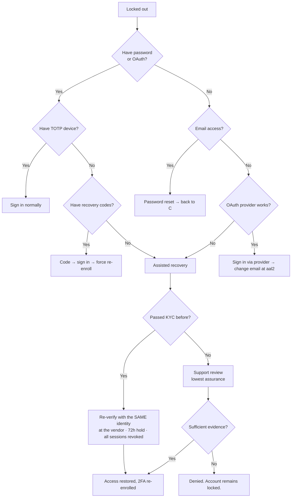

# Authentication & Two-Factor Authentication

**Status:** Approved · **Version:** 1.0.0 · **Owner:** Security

This document describes the session and identity model. Mechanics live in [SPEC-001](../03-specs/SPEC-001-authentication.md) and [SPEC-002](../03-specs/SPEC-002-two-factor-auth.md); this is the model and the policy above them.

---

## 1. Session model

Supabase GoTrue issues a short-lived access JWT and a long-lived rotating refresh token.

| Token | Lifetime | Storage | Notes |
| --- | --- | --- | --- |
| Access JWT | 60 minutes | In memory | Sent as `Authorization: Bearer`. Carries the claims RLS reads. |
| Refresh token | 30 days, rotating | `expo-secure-store` (Keychain / Android Keystore) | Single-use. Rotated on every refresh. |
| Session record | 30 days idle, 90 days absolute | Server | Revocable per device |

### 1.1 JWT claims

```jsonc
{
  "sub": "8f14e45f-…",          // profiles.id
  "role": "authenticated",       // Postgres role PostgREST assumes
  "aal": "aal2",                 // aal1 = password/OAuth only, aal2 = TOTP verified
  "app_metadata": { "role": "moderator" },   // absent for ordinary users
  "exp": 1786312800
}
```

Two claims do real work:

- **`role`** determines which Postgres role PostgREST assumes, and therefore which RLS policies apply.
- **`app_metadata.role`** is read by `app.is_moderator()` without a table lookup, so moderator checks cost nothing per row. The cost is a **revocation lag of up to 60 minutes** — the access token's lifetime. Mitigated by also checking `profiles.is_suspended` on sensitive writes, and by an admin force-revoke that invalidates sessions immediately.

`app_metadata` is server-controlled and not writable by the user. `user_metadata` is user-controlled and is **never** read by any policy. Confusing the two is a documented Supabase footgun and a privilege-escalation vector; the RLS review checklist asks about it explicitly.

### 1.2 Refresh-token reuse detection

Refresh tokens are single-use. If a token is presented twice, GoTrue treats it as evidence of theft: the whole session family is revoked and the user is signed out of that device. This produces occasional false positives on flaky networks — a request that succeeded server-side but whose response was lost causes a legitimate retry with a spent token. We accept the false-positive rate; the alternative is not detecting theft at all.

Client mitigation: refreshes are serialized through a single in-flight promise so the app never issues two concurrent refreshes with the same token.

---

## 2. Token storage on device

`expo-secure-store` caps individual items at roughly 2 KB, and a Supabase session JSON with a full JWT exceeds it. The adapter chunks:

```ts
// src/api/secureStorage.ts — the only place tokens touch disk
const CHUNK = 1800;

export const chunkedSecureStore = {
  async setItem(key: string, value: string) {
    const parts = Math.ceil(value.length / CHUNK);
    await SecureStore.setItemAsync(`${key}__n`, String(parts));
    for (let i = 0; i < parts; i++) {
      await SecureStore.setItemAsync(`${key}__${i}`, value.slice(i * CHUNK, (i + 1) * CHUNK));
    }
  },
  async getItem(key: string) {
    const n = Number(await SecureStore.getItemAsync(`${key}__n`) ?? 0);
    if (!n) return null;
    const parts = await Promise.all(
      Array.from({ length: n }, (_, i) => SecureStore.getItemAsync(`${key}__${i}`)),
    );
    return parts.some(p => p == null) ? null : parts.join('');   // partial write → treat as absent
  },
  async removeItem(key: string) { /* remove all chunks, then the count */ },
};
```

Two details matter. A partial read returns `null` rather than a truncated string, so an interrupted write degrades to "signed out" rather than "corrupt session". And removal deletes chunks before the count, so a crash mid-removal leaves an unreadable session rather than a readable orphan.

### What is never stored on device

- The `service_role` key. It does not exist in any client environment variable, `app.config.ts` value, or EAS build profile. CI greps the built bundle for it.
- The TOTP shared secret after enrollment completes.
- Recovery codes.
- Any garden coordinate, including the user's own — it is fetched on demand and held in memory only.
- Handoff codes at rest.

### Session lifecycle

`AppState`-driven: `supabase.auth.startAutoRefresh()` on foreground, `stopAutoRefresh()` on background. Refreshing in the background wastes battery and, worse, can rotate a token while the app is suspended and lose the rotation result.

---

## 3. OAuth providers

| Provider | Status | Notes |
| --- | --- | --- |
| Apple | **MVP, mandatory** | Guideline 4.8 requires it wherever other third-party logins are offered |
| Google | MVP | Native flow, not a webview |
| Facebook | Phase 2 | Deferred — [ADR-0006](../01-architecture/adr/ADR-0006-auth-providers.md) |
| X | Phase 2 | Deferred |

All OAuth uses PKCE and the platform-native flow. **No provider is authenticated through an in-app webview** — a webview OAuth flow trains users to type credentials into a surface any app can fake, and both platforms now discourage it.

### 3.1 The Apple private-relay problem

Users may hide their email, in which case Apple issues a per-app relay address (`x7k2p@privaterelay.appleid.com`). Consequences we have to live with:

- **The relay address is scoped to our Apple team ID.** If the app is ever transferred, or a user deletes and re-adds Sign in with Apple, the identifier can change and the account link breaks.
- **Account recovery by email is unreliable.** If the user forgets they used Apple and tries a password reset with their real address, no account exists. The sign-in screen therefore says *"Already have an account? You may have signed up with Apple or Google"* rather than a bare "no account found".
- **Deliverability is Apple's.** Our sending domain must be registered with Apple or relay mail is dropped silently. This is a launch-blocking configuration item, easy to miss, and it fails quietly.

### 3.2 Account linking and the merge hazard

The same human can arrive as `maya@gmail.com` via password and via Google, and Apple private relay makes a third identity. Policy:

- **Automatic linking on verified email match only.** If the OAuth provider asserts a verified email that matches an existing verified account, the identity links to it.
- **Never link on an unverified email.** That is account takeover by signup.
- **Never merge two accounts that both have exchange history.** We do not have a defensible merge semantic for ratings, trust score, or completed exchanges, and a bad merge is unrecoverable. The user is told they have two accounts and asked to choose one to keep; the other is deleted through the normal pipeline.
- Unlinking the last remaining identity is refused. There must always be at least one way in.

---

## 4. Password policy

Length-first, deliberately unfashionable in what it omits.

| Rule | Value | Rationale |
| --- | --- | --- |
| Minimum length | 12 characters | Length dominates every other factor |
| Maximum length | 128 | Prevents a DoS via bcrypt on a 10 MB input |
| Composition rules | **None** | Character-class requirements produce `Password1!` and nothing else |
| Breach check | Required, at signup and at change | k-anonymity range query against a breach corpus; the full password never leaves the device |
| Mandatory rotation | **None** | Forced rotation produces `Summer2026!` → `Summer2027!`. NIST dropped it; so do we. |
| Rotation on compromise | Forced | The only rotation that means anything |
| Reuse of last 5 | Blocked | Cheap to enforce, blocks the laziest rotation |

Passwords are hashed by GoTrue with bcrypt. We never see plaintext, never log a password field, and the telemetry scrubber drops any property named `password`, `passwd`, or `secret` regardless of nesting.

---

## 5. Two-factor authentication

TOTP (RFC 6238) only. **No SMS.** SIM-swap is a well-understood, cheap attack, and this app gates decisions about meeting strangers in person — a factor that a phone-store employee can reassign is not a second factor. [ADR-0014](../01-architecture/adr/ADR-0014-totp-not-sms.md).

| Parameter | Value |
| --- | --- |
| Algorithm | SHA-1 (universal authenticator support) |
| Digits | 6 |
| Period | 30 s |
| Clock skew tolerance | ±1 period |
| Recovery codes | 10, single-use, 10 characters, shown exactly once |
| Enrollment confirmation | One valid code required before the factor activates |

### 5.1 The AAL model

`aal1` — authenticated by password or OAuth. `aal2` — additionally proved possession of the TOTP factor in this session.

A user without 2FA enrolled is permanently `aal1` and simply cannot perform `aal2` operations; the UI routes them into enrollment rather than showing a dead end.

### 5.2 Step-up matrix

| Operation | Requires | Why |
| --- | --- | --- |
| Browse map, view listings | aal1 | — |
| Create/edit inventory | aal1 | Low consequence, reversible |
| Send / accept an exchange request | aal1 | High friction here kills the product; verification already gates it |
| Send messages | aal1 | — |
| **Change email address** | **aal2** | Classic account-takeover pivot |
| **Change password** | **aal2** | Same |
| **Disable 2FA** | **aal2** | Otherwise 2FA protects nothing |
| **Regenerate recovery codes** | **aal2** | Equivalent to disabling 2FA |
| **View security settings / active sessions** | **aal2** | Reconnaissance surface for an attacker holding a stolen session |
| **Change garden location** | **aal2** | Moving the garden moves the derived location; an attacker doing this is either hiding a target or planting a false one |
| **Request account deletion** | **aal2** | Destructive and, after the grace period, irreversible |
| **Moderator console login** | **aal2 always** | Non-negotiable — [SPEC-900-R02](../03-specs/SPEC-900-moderation-console.md) |
| **Approve a permanent ban or law-enforcement referral** | **aal2, re-prompted** | Fresh proof, not a session-old one |

Step-up prompts are valid for 15 minutes within a session. Longer is convenient; shorter is unusable.

### 5.3 Recovery codes

Ten codes, shown once at enrollment, each usable once. Displayed with copy and share-sheet options and a mandatory "I've saved these" confirmation that is not a checkbox the user can reflexively tick — it requires re-entering one of the codes.

Using the eighth code triggers a warning; using the tenth forces regeneration. Storage is a bcrypt hash per code, so a database compromise does not yield usable codes.

---

## 6. Lockout and rate limiting

| Surface | Limit | Response |
| --- | --- | --- |
| Password sign-in | 5 failures per (IP, account) in 15 min | Progressive delay: 1 s, 2 s, 4 s, 8 s, 16 s |
| Password sign-in, per IP | 30 failures in 15 min | Hard block on that IP for 1 hour |
| TOTP verification | 5 failures in 15 min | Factor locked 15 min; user notified by email |
| Recovery-code use | 3 failures in 1 hour | Locked 1 hour; user notified |
| Password reset request | 3 per account per hour | Silently rate limited — the response is identical either way |
| Email change request | 3 per account per day | — |
| Signup per IP | 10 per hour | Blunts sockpuppet farming (THR-17) |

> **Lockout must not become a weapon.** A hard per-account lock lets anyone lock a target out by failing their login repeatedly — a denial of service against a specific person, which for this app could mean preventing someone from cancelling a meeting. So: the delay is scoped to the **(IP, account) pair**, and a request from a device with a valid, previously-seen refresh token is not subject to it. The legitimate user on their own phone is never locked out by a stranger's attempts. This is THR-35.

Enumeration is avoided throughout: sign-in failure, password reset, and email change all return an identical response and take a similar amount of time whether or not the account exists.

---

## 7. Account recovery

Recovery is the hardest part of any auth system, because **a recovery path is an attack path**. Every route below trades identity assurance against user abandonment, and we should be honest that the last one is a judgement call by a human who can be fooled.



| Path | Assurance | Abuse risk | Controls |
| --- | --- | --- | --- |
| Recovery code | High | Low — codes are single-use and hashed | Forces 2FA re-enrollment |
| Email reset | Medium | Depends entirely on the email account's own security | Reset link 1 h, single-use, all sessions revoked |
| OAuth provider | Medium–high | Provider account compromise | Cannot change email without aal2 |
| **KYC re-verification** | **Highest** | Low. The attacker must pass liveness as the account's registered identity. | **72-hour hold**, notification to the old email, all sessions revoked, garden location frozen for 7 days |
| Support review | **Lowest** | **High. Social engineering.** | Two-person approval, 7-day hold, full audit, permanently flagged on the account, and moderators are trained that urgency is the primary manipulation tactic |

Two deliberate choices:

- **The 72-hour hold on KYC recovery** is friction we accept. Instant recovery via re-verification would make the KYC flow itself an account-takeover path for anyone who can obtain the target's ID.
- **Support review can end in denial.** Some accounts are unrecoverable, and saying so is more honest than a process that always eventually says yes to whoever is most persistent.

Recovery for **moderator** accounts never uses the support path. It requires an admin plus an in-person or video identity check.

---

## 8. What the user can see

Under Settings → Security, at `aal2`:

- Active sessions: device name, platform, approximate city (from IP, never from garden data), last active, current-session marker.
- **Sign out everywhere**, effective within 60 seconds via server-side session revocation rather than waiting for JWT expiry.
- Security event log for 90 days: sign-ins with new devices, password changes, email changes, 2FA enrollment and removal, recovery-code use, recovery attempts.
- 2FA status and recovery-codes-remaining count.

Email notifications, always, regardless of preferences: new-device sign-in, password change, email change (to **both** addresses), 2FA enabled or disabled, recovery code used, recovery initiated. These are security notices, not marketing, and are not suppressible.

---

## 9. Threat mapping

| Threat | Control here |
| --- | --- |
| [THR-13](01-threat-model.md) credential stuffing | Breach-list check, progressive delay, TOTP, new-device alerting |
| [THR-14](01-threat-model.md) SIM swap | No SMS factor exists |
| [THR-18](01-threat-model.md) OAuth token theft | PKCE, native flows, hardware-backed storage |
| [THR-20](01-threat-model.md) stolen unlocked device | Step-up matrix, sign-out-everywhere, optional biometric app gate |
| [THR-35](01-threat-model.md) lockout weaponization | Pair-scoped delay, known-device exemption |
| [THR-36](01-threat-model.md) `service_role` leak | Never in client config; bundle grep in CI |
| [THR-39](01-threat-model.md) moderator escalation | `app_metadata` server-controlled; role assignment admin-only and audited |

---

## 10. Open questions

| # | Question | Owner | Needed by |
| --- | --- | --- | --- |
| Q1 | Should 2FA be **mandatory** to transact rather than optional? [ADR-0014](../01-architecture/adr/ADR-0014-totp-not-sms.md) implies mandatory; [PRD C2](../00-foundation/02-prd.md) says optional. Three documents currently support two readings and `app.can_transact()` implements neither. **Must be resolved before SPEC-002 is built.** | Security + Product | Before implementation |
| Q2 | Is 60 minutes an acceptable moderator-revocation lag, or do we need a per-request role check for console traffic specifically? | Security | Before console launch |
| Q3 | Do we offer passkeys in Phase 2? They solve most of §7 and are the direction of travel, but add a third recovery topology. | Security | Phase 2 planning |

---

## Change Log

| Date | Version | Author | Change |
| --- | --- | --- | --- |
| 2026-08-08 | 1.0.0 | Security | Initial auth model |
