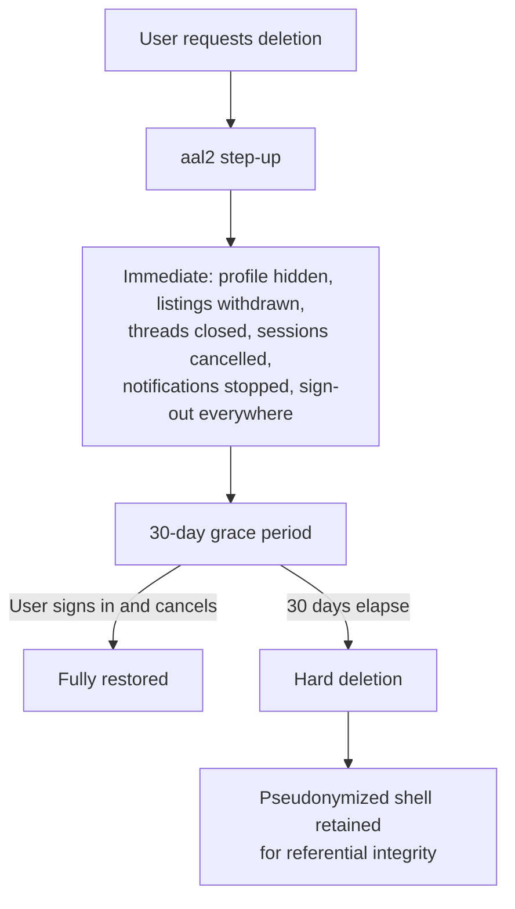

# Privacy & Data Retention

**Status:** Approved · **Version:** 1.1.1 · **Owner:** Security + Legal

The operational privacy policy: what we hold, why we're allowed to hold it, how long, and how it goes away. The architectural enforcement is in [Location Privacy](../01-architecture/04-location-privacy.md); this is the governance layer.

---

## 1. Principles

1. **Don't collect it.** The cheapest way to protect data is to not have it. This is why we hold a pass/fail instead of an ID image, an over-18 boolean instead of a birth date, and a coarse-tier cell instead of a coordinate wherever a cell will do.
2. **Privacy by architecture, not by policy.** A `REVOKE` is a guarantee; a promise in a privacy policy is a hope. Every control below should have a structural counterpart in the schema.
3. **Deletion is real deletion.** Not a flag. Not "removed from search." Gone, with a documented exception list.
4. **The user can see what we have.** An export they can actually read, not a JSON dump.
5. **Retention is a maximum, not a target.** If something can go sooner, it does.

---

## 2. Data inventory

Classification per [Data Model §1](../01-architecture/03-data-model.md). "Basis" is GDPR Article 6 lawful basis, which we apply globally rather than only to EU users because maintaining two regimes produces bugs.

### P0 — Critical

| Data | Where | Purpose | Basis | Retention | Deletion |
| --- | --- | --- | --- | --- | --- |
| `exact_point` | `private.garden_locations` | Compute the fuzzed display point and proximity matching | Contract | Life of garden | Cascade on garden delete; hard-deleted at account deletion + 30 d |
| `fuzz_seed` | `private.garden_locations` | Deterministic fuzzing | Contract | Same | Same |
| ID document images, DOB, biometrics | **Vendor only. Never ours.** | Verification | Contract | Vendor policy, disclosed at capture | Vendor deletion request |

### P1 — Sensitive

| Data | Where | Purpose | Basis | Retention | Deletion |
| --- | --- | --- | --- | --- | --- |
| Email | `auth.users` | Auth, security notices | Contract | Life of account | Hard delete at +30 d |
| `verifications` row | `public` | Gate transacting | Contract | 24 months, then re-verify | Hard delete at +30 d |
| `verification_vendor_refs` | `private` | **Fraud and ban-evasion defence** | Legitimate interest | **7 years, pseudonymized** | Retained past account deletion — disclosed |
| `gardens.fine_cell` | `public` (column-revoked) | Internal proximity bucketing | Contract | Life of garden | Cascade |
| `scheduled_start` + `safe_spot_id` | `exchange_sessions` | Coordinate the meeting | Contract | **Anonymized 90 d after completion** | Participants and times nulled; aggregates kept |
| `messages.body` | `public` | Coordinate the exchange | Contract | 90 d after thread close | Hard delete; exempt if under an open report |
| Device push tokens | `devices` | Notifications | Contract | Until rotated or 90 d idle | Hard delete |
| IP addresses | Logs | Abuse prevention | Legitimate interest | **30 days** | Automatic log expiry |
| `trust_score`, `cancellation_count_90d` | `profiles` (column-revoked) | Trust system | Legitimate interest | Life of account | Hard delete |
| Moderator rationales | `reports` | Enforcement record and appeals | Legitimate interest | 3 years from resolution | Hard delete |

### P2 — Personal

| Data | Purpose | Retention |
| --- | --- | --- |
| `display_name`, `handle`, `avatar_path`, `bio` | Identity to counterparties | Life of account; `handle` tombstoned 12 months after deletion to prevent impersonation |
| `city_label`, `display_point` (fuzzed) | Coarse location context | Life of garden |
| Ratings and tags | Trust signal | Retained after account deletion, **de-linked from the rater** |
| Inventory and listings | Product function | Life of account; listings auto-expire ≤ 21 d |

### P3 — Non-personal

Crop taxonomy, safe spots, aggregate counts, region-tier analytics. Retained indefinitely; nothing to protect.

---

## 3. Retention schedule

Authoritative. Supersedes any looser statement elsewhere.

| Data | Retention | Mechanism |
| --- | --- | --- |
| Garden exact location | Life of garden; +30 d after account deletion | Cascade + deletion pipeline |
| Verification status | 24 months from `verified_at` | `pg_cron` expiry |
| Vendor references | 7 years, pseudonymized | Explicit exception, disclosed |
| Garden verification photos | 90 days after decision | Storage lifecycle rule |
| Crop and inventory photos | Life of the item; +30 d after deletion | Storage lifecycle |
| Messages | 90 days after thread close | `pg_cron` purge |
| Exchange sessions | Anonymized 90 days after completion | `pg_cron` |
| Reports and evidence | 3 years from resolution | `pg_cron` |
| Appeals | 3 years | `pg_cron` |
| `audit.events` | **7 years, immutable** | No `UPDATE`/`DELETE` grant exists |
| Application logs | 30 days | Platform retention |
| IP addresses in logs | 30 days | Platform retention |
| Analytics events | 25 months, region tier (16 km) maximum resolution | PostHog retention setting |
| Crash reports | 90 days | Sentry retention |
| Deleted accounts | 30-day grace, then hard delete of P0/P1 | Deletion pipeline |
| Backups | 35 days (PITR window) | Deletion propagates as backups age out — disclosed |

> **Backups are the honest asterisk on "deletion is real deletion."** A deleted row persists in point-in-time-recovery backups until they age out at 35 days. We disclose this rather than claiming instantaneous erasure. Restoring a backup requires re-running the deletion pipeline against it, which is a documented step in the [restore runbook](../05-operations/05-runbooks.md).

---

## 4. Account deletion

Available in-app (Apple Guideline 5.1.1(v)) and at `https://sharecropr.app/delete-account` (Google Play requirement). Requires `aal2`.

### 4.1 Immediately on request

Profile hidden from everyone; listings withdrawn; in-flight sessions cancelled with a neutral reason and the counterparty notified; threads closed; notifications stopped; all sessions revoked. The account is functionally gone from other users' experience on day zero, which is what the user actually wants.

### 4.2 Hard-deleted at day 30

Email and auth record; password hash; `verifications` row; **`private.garden_locations` including `fuzz_seed`**; gardens and inventory; media assets and storage objects; message bodies sent by the user; device tokens; notification history; security event log; `trust_score` and behavioural counters.

### 4.3 Retained, with the reason

| Retained | Why | Form |
| --- | --- | --- |
| Pseudonymized `profiles` shell | Referential integrity — otherwise the counterparty's exchange history breaks | `id`, `deleted_at`, `handle_tombstone`. Display name becomes "Former member". |
| Ratings **given** by the user | The recipient's rating average must not silently change | De-linked from the rater |
| `audit.events` | Legal and integrity obligation; the table is immutable by construction | Actor id retained |
| `private.verification_vendor_refs` | Ban-evasion defence ([THR-17](01-threat-model.md)) | Pseudonymized, 7 years |
| Reports **about** the user | Safety record; deleting your account should not erase a harassment history | 3 years |
| Aggregate counts | Non-personal | region tier (16 km) or coarser |

Every one of these is stated in the privacy policy in plain language. "We delete everything" would be a lie, and users notice lies of that shape.

### 4.4 Counterparty messages

The deleted user's message bodies are replaced with `[deleted]` and the sender renders as "Former member". The counterparty's own messages are untouched — a person's record of their own conversation is theirs, and destroying it to satisfy someone else's deletion request creates a griefing vector.

---

## 5. Data subject requests

> ⚠ **This is a policy, not a workflow.** A DSAR carries a statutory clock, and what exists here is a position rather than a procedure: no runbook, no response template, no defined owner, no measured window. It is currently a manual Ops path that nobody has walked. Write it before launch, not on receipt of the first request ([Development Notes N-11](../07-review/02-development-notes.md#n-11--four-workflows-touching-safety-or-regulation-have-no-spec)).

| Request | SLA | Method |
| --- | --- | --- |
| Access / export | 30 days, usually < 24 h | In-app: generates a ZIP with a readable HTML summary plus machine-readable JSON |
| Rectification | 30 days | Mostly self-service in the app |
| Erasure | 30 days | Self-service deletion (§4) |
| Portability | 30 days | Same export |
| Restriction | 30 days | Manual — account frozen rather than deleted |
| Objection | 30 days | Manual review |

The export contains everything in §2 that pertains to the requester, **except** other people's message bodies (theirs, not the requester's) and moderator rationales about them (which would identify the reporter and turn a DSAR into a retaliation tool). Both exceptions are documented in the response.

**The export never contains an exact coordinate for anyone else's garden, and includes the requester's own only under an `aal2` step-up** — a DSAR export is otherwise a very convenient way for someone with a stolen session to obtain a location.

Identity for a DSAR is established by an authenticated in-app session. Email-only DSARs are refused with an explanation, because honouring an email-only request is a documented social-engineering path to someone else's data.

---

## 6. Regulatory posture

| Regime | Position |
| --- | --- |
| **GDPR** | Applied globally. Controller for user data; Persona, Supabase, Expo, Cloudflare, Sentry, and PostHog are sub-processors under DPAs. **OpenStreetMap and Overpass are not sub-processors** — no user data reaches them (§7.1). Lawful bases in §2. No cross-border transfer of P0 data — it never leaves the primary region. |
| **CCPA / CPRA** | We do not sell or share personal information as defined, and there is no advertising model. "Do Not Sell" is presented anyway, and it is honest that there is nothing to opt out of. |
| **COPPA** | Under-13 prohibited outright. Over-18 required to transact, enforced through KYC. We do not knowingly collect children's data; a report of a minor account is severity-1 and results in immediate suspension pending review. |
| **State biometric laws (BIPA and similar)** | We collect and store **no** biometric data. The vendor does, under its own consent flow presented before capture. Structural avoidance rather than compliance. |
| **Breach notification** | 72 h to the supervisory authority, without undue delay to affected users. §8. |

---

## 7. Sub-processors

| Sub-processor | Purpose | Data | Region |
| --- | --- | --- | --- |
| Supabase | Database, auth, storage, realtime, functions | All | US |
| Persona | Identity verification | Identity documents (theirs), pass/fail (ours) | US |
| Expo | Push delivery | Device tokens, notification titles and bodies | US |
| Apple / Google | APNs / FCM transport | Same | Global |
| Sentry | Crash and performance | Scrubbed diagnostics; no PII, no coordinates | US |
| PostHog | Product analytics | Pseudonymous ids, region tier max | US |
| Cloudflare R2 | Media storage | EXIF-stripped images | US |
| **Cloudflare R2 + CDN** | **Basemap tile serving** | Tile requests: a `z/x/y` address, a byte range, and an IP. **No user identifier, no device identifier, no session token, no credential of any kind** — a tile request is not attributable to a user, including by us ([API Contract §6a](../01-architecture/06-api-contract.md)) | US / global edge |

The register is published, and material changes are notified 30 days in advance with a right to object.

### 7.1 Two clarifications about the map, because the obvious assumption is wrong

**No map vendor receives your viewport.** Until 2026-08-09 the basemap was Apple Maps on iOS and Google Maps on Android, which meant every pan and zoom sent a viewport to a large ad-adjacent company — invisibly, because it arrived bundled with the operating system rather than as a vendor we chose. [ADR-0019](../01-architecture/adr/ADR-0019-openstreetmap-maplibre.md) removed that. **Apple and Google no longer appear in this register in a mapping capacity at all**; their only remaining role is APNs/FCM transport, as listed above.

What replaced them is Cloudflare, which we already needed for media storage. It is a CDN and object store, not a map vendor with a view of user behaviour. It sees tile requests — necessarily, since it serves them — and those requests carry nothing that identifies who made them. There is consequently no viewport log for us to retain, disclose, or be compelled to produce, which is a stronger statement than a retention policy.

We should be honest about the size of this win rather than overstate it: **the operating system already knows precisely where the user is**, continuously, and a tile request revealing that someone is looking at a map of Ann Arbor tells Apple or Google nothing they do not hold ([THR-46](01-threat-model.md)). The real gain is that there is no *additional* processor in that position, no DPA to maintain around one, and nothing to disclose here.

**Overpass and OpenStreetMap receive no user data whatsoever.** They are not sub-processors and do not belong in the table above. OSM is an upstream *source*: Geofabrik extracts feed a monthly tile build, and the Overpass API is queried **only** by a scheduled server-side Edge Function importing civic POIs for human review ([ADR-0021](../01-architecture/adr/ADR-0021-osm-safe-spot-sourcing.md)). No client, no console action, no CI job and no user-triggered path can reach Overpass — asserted from the deployed egress policy, not from source ([SPEC-007-R60](../03-specs/SPEC-007-safe-spots.md), SPEC-007-T75). Data flows from OSM to us and never the other way.

The one thing that would change this is contributing corrections back upstream — publishing which venues we phone-verified would disclose our operating footprint. It is out of MVP scope and is a Product-plus-Legal decision, not an engineering one.

---

## 8. Breach response

| Phase | Timeline | Actions |
| --- | --- | --- |
| Detect | — | Alerting, canaries ([LP-10](../01-architecture/04-location-privacy.md)), vendor notice, or external report |
| Contain | < 1 h | Revoke credentials, disable the affected path, snapshot evidence |
| Assess | < 24 h | Which data classes, how many subjects, is P0 involved |
| Notify authority | **< 72 h** | If a risk to rights and freedoms exists |
| Notify users | Without undue delay | If high risk. **Any P0 exposure is automatically high risk and users are told individually.** |
| Remediate | — | Fix, verify, add the regression test |
| Post-mortem | < 14 days | Blameless; published internally; controls updated |

**Special case — a location breach.** If exact coordinates are exposed, the affected users are notified individually, told specifically what was exposed and to whom, offered garden re-registration at a new fuzz seed, and told plainly that they may wish to take physical precautions. There is no version of this that is soft-pedalled. The runbook is in [Runbooks §7](../05-operations/05-runbooks.md).

---

## 9. Telemetry scrubbing

The most likely privacy failure is not a breach — it is a coordinate in a Sentry breadcrumb. Enforced, tested policy:

| Rule | Applies to |
| --- | --- |
| Drop any key matching `/lat\|lng\|latitude\|longitude\|coord\|point\|geohash\|fine_cell/i` at any nesting depth | Sentry, PostHog, logs |
| Drop any key matching `/password\|token\|secret\|authorization\|api[_-]?key/i` | All |
| Drop `body`, `message`, `text` on messaging events | All |
| Redact email addresses to `***@domain.tld` | All |
| Cap spatial properties at the region tier | PostHog |
| Never log RPC parameters for `safe_spots_near` | Supabase statement logging |

Each rule has a test that fires a synthetic event containing the forbidden value and asserts its absence from the outgoing payload. Untested scrubbing is a scrubber that will quietly stop working after a library upgrade.

---

## 10. Privacy review checklist

Any feature touching personal data answers these before its spec reaches `Approved`:

- [ ] What new personal data does this collect, and what class is it?
- [ ] Can the feature work without it, or with a coarser form of it?
- [ ] What is the lawful basis?
- [ ] What is the retention period, and what mechanism enforces it?
- [ ] Who can see it, and which RLS policy enforces that?
- [ ] Can any response path expose a coordinate? How is that verified?
- [ ] What appears in logs and telemetry? Is it scrubbed, and is the scrubbing tested?
- [ ] What happens to it on account deletion?
- [ ] Does it appear in the DSAR export? Should it?
- [ ] Does it need a privacy-policy update? A store data-safety declaration update?
- [ ] Is a new sub-processor involved? Is the DPA in place?

---

## 11. Open questions

| # | Question | Owner | Needed by |
| --- | --- | --- | --- |
| Q1 | Is 90-day message retention right? Shorter is better for privacy; longer supports a late report. | Legal + Security | Before launch |
| Q2 | Is 7-year vendor-reference retention defensible under GDPR legitimate interest, or does it need a shorter period? | Legal | Before launch |
| Q3 | Should moderator rationales be exportable to their subject in redacted form? Currently withheld entirely. | Legal | Post-launch |
| Q4 | Do we publish a transparency report, and at what cadence? | Legal + Product | 6 months post-launch |

---

## Change Log

| Date | Version | Author | Change |
| --- | --- | --- | --- |
| 2026-08-08 | 1.0.0 | Security + Legal | Initial privacy and retention policy |
| 2026-08-09 | 1.1.0 | Security + Legal | §7 sub-processor register updated for the OpenStreetMap decision ([ADR-0019](../01-architecture/adr/ADR-0019-openstreetmap-maplibre.md), [ADR-0020](../01-architecture/adr/ADR-0020-pmtiles-self-hosting.md), [ADR-0021](../01-architecture/adr/ADR-0021-osm-safe-spot-sourcing.md)). **Apple and Google no longer receive viewport data** — they appear only as APNs/FCM transport. Cloudflare R2 + CDN added for tile serving, receiving tile requests with no user identifier. New §7.1 records that Overpass is queried server-side only and is not a sub-processor because no user data reaches it |
| 2026-10-22 | 1.1.1 | Security + Legal | H3 removed; renamed to location tiers per [ADR-0023](../01-architecture/adr/ADR-0023-postgis-location-tiers.md). Analytics cap is the region tier (16 km). |
