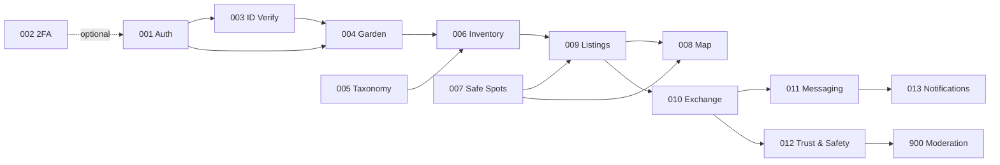

# Feature Spec Register

Every capability in Sharecropr has a numbered spec. Numbers are permanent and never reused. Before writing a new spec, **claim a number here in a small PR** — this is what prevents two people picking `SPEC-024` in the same week.

Rules for writing specs: [Doc Conventions](../00-foundation/06-doc-conventions.md). Structure to copy: [Spec Template](../00-foundation/07-spec-template.md).

---

## Number ranges

| Range | Meaning |
| --- | --- |
| `001`–`019` | MVP capabilities |
| `020`–`039` | Phase 2 — specified, not built |
| `040`–`059` | Phase 3 — specified, not built |
| `060`+ | Unallocated |
| `900`+ | Internal / staff tooling |

---

## MVP — SPEC-001 … SPEC-013

| ID | Spec | Capability | Status | Sec. review | Depends on |
| --- | --- | --- | --- | --- | --- |
| 001 | [Authentication](SPEC-001-authentication.md) | C1 | Approved | required | — |
| 002 | [Two-Factor Authentication](SPEC-002-two-factor-auth.md) | C2 | Approved | required | 001 |
| 003 | [Identity Verification](SPEC-003-identity-verification.md) | C3 | Approved | required | 001 |
| 004 | [Garden Verification](SPEC-004-garden-verification.md) | C4 | Approved | required | 001, 003 |
| 005 | [Crop Taxonomy](SPEC-005-crop-taxonomy.md) | C5 | Approved | not required | — |
| 006 | [Crop Inventory](SPEC-006-crop-inventory.md) | C6 | Approved | not required | 004, 005 |
| 007 | [Safe Spots](SPEC-007-safe-spots.md) | C7 | Approved | not required | — |
| 008 | [Interactive Map](SPEC-008-interactive-map.md) | C8 | Approved | not required | 007, 009 |
| 009 | [Listings & Offers](SPEC-009-listings-and-offers.md) | C9 | Approved | not required | 006, 007 |
| 010 | [Exchange Lifecycle](SPEC-010-exchange-lifecycle.md) | C10 | Approved | required | 003, 006, 007, 009 |
| 011 | [Messaging](SPEC-011-messaging.md) | C11 | Approved | required | 010, 012 |
| 012 | [Trust & Safety](SPEC-012-trust-and-safety.md) | C12 | Approved | required | 010 |
| 013 | [Notifications](SPEC-013-notifications.md) | C13 | Approved | not required | 010, 011, 012 |

## Future

| ID | Spec | Capability | Phase | Status | Depends on |
| --- | --- | --- | --- | --- | --- |
| 020 | [Harvest Planning & Surplus Alerts](SPEC-020-harvest-planning.md) | C20 | Phase 2 | Approved | 005, 006, 013 |
| 021 | [Community Groups & Garden Clubs](SPEC-021-community-groups.md) | C21 | Phase 2 | Approved | 007, 010, 012 |
| 022 | [Gamification](SPEC-022-gamification.md) | C22 | Phase 3 | Approved | 010, 012, 021 |
| 023 | [Crop ID & Food Safety](SPEC-023-crop-id-and-food-safety.md) | C23 | Phase 3 | Approved | 005, 006 |

> **Open register question.** SPEC-022 currently carries `security review: not required`, and its author disputes that: gamification reads `trust_score`, publishes user data to other users via leaderboards, and is almost entirely an adversarial-control surface. Resolve before Phase 3 planning. See SPEC-022 §15 Q1.

## Internal tooling

| ID | Spec | Capability | Status | Sec. review | Depends on |
| --- | --- | --- | --- | --- | --- |
| 900 | [Moderation Console](SPEC-900-moderation-console.md) | C90 | Approved | required | 004, 011, 012 |

---

## Build order

Dependencies constrain the order more than priority does. The critical path to a usable product:

**Before any of it**, run the map spike from [R-04](../06-roadmap/02-open-risks.md): build the SPEC-008 map screen with 200 clustered custom markers on both platforms under the New Architecture. The map is the product, and if `react-native-maps` misbehaves under Fabric, that changes the plan before the data model is written, not after.

**Parallelizable early:** SPEC-005 (taxonomy) and SPEC-007 (safe spots) are both mostly data curation and depend on nothing. Start them on day one — SPEC-007 in particular has a long lead time because it requires physically verifying venue hours in two metros.

---

## Traceability

Every `MUST` requirement in every spec maps to at least one test ID in that spec's §13. CI enforces this ([CI/CD §4](../05-operations/02-cicd.md)) — a spec with an untested `MUST` fails the build.

| Want to know… | Look at |
| --- | --- |
| Which spec owns a table | Each spec's §6 Data |
| Which spec owns an endpoint | [API Contract](../01-architecture/06-api-contract.md), cross-referenced to specs |
| Which tests prove a requirement | The spec's §13.1 coverage matrix |
| Which RLS policies a feature relies on | The spec's §9 Security & Privacy |
| Why a design is the way it is | The ADRs listed in the spec's front matter |

---

## Claiming a number

1. Add a row to the appropriate table above with status `Draft`.
2. Open a PR containing only that change.
3. Once merged, the number is yours. Create `SPEC-###-your-slug.md` from the template.

Retired specs keep their number and their file. Set status to `Superseded by SPEC-###` and leave a banner at the top pointing to the replacement. Nothing is ever deleted — deleted history is how a team relearns the same lesson three times.
