# Environments

**Status:** Approved · **Version:** 1.0.0 · **Owner:** Platform Engineering

---

## 1. The four environments

| Environment | Supabase | Mobile channel | Data | Lifetime |
| --- | --- | --- | --- | --- |
| `local` | Supabase CLI in Docker | Expo Dev Client | Synthetic seed | Developer's machine |
| `preview` | Ephemeral branch project per PR | EAS Update `preview` | Synthetic seed | Life of the PR |
| `staging` | Dedicated project | EAS Update `staging` | Production-**shaped** synthetic | Permanent |
| `production` | Dedicated project, PITR on | EAS Update `production` | Real | Permanent |

### The rule that governs all of them

> **There is no path from production data to any other environment.** Not a sanitized dump, not an anonymized export, not "just this once for debugging."

Seeds are **generated**, never copied. This is not paranoia about tooling quality — anonymization of a dataset containing home coordinates and identity verification records is genuinely hard to get right, and the failure mode is a developer laptop holding the home addresses of thousands of users. Removing the capability entirely is cheaper than doing it correctly.

The only exception is the [break-glass procedure](../01-architecture/04-location-privacy.md#10-break-glass-access-to-exact-coordinates), which reads production in place and never exports.

---

## 2. Local

```bash
supabase start                    # Postgres + PostGIS + h3 + GoTrue + Storage + Realtime
supabase db reset                 # migrations, then seed
pnpm seed:local                   # synthetic users, gardens, listings, safe spots
pnpm ios / pnpm android           # Expo Dev Client
```

`supabase/config.toml` pins extension versions so a developer's local Postgres matches CI and production. A PostGIS version drift between local and CI produces geospatial results that differ in the last decimal place and wastes an afternoon.

**Third parties are mocked locally.** Persona returns a scripted pass/fail, Expo Push writes to a local sink. Nobody should burn a real KYC inquiry — which costs money — to test a signup flow.

---

## 3. Preview

Every PR gets an ephemeral Supabase branch project and an EAS Update preview channel.

```mermaid
flowchart LR
    PR[PR opened] --> BR[Create Supabase branch project]
    BR --> MIG[Run migrations]
    MIG --> SEED[Seed synthetic data]
    SEED --> TEST[pgTAP · integration · concurrency]
    TEST --> EAS[Publish EAS preview]
    EAS --> E2E[Maestro smoke, both platforms]
    E2E --> REV[Reviewable build + QR in the PR comment]
    REV --> CLOSE[PR closed → branch destroyed]
```



Preview projects are destroyed on PR close and force-destroyed after 7 days regardless — an orphaned preview project is a cost leak and, more importantly, an unmonitored database.

---

## 4. Staging

A permanent environment that exists to answer one question: **would this work in production?**

- **Production-shaped data.** Same volume distribution as production (100k profiles, 500k listings, 2M messages), same geographic spread, entirely synthetic. Performance results from staging are meaningful precisely because the shape matches.
- **Real third parties in sandbox mode.** Persona sandbox, Expo Push to real test devices. This is where an integration bug surfaces that mocks hid.
- **Release candidates soak here for 24 hours minimum** before a production submission.
- **Store review builds point at staging**, so a reviewer never touches production data and the reviewer-bypass allowlist lives somewhere harmless.

---

## 5. Production

| Property | Value |
| --- | --- |
| Region | US East (primary market) |
| PITR | Enabled, 35-day window |
| Backups | Daily full + continuous WAL |
| Connection pooling | Supavisor, transaction mode |
| Read replica | Not at launch. Added when analytics or moderation queries affect the map RPC's p95. |
| Access | No human has a standing psql session. Break-glass only, audited. |
| Migrations | Applied by CI, never by a person |

### 5.1 Recovery objectives

| Objective | Target |
| --- | --- |
| RPO | 5 minutes (WAL) |
| RTO — application rollback (JS) | 15 minutes via EAS Update |
| RTO — database point-in-time restore | 2 hours |
| RTO — full regional failover | **Not available at MVP.** Accepted, documented, revisit at scale. |

Restore is rehearsed quarterly against staging. A restore procedure that has never been executed is a hope, not a plan.

> **After any restore, the account-deletion pipeline must be re-run against the restored data.** A point-in-time restore resurrects rows that were legitimately deleted, including garden coordinates for accounts that exercised their right to erasure. This is a mandatory step in the [restore runbook](05-runbooks.md), and it is the step most likely to be forgotten under pressure.

---

## 6. Configuration and secrets

| Config | Where | Notes |
| --- | --- | --- |
| Supabase URL, anon key | `app.config.ts` per EAS profile | Public by design; the anon key does nothing without a policy allowing it |
| `service_role` key | Edge Function secrets + GitHub Actions secrets | **Never in a client env var, never in the bundle.** CI greps the built bundle. |
| Persona API key | Edge Function secrets | Server-side only |
| Persona webhook secret | Edge Function secrets | HMAC verification |
| Sentry DSN | `app.config.ts` | Public by design |
| Feature flags | Database table, cached client-side | Server-controlled, changeable without a release |

Rotation: quarterly for service keys, immediately on any suspected exposure, and on any personnel change with access.

---

## 7. Seed data

Generated by `packages/seed`, deterministic under a fixed RNG seed so a bug found in CI reproduces locally.

| Dataset | Local | Preview | Staging |
| --- | --- | --- | --- |
| Profiles | 50 | 200 | 100,000 |
| Gardens | 40 | 150 | 80,000 |
| Safe spots | 20 (real, 1 metro) | 60 | 2,000 |
| Crop taxonomy | Full (real) | Full | Full |
| Inventory items | 200 | 1,000 | 400,000 |
| Listings | 100 | 500 | 500,000 |
| Exchange sessions | 30 | 200 | 200,000 |
| Messages | 500 | 3,000 | 2,000,000 |

Safe spots in seeds are **real public buildings with real coordinates** — they are public data, they make local development feel like the actual product, and a synthetic map full of points in a field teaches you nothing about clustering behaviour.

Every seeded garden coordinate is generated, never real. The seed script has no capability to read production.

---

## 8. Feature flags

Database-backed, cached in the client for 5 minutes, defaulting to **off** for anything new.

| Flag | Purpose |
| --- | --- |
| `messaging_enabled` | Kill switch — makes threads read-only rather than hiding them |
| `kyc_enabled` | Fallback if the vendor fails catastrophically |
| `map_clustering_enabled` | Escape hatch if clustering misbehaves at scale |
| `surplus_alerts_enabled` | Phase 2 gate |
| `groups_enabled` | Phase 2 gate |

Flags are for **operational control and phased rollout**, not for permanent branching. A flag older than 90 days is either removed or promoted to a real setting; CI reports on flag age.

Safety-critical behaviour is never behind a flag. There is no flag that disables RLS, location fuzzing, or moderation.

---

## 9. Environment parity

| Aspect | Parity | Deviation |
| --- | --- | --- |
| Postgres version and extensions | Identical | — |
| Migrations | Identical | — |
| RLS policies | Identical | — |
| Edge Functions | Identical | — |
| Data volume | Staging matches production | Local and preview are small by design |
| Third parties | Real in staging (sandbox), mocked below | — |
| Push delivery | Real in staging | Sink locally |
| Rate limits | Identical | **Deliberately not relaxed in staging** — a rate-limit bug found in production is one nobody could reproduce |

---

## 10. Access

| Environment | Who | How |
| --- | --- | --- |
| `local` | Every engineer | Their own machine |
| `preview` | Every engineer | Auto-provisioned per PR |
| `staging` | Engineering + QA | SSO, standing access |
| `production` — dashboard, read-only metrics | Engineering | SSO + 2FA |
| **`production` — database** | **Nobody by default** | Break-glass: two-person, 60 min, audited |
| `production` — migrations | CI only | No human path |

No person holds standing production database credentials. Every production data access is a deliberate, approved, audited act. This is inconvenient roughly once a month and prevents an entire category of incident.

---

## Change Log

| Date | Version | Author | Change |
| --- | --- | --- | --- |
| 2026-08-08 | 1.0.0 | Platform Engineering | Initial environments |
