# Environments

**Status:** Approved · **Version:** 1.0.0 · **Owner:** Platform Engineering

---

## 1. The four environments

| Environment | Supabase | Mobile channel | Data | Lifetime |
| --- | --- | --- | --- | --- |
| `local` | Supabase CLI in Docker | Expo Dev Client | Synthetic seed | Developer's machine |
| `preview` | Ephemeral branch project per PR | EAS Update `preview` | Synthetic seed | Life of the PR |
| `staging` | Dedicated project | EAS Update `staging` | Production-**shaped** synthetic | Permanent |
| `production` | Dedicated project, PITR on | EAS Update `production` | Real | Permanent |

### The rule that governs all of them

> **There is no path from production data to any other environment.** Not a sanitized dump, not an anonymized export, not "just this once for debugging."

Seeds are **generated**, never copied. This is not paranoia about tooling quality — anonymization of a dataset containing home coordinates and identity verification records is genuinely hard to get right, and the failure mode is a developer laptop holding the home addresses of thousands of users. Removing the capability entirely is cheaper than doing it correctly.

The only exception is the [break-glass procedure](../01-architecture/04-location-privacy.md#10-break-glass-access-to-exact-coordinates), which reads production in place and never exports.

---

## 2. Local

```bash
supabase start                    # Postgres + PostGIS + h3 + GoTrue + Storage + Realtime
supabase db reset                 # migrations, then seed
pnpm seed:local                   # synthetic users, gardens, listings, safe spots
pnpm ios / pnpm android           # Expo Dev Client
```

`supabase/config.toml` pins extension versions so a developer's local Postgres matches CI and production. A PostGIS version drift between local and CI produces geospatial results that differ in the last decimal place and wastes an afternoon.

**Third parties are mocked locally.** Persona returns a scripted pass/fail, Expo Push writes to a local sink. Nobody should burn a real KYC inquiry — which costs money — to test a signup flow.

---

## 3. Preview

Every PR gets an ephemeral Supabase branch project and an EAS Update preview channel.

```mermaid
flowchart LR
    PR[PR opened] --> BR[Create Supabase branch project]
    BR --> MIG[Run migrations]
    MIG --> SEED[Seed synthetic data]
    SEED --> TEST[pgTAP · integration · concurrency]
    TEST --> EAS[Publish EAS preview]
    EAS --> E2E[Maestro smoke, both platforms]
    E2E --> REV[Reviewable build + QR in the PR comment]
    REV --> CLOSE[PR closed → branch destroyed]
```



Preview projects are destroyed on PR close and force-destroyed after 7 days regardless — an orphaned preview project is a cost leak and, more importantly, an unmonitored database.

---

## 4. Staging

A permanent environment that exists to answer one question: **would this work in production?**

- **Production-shaped data.** Same volume distribution as production (100k profiles, 500k listings, 2M messages), same geographic spread, entirely synthetic. Performance results from staging are meaningful precisely because the shape matches.
- **Real third parties in sandbox mode.** Persona sandbox, Expo Push to real test devices. This is where an integration bug surfaces that mocks hid.
- **Release candidates soak here for 24 hours minimum** before a production submission.
- **Store review builds point at staging**, so a reviewer never touches production data and the reviewer-bypass allowlist lives somewhere harmless.

---

## 5. Production

| Property | Value |
| --- | --- |
| Region | US East (primary market) |
| PITR | Enabled, 35-day window |
| Backups | Daily full + continuous WAL |
| Connection pooling | Supavisor, transaction mode |
| Read replica | Not at launch. Added when analytics or moderation queries affect the map RPC's p95. |
| Access | No human has a standing psql session. Break-glass only, audited. |
| Migrations | Applied by CI, never by a person |

### 5.1 Recovery objectives

| Objective | Target |
| --- | --- |
| RPO | 5 minutes (WAL) |
| RTO — application rollback (JS) | 15 minutes via EAS Update |
| RTO — database point-in-time restore | 2 hours |
| RTO — full regional failover | **Not available at MVP.** Accepted, documented, revisit at scale. |

Restore is rehearsed quarterly against staging. A restore procedure that has never been executed is a hope, not a plan.

> **After any restore, the account-deletion pipeline must be re-run against the restored data.** A point-in-time restore resurrects rows that were legitimately deleted, including garden coordinates for accounts that exercised their right to erasure. This is a mandatory step in the [restore runbook](05-runbooks.md), and it is the step most likely to be forgotten under pressure.

---

## 6. Configuration and secrets

| Config | Where | Notes |
| --- | --- | --- |
| Supabase URL, anon key | `app.config.ts` per EAS profile | Public by design; the anon key does nothing without a policy allowing it |
| `service_role` key | Edge Function secrets + GitHub Actions secrets | **Never in a client env var, never in the bundle.** CI greps the built bundle. |
| Persona API key | Edge Function secrets | Server-side only |
| Persona webhook secret | Edge Function secrets | HMAC verification |
| Sentry DSN | `app.config.ts` | Public by design |
| Feature flags | Database table, cached client-side | Server-controlled, changeable without a release |
| Basemap style URL | `app.config.ts` per EAS profile | Points at one explicit dated archive (§11). Public by design — it addresses an unauthenticated public bucket |
| R2 write credential (tile bucket) | GitHub Actions secrets, tile-build workflow only | Write is CI-only. **No runtime component holds it**, and nothing in the app has any credential for the tile origin at all |
| `handoff_code_key` (Vault) | Supabase Vault in each project; provisioned by migration `20260822_0006_vault_handoff_key.sql` locally | **Symmetric key for `pgp_sym_encrypt` on `exchange_sessions.handoff_code`.** Readable only by `service_role` and `SECURITY DEFINER` RPCs (`get_handoff_code`, `accept_exchange_request`). **Custody:** Platform Engineering + Security (two-person) for production rotation per [Runbook 14](05-runbooks.md). Local dev uses a documented placeholder — never reuse in staging/production. Client and `authenticated` roles cannot call `vault.get_secret`. |

Rotation: quarterly for service keys, immediately on any suspected exposure, and on any personnel change with access.

**There is no map API key, in any environment.** [ADR-0019](../01-architecture/adr/ADR-0019-openstreetmap-maplibre.md) and [ADR-0020](../01-architecture/adr/ADR-0020-pmtiles-self-hosting.md) removed the whole category: no Google Maps key, no Mapbox token, no tile-vendor key. That is one fewer credential to provision per environment, restrict by bundle id, rotate, and accidentally commit. It is also the reason a tile request cannot be attributed to a user ([API Contract §6a](../01-architecture/06-api-contract.md)).

---

## 7. Seed data

Generated by `packages/seed`, deterministic under a fixed RNG seed so a bug found in CI reproduces locally.

| Dataset | Local | Preview | Staging |
| --- | --- | --- | --- |
| Profiles | 50 | 200 | 100,000 |
| Gardens | 40 | 150 | 80,000 |
| Safe spots | 20 (real, 1 metro) | 60 | 2,000 |
| Crop taxonomy | Full (real) | Full | Full |
| Inventory items | 200 | 1,000 | 400,000 |
| Listings | 100 | 500 | 500,000 |
| Exchange sessions | 30 | 200 | 200,000 |
| Messages | 500 | 3,000 | 2,000,000 |

Safe spots in seeds are **real public buildings with real coordinates** — they are public data, they make local development feel like the actual product, and a synthetic map full of points in a field teaches you nothing about clustering behaviour.

Every seeded garden coordinate is generated, never real. The seed script has no capability to read production.

---

## 8. Feature flags

Database-backed, cached in the client for 5 minutes, defaulting to **off** for anything new.

| Flag | Purpose |
| --- | --- |
| `messaging_enabled` | Kill switch — makes threads read-only rather than hiding them |
| `kyc_enabled` | Fallback if the vendor fails catastrophically |
| `map_clustering_enabled` | Escape hatch if clustering misbehaves at scale |
| `surplus_alerts_enabled` | Phase 2 gate |
| `groups_enabled` | Phase 2 gate |

Flags are for **operational control and phased rollout**, not for permanent branching. A flag older than 90 days is either removed or promoted to a real setting; CI reports on flag age.

Safety-critical behaviour is never behind a flag. There is no flag that disables RLS, location fuzzing, or moderation.

---

## 9. Environment parity

| Aspect | Parity | Deviation |
| --- | --- | --- |
| Postgres version and extensions | Identical | — |
| Migrations | Identical | — |
| RLS policies | Identical | — |
| Edge Functions | Identical | — |
| Data volume | Staging matches production | Local and preview are small by design |
| Third parties | Real in staging (sandbox), mocked below | — |
| Push delivery | Real in staging | Sink locally |
| Rate limits | Identical | **Deliberately not relaxed in staging** — a rate-limit bug found in production is one nobody could reproduce |

---

## 10. Access

| Environment | Who | How |
| --- | --- | --- |
| `local` | Every engineer | Their own machine |
| `preview` | Every engineer | Auto-provisioned per PR |
| `staging` | Engineering + QA | SSO, standing access |
| `production` — dashboard, read-only metrics | Engineering | SSO + 2FA |
| **`production` — database** | **Nobody by default** | Break-glass: two-person, 60 min, audited |
| `production` — migrations | CI only | No human path |

No person holds standing production database credentials. Every production data access is a deliberate, approved, audited act. This is inconvenient roughly once a month and prevents an entire category of incident.

---

## 11. The basemap tile pipeline

The basemap is no longer a platform default. It is an artifact we build, version, store, and serve ([ADR-0019](../01-architecture/adr/ADR-0019-openstreetmap-maplibre.md), [ADR-0020](../01-architecture/adr/ADR-0020-pmtiles-self-hosting.md)), which makes it an environment concern.

```
OSM regional extract (Geofabrik)         ← launch metros + a generous buffer, not the planet
        │
        ▼
Protomaps basemap build                  ← scheduled monthly, pinned tooling version
        │
        ▼
sharecropr-basemap-YYYYMM.pmtiles        ← immutable, date-stamped, never overwritten
        │
        ▼
Cloudflare R2                            ← versioned object; CI holds the only write credential
        │
        ▼
Cloudflare CDN  →  MapLibre client       ← unauthenticated HTTPS range GETs, no origin server
```

| Property | Value |
| --- | --- |
| Cadence | **Monthly**, plus on demand when a launch market needs it. Civic buildings do not move |
| Coverage | Regional extracts for the launch metros plus a buffer. Panning to another continent shows empty tiles, which is acceptable when every safe spot is in one of two metros |
| Naming | `sharecropr-basemap-YYYYMM.pmtiles`. **Archives are immutable and never overwritten in place** |
| Selection | The style JSON names **one explicit archive**. There is no `latest` alias, deliberately — an alias makes a rollback a cache-invalidation problem instead of a one-line change |
| Promotion | Repoint the style at the new archive, per environment |
| **Rollback** | **Repoint the style at the previous archive.** Instant, no app release, no cache dance. This is the entire incident response for a bad build ([Runbook 15](05-runbooks.md)) |
| Verification before promotion | TC-GEO-46…50 ([Geospatial Test Plan §8a.3](../04-testing/03-geospatial-test-plan.md)): archive readable, coverage sampled at metro centres, bounding-box corners, and just outside the buffer; style validates and references only our hosts; build reproducible |
| Cost | Object storage plus egress. **R2 has no egress fee**, which is the whole reason this is cheap — under $10/month at MVP scale, revisit at $50 |

### 11.1 Which archive each environment serves

| Environment | Bucket / prefix | Archive | Why |
| --- | --- | --- | --- |
| `local` | Production R2, read-only over the public CDN | Whatever `staging` points at | Nobody should build a 2 GB archive to run the app. A developer needs *a* correct basemap, not a private one, and the data is public |
| `preview` | Same as `staging` | Same as `staging` | A preview branch is about schema and app code. Giving each PR its own archive would be a cost leak for zero signal |
| `staging` | `sharecropr-tiles-staging` | **The new archive, promoted here first** | Staging is where a bad build is caught. A new archive soaks here for the same 24 hours a release candidate does |
| `production` | `sharecropr-tiles` | The archive promoted after staging soak | — |

Two consequences worth stating because they are easy to get wrong:

- **A tile build is not a code deploy and does not follow the release train.** It is promoted by editing a URL in the style JSON, which *is* reviewed like code and does ship in a release. So an archive promotion reaches users on the next app update or EAS Update — except for a rollback, which repoints the style server-side and is why the rollback path is the fast one.
- **Local and preview intentionally share production's public archive.** This is the one place the "no path from production to another environment" rule (§1) does not apply, and it does not apply because **there is no production *data* here.** OSM tiles are public geodata identical for every user; there is nothing to sanitize, and nothing about who looked at what is recorded to leak. Treating it as if it were user data would cost every developer a multi-gigabyte build for no privacy gain.

### 11.2 The OSM candidate import

The `osm-import` Edge Function is scheduled and environment-scoped, not part of the tile pipeline, but it shares its upstream and its cadence.

| Environment | Runs | Against |
| --- | --- | --- |
| `local`, `preview` | **No.** Fixture Overpass responses only | Nobody burns donated community infrastructure to test a parser |
| `staging` | Monthly, against a **fixture or mirrored** Overpass response | Exercises the whole path — parse, dedupe, reject, flag — without adding load upstream |
| `production` | Monthly per active metro | Overpass, with a descriptive `User-Agent` and a contact address |

Only the production function has the Overpass host on its egress allowlist ([SPEC-007-R60](../03-specs/SPEC-007-safe-spots.md)). A new Edge Function inherits denial by default, which is asserted from the deployed network policy rather than from source.

---

## Change Log

| Date | Version | Author | Change |
| --- | --- | --- | --- |
| 2026-08-08 | 1.0.0 | Platform Engineering | Initial environments |
| 2026-08-09 | 1.1.0 | Platform Engineering | §11 added: the basemap tile pipeline (Geofabrik extract → Protomaps build → dated PMTiles archive → R2 → CDN, monthly), which archive each environment serves, and rollback by repointing the style. §11.2 scopes the OSM candidate import per environment. §6 records that **no map API key exists in any environment** ([ADR-0019](../01-architecture/adr/ADR-0019-openstreetmap-maplibre.md), [ADR-0020](../01-architecture/adr/ADR-0020-pmtiles-self-hosting.md)) |
