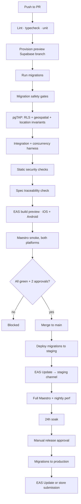

# CI/CD

**Status:** Approved · **Version:** 1.0.0 · **Owner:** Platform Engineering

GitHub Actions for verification, EAS for building and shipping. The pipeline's job is to make the [five rules](../README.md) mechanically enforced rather than culturally enforced, because culture degrades under deadline pressure and a `grep` in CI does not.

---

## 1. Pipeline overview



---

## 2. Required checks

None of these are advisory. A PR cannot merge with any of them red.

| Check | Blocks on |
| --- | --- |
| `lint` | ESLint errors; `src/domain` importing React Native |
| `typecheck` | Any TS error; `any` in `src/domain` |
| `unit` | Any failure |
| `migrate` | Migration fails against a production-shaped seed |
| `migration-safety` | §3 gates |
| `pgtap-rls` | Any RLS assertion; negative < positive per table |
| `pgtap-geo` | Any geospatial assertion |
| `location-invariants` | **LP-01 … LP-13** |
| `integration` | Any failure |
| `concurrency` | Any hazard H1–H8 |
| `security-static` | §4 checks |
| `spec-traceability` | A `MUST` with no linked test |
| `secret-scan` | Any secret in source or the built bundle |
| `e2e-smoke` | Any smoke flow on either platform |
| `perf-baseline` | An unreviewed `EXPLAIN` plan change on a hot path |

Two approvals required, and a **`DB` CODEOWNERS approval** if `supabase/migrations/**` changed.

---

## 3. Migration safety gates

Migrations are the most dangerous thing in the pipeline, because they are the one change that cannot be reverted by shipping a new build.

### 3.1 Structural gates

```yaml
- name: Every new table has RLS enabled and forced
  run: pnpm ci:assert-rls-on-new-tables

- name: No GRANT on schema private
  run: |
    if grep -rniE 'GRANT .* ON .*\bprivate\b' supabase/migrations/; then
      echo "::error::A migration grants privileges on schema private. Denied."; exit 1
    fi

- name: Every SECURITY DEFINER function pins search_path
  run: pnpm ci:assert-definer-search-path

- name: Every new definer function is on the reviewed allowlist
  run: pnpm ci:assert-definer-allowlist

- name: Every new view sets security_invoker = on
  run: pnpm ci:assert-security-invoker

- name: No forbidden column in any client-reachable return type
  run: pnpm ci:assert-no-forbidden-columns    # h3_r9, exact_point, fuzz_seed, trust_score
```

### 3.2 The destructive-migration gate

Forward-only, expand → migrate → contract ([Data Model §15](../01-architecture/03-data-model.md)). The contract phase is gated on **actual production adoption**, read from `devices.app_version`:

```yaml
- name: Destructive migration DAU gate
  run: |
    if grep -qiE '^\s*(ALTER TABLE .* DROP COLUMN|DROP TABLE|ALTER TYPE .* RENAME)' "$MIGRATION"; then
      STALE=$(psql "$PROD_READONLY_URL" -tAc "
        SELECT round(100.0 * count(*) FILTER (
                 WHERE string_to_array(app_version,'.')::int[]
                     < string_to_array('$CONTRACT_FLOOR','.')::int[]
               ) / NULLIF(count(*),0), 2)
          FROM devices WHERE last_seen_at > now() - interval '7 days'")
      echo "Users below contract floor: ${STALE}%"
      awk -v s="$STALE" 'BEGIN { exit (s > 2.0) ? 1 : 0 }' || {
        echo "::error::${STALE}% of DAU are below the contract floor. Gate is 2%."; exit 1; }
    fi
```

> Without this gate, [ADR-0017](../01-architecture/adr/ADR-0017-release-cadence.md)'s two-version compatibility rule is a comment convention that someone will violate in a hurry. With it, the rule is arithmetic. `ALTER TYPE … ADD VALUE` is explicitly **not** matched — it is additive and safe, and gating it would block every new notification kind.

### 3.3 Migration + test coupling

A migration creating a table without a matching `supabase/tests/rls_<table>.test.sql` in the same PR fails the build. Tests written "next sprint" are tests written never.

---

## 4. Static security checks

| Check | What it catches |
| --- | --- |
| Bundle secret grep | `service_role`, Persona key, webhook secret in the built JS |
| Forbidden-column sweep | `h3_r9`, `exact_point`, `fuzz_seed`, `trust_score` in any client-facing type |
| Telemetry scrubber test | Coordinate survives a synthetic Sentry event |
| Merged-manifest check | `ACCESS_BACKGROUND_LOCATION` injected by a transitive dependency |
| Info.plist check | Permission strings present and non-generic |
| Dependency audit | Known CVEs at high or critical |
| License audit | Copyleft in a shipped dependency |

The merged-manifest check exists because a background-location permission can arrive through a dependency without anyone adding it, and it lands us in an App Store review category we've deliberately avoided.

---

## 5. Spec traceability

```yaml
- name: Every MUST has a test
  run: pnpm ci:spec-traceability
```

Parses `docs/03-specs/*.md`, extracts every requirement marked `MUST`, and confirms each appears in that spec's §13 coverage matrix **and** that a test file references the ID. A `MUST` with no test fails the build.

This is what makes [the doc conventions](../00-foundation/06-doc-conventions.md) real rather than aspirational.

---

## 6. Build and release

### 6.1 EAS profiles

```jsonc
// eas.json
{
  "build": {
    "development": { "developmentClient": true, "distribution": "internal",
                     "env": { "APP_ENV": "local" } },
    "preview":     { "distribution": "internal", "channel": "preview",
                     "env": { "APP_ENV": "preview" } },
    "staging":     { "distribution": "internal", "channel": "staging",
                     "env": { "APP_ENV": "staging" } },
    "production":  { "channel": "production", "autoIncrement": "version",
                     "env": { "APP_ENV": "production" } }
  },
  "submit": {
    "production": {
      "ios":     { "appleTeamId": "…", "ascAppId": "…" },
      "android": { "track": "internal", "releaseStatus": "draft" }
    }
  }
}
```

### 6.2 OTA policy

| Change | Mechanism | Review |
| --- | --- | --- |
| JS-only: copy, layout, logic, bug fix | EAS Update | Standard PR |
| New native dependency, permission, or config | **Store release** | PR + release approval |
| Anything touching auth, location, or moderation | **Store release** | + Security sign-off |

**OTA is never used to ship a change that alters what the app does with permissions or personal data.** That is a store-policy violation dressed up as a hotfix, and it is the fastest way to lose a developer account.

Rollout is staged: 10% → 50% → 100%, with 30 minutes between stages and automatic halt on a crash-rate regression.

### 6.3 Versioning

`MAJOR.MINOR.PATCH`, with build numbers auto-incremented by EAS. The `CONTRACT_FLOOR` used by §3.2 is set explicitly per destructive migration, not derived — deriving it would be clever and wrong the first time someone skips a release.

---

## 7. Deployment order

Backend first, always:

1. Migrations to production (expand phase only — additive, backward compatible)
2. Edge Functions
3. Verify: error rates, `safe_spots_near` p95, auth success
4. EAS Update or store submission
5. Monitor for 1 hour ([QA checklist §5](../04-testing/05-qa-release-checklist.md))
6. Contract-phase migration in a **later** release, once the DAU gate passes

An old client must always work against a new backend. The reverse is never assumed, because store review latency means we do not control when users update.

---

## 8. Rollback

| Failure | Rollback | Time |
| --- | --- | --- |
| JS bug | Republish the previous EAS Update | < 5 min |
| Edge Function bug | Redeploy the previous version | < 5 min |
| Bad expand migration | **Roll forward** with a corrective migration | < 30 min |
| Bad contract migration | **Point-in-time restore** — this is why contract phases are gated | ~2 h |
| Native bug | Expedited store review | Hours to days |

There are no `DOWN` migrations. Reversing a migration on a live database with concurrent writes is more dangerous than fixing forward, and a `DOWN` script that has never been run is not a rollback plan.

---

## 9. Scheduled workflows

| Workflow | Cadence | Purpose |
| --- | --- | --- |
| Full Maestro suite | Nightly | Beyond smoke |
| Performance suite | Nightly | k6 + `EXPLAIN` diffs |
| **Location invariant canary (LP-10)** | **Every 15 min against production** | Verifies what we deployed, not what we intended |
| Dependency audit | Weekly | CVEs |
| Data-quality checks | Nightly | Stale safe-spot hours, orphaned media |
| Preview cleanup | Daily | Destroy orphaned branch projects |
| Flake report | Weekly | Auto-quarantine above 2% |

---

## 10. Secrets in CI

| Secret | Scope |
| --- | --- |
| `SUPABASE_ACCESS_TOKEN` | Branch provisioning |
| `PROD_MIGRATION_URL` | Production job only, environment-protected, requires approval |
| `PROD_READONLY_URL` | The DAU gate only; read-only role with access to `devices` and nothing else |
| `EXPO_TOKEN` | Build and submit |
| `APPLE_*` / `GOOGLE_*` | Submission |

Production-scoped secrets live in a protected GitHub Environment requiring a named reviewer. **No secret is ever echoed**, and log masking is verified by a job that deliberately attempts to print one and asserts it is masked.

`PROD_READONLY_URL` deserves a note: it is a read-only role that can see `devices.app_version` and nothing else. Giving CI broad production read access to enforce a safety gate would be trading one risk for a larger one.

---

## Change Log

| Date | Version | Author | Change |
| --- | --- | --- | --- |
| 2026-08-08 | 1.0.0 | Platform Engineering | Initial CI/CD |
