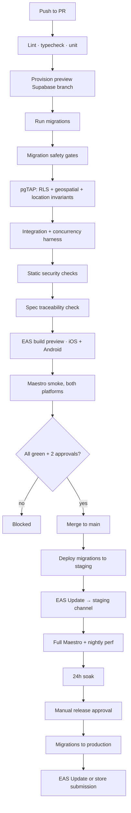

# CI/CD

**Status:** Approved · **Version:** 1.0.3 · **Owner:** Platform Engineering

GitHub Actions for verification, EAS for building and shipping. The pipeline's job is to make the [five rules](../README.md) mechanically enforced rather than culturally enforced, because culture degrades under deadline pressure and a `grep` in CI does not.

---

## 1. Pipeline overview



---

## 2. Required checks

None of these are advisory once built. A PR cannot merge with any *running* check red. **Most are not built yet** — the State column is the truth; [N-07](../07-review/02-development-notes.md#n-07--the-ci-gates-are-described-not-built) tracks the gap. Update the column in the PR that wires a check up.

| Check | Blocks on | State (2026-10-21) |
| --- | --- | --- |
| `lint` | ESLint errors; `src/domain` or `src/api` importing React Native; any file but the seam importing `@supabase/*` or a map renderer — proved by `npm run lint:fixtures` | **Running** — `app.yml` |
| `typecheck` | Any TS error; `any` in `src/domain` | **Running** — `app.yml` |
| `unit` | Any failure | **Running** — `app.yml` `npm test` (Jest + RNTL over `src/` and `app/`; [Test Strategy §2](../04-testing/01-test-strategy.md#2-the-pyramid-weighted-for-this-system)) |
| `migrate` | Migration fails against a production-shaped seed | **Partial** — `db.yml` `supabase db reset`; no production-shaped seed |
| `migration-safety` | §3 gates | Planned |
| `pgtap-rls` | Any RLS assertion; negative < positive per table | **Running** — `db.yml` (pgTAP + `ci:assert-negative-ratio`) |
| `pgtap-geo` | Any geospatial assertion | **Partial** — `db.yml` runs every `supabase/tests/*.test.sql` |
| `location-invariants` | **LP-01 … LP-13** | Planned — `npm run location-canary` exists, not wired |
| `integration` | Any failure | Planned |
| `concurrency` | Any hazard H1–H8 | Planned |
| `security-static` | §4 checks | **Partial** — `db.yml` private-grant + definer-allowlist gates |
| `spec-traceability` | A `MUST` with no linked test | Planned |
| `doc-gates` | §5.1 gates | **Partial** — `app.yml` runs the schema-graph acyclic half + register sync (SCR-0003); symmetry (SCR-0004) and the other §5.1 gates planned |
| `secret-scan` | Any secret in source or the built bundle | Planned |
| `e2e-smoke` | Any smoke flow on either platform | Planned |
| `perf-baseline` | An unreviewed `EXPLAIN` plan change on a hot path | Planned |
| `map-style` | An invalid style JSON, or one referencing a tile, sprite, or glyph host we do not control (§4.1) | Running (app.yml) |
| `map-attribution` | The OSM attribution missing, zero-area, or obscured in any map state — **NFR-99, a licence obligation** (§4.1) | Planned |
| `map-egress` | Any map-screen request to a non-allowlisted host, or a tile request carrying a credential or a coordinate — NFR-102 (§4.1) | Planned |

Two approvals required, and a **`DB` CODEOWNERS approval** if `supabase/migrations/**` changed. *(Partial: [`.github/CODEOWNERS`](../../.github/CODEOWNERS) names the DB owner for `supabase/migrations/`, and `app.yml`/`db.yml` now run on pushes to `develop` as well as `main`. **Branch protection is not configured**, so nothing yet blocks a merge, and with a single maintainer "Require review from Code Owners" cannot be satisfied — see SCR-0002.)*

---

## 3. Migration safety gates

Migrations are the most dangerous thing in the pipeline, because they are the one change that cannot be reverted by shipping a new build.

### 3.1 Structural gates

```yaml
- name: Every new table has RLS enabled and forced
  run: npm run ci:assert-rls-on-new-tables

- name: No GRANT on schema private
  run: |
    if grep -rniE 'GRANT .* ON .*\bprivate\b' supabase/migrations/; then
      echo "::error::A migration grants privileges on schema private. Denied."; exit 1
    fi

- name: Every SECURITY DEFINER function pins search_path
  run: npm run ci:assert-definer-search-path

- name: Every new definer function is on the reviewed allowlist
  run: npm run ci:assert-definer-allowlist

- name: Every new view sets security_invoker = on
  run: npm run ci:assert-security-invoker

- name: No forbidden column in any client-reachable return type
  run: npm run ci:assert-no-forbidden-columns    # h3_r9, exact_point, fuzz_seed, trust_score
```

### 3.2 The destructive-migration gate

Forward-only, expand → migrate → contract ([Data Model §15](../01-architecture/03-data-model.md)). The contract phase is gated on **actual production adoption**, read from `devices.app_version`:

```yaml
- name: Destructive migration DAU gate
  run: |
    if grep -qiE '^\s*(ALTER TABLE .* DROP COLUMN|DROP TABLE|ALTER TYPE .* RENAME)' "$MIGRATION"; then
      STALE=$(psql "$PROD_READONLY_URL" -tAc "
        SELECT round(100.0 * count(*) FILTER (
                 WHERE string_to_array(app_version,'.')::int[]
                     < string_to_array('$CONTRACT_FLOOR','.')::int[]
               ) / NULLIF(count(*),0), 2)
          FROM devices WHERE last_seen_at > now() - interval '7 days'")
      echo "Users below contract floor: ${STALE}%"
      awk -v s="$STALE" 'BEGIN { exit (s > 2.0) ? 1 : 0 }' || {
        echo "::error::${STALE}% of DAU are below the contract floor. Gate is 2%."; exit 1; }
    fi
```

> Without this gate, [ADR-0017](../01-architecture/adr/ADR-0017-release-cadence.md)'s two-version compatibility rule is a comment convention that someone will violate in a hurry. With it, the rule is arithmetic. `ALTER TYPE … ADD VALUE` is explicitly **not** matched — it is additive and safe, and gating it would block every new notification kind.

### 3.3 Migration + test coupling

A migration creating a table without a matching `supabase/tests/rls_<table>.test.sql` in the same PR fails the build. Tests written "next sprint" are tests written never.

---

## 4. Static security checks

| Check | What it catches |
| --- | --- |
| Bundle secret grep | `service_role`, Persona key, webhook secret in the built JS |
| Forbidden-column sweep | `h3_r9`, `exact_point`, `fuzz_seed`, `trust_score` in any client-facing type |
| Telemetry scrubber test | Coordinate survives a synthetic Sentry event |
| Merged-manifest check | `ACCESS_BACKGROUND_LOCATION` injected by a transitive dependency |
| Info.plist check | Permission strings present and non-generic |
| Dependency audit | Known CVEs at high or critical — residual, unfixable-in-SDK advisories live in the [Dependency Risk Register](06-dependency-risk-register.md) |
| License audit | Copyleft in a shipped dependency |

The merged-manifest check exists because a background-location permission can arrive through a dependency without anyone adding it, and it lands us in an App Store review category we've deliberately avoided.

### 4.1 Map, tile, and attribution checks

Three gates protect things that break silently: a licence obligation rendered in pixels, and an egress guarantee that no import audit can prove ([ADR-0019](../01-architecture/adr/ADR-0019-openstreetmap-maplibre.md), [ADR-0020](../01-architecture/adr/ADR-0020-pmtiles-self-hosting.md)).

```yaml
- name: Style JSON validates and references only our own hosts
  run: npm run ci:validate-map-style
  # - validates src/features/map/style/sharecropr-basemap.json against the MapLibre schema
  # - asserts every source, sprite, and glyph URL is on the Sharecropr tile origin
  # - asserts the tile source names ONE explicit dated archive, never a "latest" alias

- name: Attribution is present and unobscured in every map state
  run: npm run ci:assert-attribution
  # Renders the map fixture in each §8.2 state and at each sheet detent, then asserts
  # the attribution node is mounted, has non-zero measured area, meets 4.5:1, and its
  # rect intersects no other rendered node. TC-GEO-37/38/39/40.

- name: No map request leaves Sharecropr infrastructure
  run: npm run ci:assert-map-egress
  # Captures every request the map screen makes against a host allowlist, then regexes
  # each tile request for credentials and for coordinate-shaped values beyond z/x/y and
  # PMTiles byte ranges. TC-GEO-41/42/43, NFR-102.
```

Three notes on why these are shaped the way they are:

- **`map-attribution` is geometric, not a string search.** Nobody deletes the attribution. Somebody adds a bottom banner in an unrelated PR, and the notice is still in the tree, still rendered, and covered. A `grep` for the string passes; the incident is "we breached ODbL for six weeks and nobody checked". **Failing this check is treated as a licence incident, not a layout bug.**
- **`map-egress` inspects captured traffic, not imports.** A lint rule can prove that only `MapCanvas` imports `@maplibre/*`; it cannot prove that nothing in the dependency tree resolves a font, a sprite, or a telemetry beacon from someone else's host. Only the wire can.
- **`map-style` bans a `latest` alias deliberately.** The style must name one dated archive, because that is what makes a bad basemap a one-line rollback rather than a cache-invalidation problem ([Environments §11](01-environments.md)).

---

## 5. Spec traceability

```yaml
- name: Every MUST has a test
  run: npm run ci:spec-traceability
```

Parses `docs/03-specs/*.md`, extracts every requirement marked `MUST`, and confirms each appears in that spec's §13 coverage matrix **and** that a test file references the ID. A `MUST` with no test fails the build.

This is what makes [the doc conventions](../00-foundation/06-doc-conventions.md) real rather than aspirational.

### 5.1 The checks the traceability gate cannot see

The `MUST`→test gate only sees requirements that were written as requirements. Five rate limits in SPEC-010 lived in a prose cell for the whole first draft, so they had no ID, no traceability row, and therefore no test — invisible to the one check designed to catch exactly that. These five gates close the gaps found in the [2026-08-09 review](../07-review/01-workflow-architect-review.md):

```yaml
- name: Doc governance gates
  run: npm run ci:doc-gates
```

| Gate | Rule | Rationale |
| --- | --- | --- |
| **Normative-prose sweep** | A spec section containing a numeric limit, threshold, or cadence outside a `MUST` row fails. Numbers belong to requirements | The failure mode that hid five rate limits |
| **Approval gate** | A spec MUST NOT hold `Status: Approved` while any of its open questions carries `Needed by: Before launch`, or while its registry row has no `Last verified` date | "Approved" has to mean something. 18 specs claimed it with 21 launch-blocking questions open and no code to verify against |
| **Schema-graph gate** | `Schema depends on` across all specs must be **acyclic**; `Behaviourally coupled with` must be **symmetric** | [Specs README §Build order](../03-specs/README.md). Conflating the two produced five apparent cycles |
| **Cross-reference gate** | Every `SPEC-###-T##`, `R##`, `EC-##`, `THR-##`, and `R-##` citation must resolve to a real row. Bare `T##` across documents fails — citations must be namespaced. Also link-checks every relative markdown link and heading anchor | `T-26` was a threat and `T30` a test, one hyphen apart, both cited across documents. The link half is proven: a run on 2026-08-09 checked **1,957 links across 74 documents** and found 6 broken anchors, all since fixed. Note the slug rule — GitHub drops `.` and `—`, keeps `_`, and turns *each* space into its own hyphen, so `## 9. Journey — Ray` is `#9-journey--ray` |
| **Registry staleness** | Every row in [`docs/workflows/REGISTRY.md`](../workflows/REGISTRY.md) with a `Last verified` date older than 30 days is reported; a row for a shipped workflow that has never been verified fails once its spec is `Approved` | A spec that is never re-checked against code is a spec that is quietly wrong |

**Generated-artefact gates** — each asserts that a fact stored in the database is not also hand-maintained somewhere:

| Artefact | Generated from | Failure |
| --- | --- | --- |
| `src/domain/exchange/machine.ts` | `private.legal_session_transitions` | Regeneration produces a diff |
| `domain/errors/classify.ts` | [Exchange State Machine §9](../01-architecture/07-exchange-state-machine.md) | A code in one and not the other |
| Notification template coverage | `private.notification_templates` × phase | A kind with no template, or a test iterating the enum rather than the phase-filtered table |

The pattern is the one already proven by the transition table: put the fact in the database, generate the copy, and let CI fail on drift. Every finding in the review's process section was a fact that lived in two places with nothing comparing them.

> **Only the schema-graph gate's acyclic half exists** (`npm run ci:doc-gates`, SCR-0003, which also checks the register's `Schema depends on` column against front matter); the rest of this section is planned. Until the rest is real, the 2026-08-09 fixes are a snapshot and the doc set will drift back to where it was. Build them in the first sprint, while the reasons are fresh and there are no green builds to break — see [Development Notes N-07](../07-review/02-development-notes.md#n-07--the-ci-gates-are-described-not-built).

---

## 6. Build and release

### 6.1 EAS profiles

```jsonc
// eas.json
{
  "build": {
    "development": { "developmentClient": true, "distribution": "internal",
                     "env": { "APP_ENV": "local" } },
    "preview":     { "distribution": "internal", "channel": "preview",
                     "env": { "APP_ENV": "preview" } },
    "staging":     { "distribution": "internal", "channel": "staging",
                     "env": { "APP_ENV": "staging" } },
    "production":  { "channel": "production", "autoIncrement": "version",
                     "env": { "APP_ENV": "production" } }
  },
  "submit": {
    "production": {
      "ios":     { "appleTeamId": "…", "ascAppId": "…" },
      "android": { "track": "internal", "releaseStatus": "draft" }
    }
  }
}
```

### 6.2 OTA policy

| Change | Mechanism | Review |
| --- | --- | --- |
| JS-only: copy, layout, logic, bug fix | EAS Update | Standard PR |
| New native dependency, permission, or config | **Store release** | PR + release approval |
| Anything touching auth, location, or moderation | **Store release** | + Security sign-off |

**OTA is never used to ship a change that alters what the app does with permissions or personal data.** That is a store-policy violation dressed up as a hotfix, and it is the fastest way to lose a developer account.

Rollout is staged: 10% → 50% → 100%, with 30 minutes between stages and automatic halt on a crash-rate regression.

### 6.3 Versioning

`MAJOR.MINOR.PATCH`, with build numbers auto-incremented by EAS. The `CONTRACT_FLOOR` used by §3.2 is set explicitly per destructive migration, not derived — deriving it would be clever and wrong the first time someone skips a release.

---

## 7. Deployment order

Backend first, always:

1. Migrations to production (expand phase only — additive, backward compatible)
2. Edge Functions
3. Verify: error rates, `safe_spots_near` p95, auth success
4. EAS Update or store submission
5. Monitor for 1 hour ([QA checklist §5](../04-testing/05-qa-release-checklist.md))
6. Contract-phase migration in a **later** release, once the DAU gate passes

An old client must always work against a new backend. The reverse is never assumed, because store review latency means we do not control when users update.

---

## 8. Rollback

| Failure | Rollback | Time |
| --- | --- | --- |
| JS bug | Republish the previous EAS Update | < 5 min |
| Edge Function bug | Redeploy the previous version | < 5 min |
| Bad expand migration | **Roll forward** with a corrective migration | < 30 min |
| Bad contract migration | **Point-in-time restore** — this is why contract phases are gated | ~2 h |
| Native bug | Expedited store review | Hours to days |

There are no `DOWN` migrations. Reversing a migration on a live database with concurrent writes is more dangerous than fixing forward, and a `DOWN` script that has never been run is not a rollback plan.

---

## 9. Scheduled workflows

| Workflow | Cadence | Purpose |
| --- | --- | --- |
| Full Maestro suite | Nightly | Beyond smoke |
| Performance suite | Nightly | k6 + `EXPLAIN` diffs |
| **Location invariant canary (LP-10)** | **Every 15 min against production** | Verifies what we deployed, not what we intended |
| Dependency audit | Weekly | CVEs — **Running (weekly, not a PR gate)**: [dependency-audit.yml](../../.github/workflows/dependency-audit.yml) opens one issue per advisory; Dependabot for npm + actions. Advisories we cannot patch without an SDK/major upgrade are listed in the [Dependency Risk Register](06-dependency-risk-register.md); an accepted one is labelled `wontfix` so the job stops reopening it |
| Data-quality checks | Nightly | Stale safe-spot hours, orphaned media |
| Preview cleanup | Daily | Destroy orphaned branch projects |
| Flake report | Weekly | Auto-quarantine above 2% |
| **Basemap tile build** | **Monthly** | Geofabrik extract → Protomaps build → dated PMTiles → R2 → promote to `staging` (§9.1) |
| Basemap coverage and age | Nightly | TC-GEO-47 (every active spot inside coverage), TC-GEO-49 (`basemap_age_days` ≤ 45) |
| OSM candidate import | Monthly, production only | `osm-import` per active metro; result recorded as `osm_import_job_result` |

### 9.1 The monthly tile build

```yaml
# .github/workflows/tile-build.yml
on:
  schedule: [{ cron: '0 3 1 * *' }]        # 03:00 UTC, first of the month
  workflow_dispatch:                        # on demand when a market needs it

jobs:
  build:
    steps:
      - name: Download Geofabrik extracts for every active metro
      - name: Protomaps basemap build            # tooling version PINNED, not floating
      - name: Emit sharecropr-basemap-$(date +%Y%m).pmtiles
      - name: Verify archive                     # TC-GEO-46, 48, 50 — before it is uploaded
      - name: Upload to R2                       # immutable; NEVER overwrite an existing key
      - name: Promote to staging                 # repoint the staging style; production waits
      - name: Record osm_tile_build_result       # success or failure, either way
```

Four properties this workflow must keep, each of which is a lesson [ADR-0020](../01-architecture/adr/ADR-0020-pmtiles-self-hosting.md) already paid for in advance:

1. **The tooling version is pinned.** An unpinned Protomaps version turns a cartography regression into an archaeology exercise, and TC-GEO-50's reproducibility assertion is what notices.
2. **Verification happens before upload, not after promotion.** A bad archive that never reaches the bucket needs no rollback.
3. **Upload never overwrites.** Archives are immutable and date-stamped; that is what makes rollback a one-line style change ([Runbook 15](05-runbooks.md)).
4. **A failed or skipped run is recorded, not silent.** A monthly job that quietly stops running is exactly the operational tax ADR-0020's steel-man warns about, and the only detector is that somebody notices the metric stopped moving. Two failures or skips in a quarter is the documented signal to take the managed-tiles fallback rather than to automate harder around it.

Production promotion is **not** automatic. A new archive soaks on staging alongside the release candidate; promoting it to production is repointing the production style, which ships as a reviewed change.

---

## 10. Secrets in CI

| Secret | Scope |
| --- | --- |
| `SUPABASE_ACCESS_TOKEN` | Branch provisioning |
| `PROD_MIGRATION_URL` | Production job only, environment-protected, requires approval |
| `PROD_READONLY_URL` | The DAU gate only; read-only role with access to `devices` and nothing else |
| `EXPO_TOKEN` | Build and submit |
| `APPLE_*` / `GOOGLE_*` | Submission |

Production-scoped secrets live in a protected GitHub Environment requiring a named reviewer. **No secret is ever echoed**, and log masking is verified by a job that deliberately attempts to print one and asserts it is masked.

`PROD_READONLY_URL` deserves a note: it is a read-only role that can see `devices.app_version` and nothing else. Giving CI broad production read access to enforce a safety gate would be trading one risk for a larger one.

---

## Change Log

| Date | Version | Author | Change |
| --- | --- | --- | --- |
| 2026-08-08 | 1.0.0 | Platform Engineering | Initial CI/CD |
| 2026-10-21 | 1.0.1 | Architecture | §2 gains a State column (running / partial / planned); `pnpm` → `npm run` to match the repo's package manager. Scripts named in §4–§5 that do not exist in `package.json` are planned |
| 2026-10-21 | 1.0.2 | Engineering | §2 `unit` is Running: `app.yml` runs `npm test` (Jest + React Native Testing Library over `src/` and `app/`), replacing the auth-domain and map `node:test` scripts (SCRUM-64, SCR-0002) |
| 2026-10-22 | 1.0.3 | Platform Engineering | §4 and §9 link the new Dependency Risk Register (WP-DEPS): in-range lockfile refresh cleared 8 of 12 advisories including the critical; 4 with no in-SDK-57 fix are recorded there pending acceptance |
