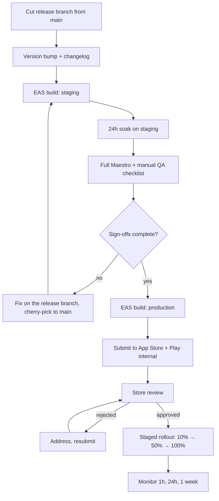

# Release & Store Submission

**Status:** Approved · **Version:** 1.0.0 · **Owner:** Mobile + Release Management

---

## 1. Cadence

| Type | Frequency | Mechanism | Approval |
| --- | --- | --- | --- |
| Hotfix (JS) | As needed | EAS Update | Engineering lead |
| Patch | Weekly | EAS Update | Engineering lead |
| Minor | Every 2–3 weeks | Store release | Release manager + Product |
| Major | Quarterly | Store release | Full sign-off |

**Backend deploys continuously; the app does not.** This asymmetry is the source of most release risk and is why [ADR-0017](../01-architecture/adr/ADR-0017-release-cadence.md)'s two-version compatibility rule exists and is [mechanically enforced](02-cicd.md#32-the-destructive-migration-gate).

---

## 2. Release process



Release branches are `release/1.4.0`, cut from `main`, fixes cherry-picked back. `main` stays shippable.

**The 24-hour staging soak is not negotiable.** Most integration bugs that survive CI show up within a few hours of a real device talking to real (sandbox) third parties.

---

## 3. Apple App Store

### 3.1 Guideline traps for this app

| Guideline | Requirement | How we satisfy it |
| --- | --- | --- |
| **4.8** Sign in with Apple | Required wherever another third-party login is offered | Apple + Google at MVP. Adding Facebook later does not change this. |
| **1.2** UGC | In-app reporting, blocking, content filtering, **and a documented process for acting within 24 hours** | [SPEC-012](../03-specs/SPEC-012-trust-and-safety.md), [SPEC-900](../03-specs/SPEC-900-moderation-console.md), and a real rota. The submission asserts this exists. |
| **5.1.1(v)** | Account deletion in-app | [SPEC-001](../03-specs/SPEC-001-authentication.md) |
| **5.1.1** Permissions | Purpose strings must be specific | Written per-permission, no boilerplate |
| **5.1.2** Data use | Data-safety disclosures must match reality | Verified against the [data inventory](../02-security/04-privacy-and-data-retention.md) each release |
| **2.1** Completeness | Reviewer must reach full functionality | Bypass allowlist + mocked KYC + seeded local data |

### 3.2 The three things most likely to get us rejected

**1. The reviewer hits the KYC wall.**
A reviewer will not photograph their driver's licence. If they hit an ID-verification screen they cannot pass, the app is "incomplete" and gets rejected. Mitigation: reviewer accounts on the server-side allowlist, KYC mocked in the review environment, and review notes that say plainly *"the provided account is pre-verified; you will not be asked for ID."*

The allowlist must be **server-side with an expiry**. A build-time flag ships to production and becomes a permanent hole ([T-15](../02-security/01-threat-model.md)).

**2. The reviewer sees an empty map.**
Apple reviews from Cupertino. If our launch metros are Ann Arbor and Portland, the reviewer opens the map and sees nothing, which reads as a broken app. Mitigation: seed demo safe spots and listings near Apple's review locations in the review environment, and document the location-override in the notes.

**3. Location permission looks unjustified.**
A social app asking for location invites scrutiny. Mitigation: the purpose string is specific, the request is contextual rather than at launch, and **we request while-in-use only**. Background location would move us into a review category with an ongoing justification burden for a capability we do not need ([Location Privacy §9](../01-architecture/04-location-privacy.md)).

### 3.3 Review notes template

```
SHARECROPR — REVIEW NOTES

WHAT IT IS
Home gardeners list surplus crops and trade them with neighbours. Exchanges
happen only at pre-approved public places (libraries, town halls). No money is
ever involved — trade only, no payments of any kind.

TEST ACCOUNT
  apple-review@sharecropr.app / <password>
  Pre-verified. You will NOT be asked to submit an ID.

SEEING CONTENT
The account is seeded with safe spots and listings near Cupertino. Open the app,
allow location when prompted, and the map will show nearby exchange points. Tap
a marker to see what is offered there.

WALKTHROUGH
1. Map — tap any marker, then a listing
2. Request an exchange from a listing
3. Exchanges tab — a pre-seeded accepted exchange is ready to complete
4. Profile → My Inventory — add an item and publish it

PERMISSIONS
  Location (while in use) — place the user's own garden and show nearby
    exchange points. We do NOT request background location.
  Camera — verify a garden and photograph crops.
  Notifications — requested only after the first exchange request is sent.

UGC / GUIDELINE 1.2
  Reporting: available on every user, listing, message, and exchange
  Blocking: Profile → Block; immediate and complete
  Moderation: staffed queue, 24-hour SLA (1 hour for safety reports)
  Guidelines: https://sharecropr.app/guidelines

ACCOUNT DELETION
  Settings → Account → Delete Account (in-app, 5.1.1(v))
  Also at https://sharecropr.app/delete-account

AGE
  18+ to trade, enforced by identity verification.

CONTACT
  review@sharecropr.app — monitored during review hours
```

---

## 4. Google Play

| Requirement | How we satisfy it |
| --- | --- |
| Public web deletion URL | `https://sharecropr.app/delete-account`, live and functional — Google checks it |
| Data-deletion declaration | Matches the 30-day grace we actually implement |
| Target API level | Tracked against the annual deadline; `expo-build-properties` pins `compileSdk`/`targetSdk` |
| **`ACCESS_BACKGROUND_LOCATION` absent** | Checked in the **merged** manifest, since a transitive dependency can inject it |
| UGC policy | Same artifacts as Apple 1.2 |
| Data safety form | Reviewed against the data inventory each release |

The merged-manifest check is a [CI gate](02-cicd.md#4-static-security-checks), not a manual step. A background-location permission arriving through a dependency upgrade is exactly the kind of thing nobody notices until a rejection.

---

## 5. Staged rollout

| Stage | Share | Duration | Halt if |
| --- | --- | --- | --- |
| 1 | 10% | 2 hours | Crash-free < 99%, or any new crash type above 0.1% |
| 2 | 50% | 12 hours | Crash-free < 99.3%, error rate up > 50% |
| 3 | 100% | — | — |

Halting is automatic on the crash thresholds. A human decides on the softer signals.

For an EAS Update, halting means republishing the previous update — effective in minutes. For a store release, halting means pausing the rollout, which leaves the already-updated cohort on the bad build, which is why native changes get more scrutiny before submission.

---

## 6. Monitoring windows

| Window | Watched | Owner |
| --- | --- | --- |
| First hour | Crash-free rate, API error rate, `safe_spots_near` p95, auth success, report volume | Release manager |
| First 24 hours | Signup and verification funnels, exchange completion, moderation queue depth, store reviews | Product + T&S |
| First week | Retention cohorts, listings per safe spot, request→completion conversion, flag rates | Product |

The full checklist is in [QA & Release §5](../04-testing/05-qa-release-checklist.md).

---

## 7. Emergency release

For a security issue or a data-exposure bug:

1. **Assess** — is this an EAS Update fix, or does it need native?
2. **JS-only:** fix on a hotfix branch, run the full CI suite (**no skipping**, especially the location invariants), publish to 100% directly, monitor continuously.
3. **Native:** request expedited App Store review with a written justification; simultaneously ship any JS-side mitigation to reduce exposure while waiting.
4. **If exposure is ongoing and cannot be mitigated client-side:** disable the affected path server-side via feature flag or by revoking a function grant. **A degraded app is better than a leaking one**, and this decision does not need a meeting.
5. Follow the relevant [runbook](05-runbooks.md) and, if user data was exposed, the [breach procedure](../02-security/04-privacy-and-data-retention.md#8-breach-response).

---

## 8. Release artifacts

Every release records: version and build number, changelog (user-facing and internal), the commit range, migrations applied, the signed QA checklist, sign-offs with names, store submission IDs, and the rollout timeline. Kept for two years.

Enough to answer "what changed, who approved it, and when did users get it" without archaeology — which is the first question asked after any incident.

---

## Change Log

| Date | Version | Author | Change |
| --- | --- | --- | --- |
| 2026-08-08 | 1.0.0 | Mobile + Release Management | Initial release process |
