# Roadmap

**Status:** Approved · **Version:** 1.0.1 · **Owner:** Product + CTO

> This document says *what* ships and *why*. The [Delivery Backlog](03-delivery-backlog.md) is the executable layer beneath it — epics, stories, estimates, dependencies, and a sprint schedule. **The two disagree on duration**, deliberately and in writing: see [Capacity reality check](03-delivery-backlog.md#capacity-reality-check).

---

## Before anything else — the map spike

**Two days. Blocking. Do not start the data model until it passes.**

Build the [SPEC-008](../03-specs/SPEC-008-interactive-map.md) map screen with 200 clustered markers and an animated avatar, on both platforms, under the New Architecture. The map is the product; if the renderer misbehaves under Fabric, that changes the plan before anything is written, not after. [R-04](02-open-risks.md#r-04--the-map-stack-is-unvalidated).

> **⚠️ The spike has been reset.** [ADR-0019](../01-architecture/adr/ADR-0019-openstreetmap-maplibre.md) moved the renderer from `react-native-maps` to `@maplibre/maplibre-react-native` over self-hosted OpenStreetMap vector tiles. The existing spike code in `src/features/map/` is built on the old renderer and **no longer validates the stack we intend to ship**. Budget **4–6 engineer-days** to port it, then re-run. Do not treat the earlier green result as evidence.

**Pass criteria:** 60 fps pan and zoom at 200 markers on a 3-year-old mid-range device; `ShapeSource`/`SymbolLayer` symbols rendering and colliding correctly; cluster expansion working; camera control (zoom, not deltas) behaving; ODbL attribution visible and unobscured; tiles loading from the PMTiles archive — on both iOS and Android.

**The two things this spike must answer that the old one did not:** whether MapLibre RN's New Architecture interop is solid at our SDK version, and whether style complexity (label collision, sprite count) rather than marker count is now the frame-budget constraint.

**If it fails:** fall back to [ADR-0013](../01-architecture/adr/ADR-0013-map-library.md)'s `react-native-maps` behind the same `MapCanvas` seam — roughly 3 days, since that code already exists. That reverts the basemap to Apple/Google and forfeits [ADR-0021](../01-architecture/adr/ADR-0021-osm-safe-spot-sourcing.md)'s rationale-by-association but not the OSM safe-spot pipeline, which is server-side and renderer-independent.

---

## MVP — approximately 14–18 engineer-weeks

### Scope

| Area | What ships |
| --- | --- |
| Auth | Email/password, Apple, Google. TOTP 2FA. Password reset, email change with re-auth, account deletion. |
| Onboarding | Profile, one garden, geotagged garden photo → review queue, contextual permission screens |
| Identity | Persona hosted flow; pass/fail stored; gates transacting only |
| Map | **OpenStreetMap vector tiles via MapLibre**, identical on both platforms. Safe-spot nodes, avatar with follow mode, inventory FAB, bottom sheet, client-side clustering, category filters, list alternative, **mandatory ODbL attribution** |
| Basemap ops | Protomaps **PMTiles** archive built monthly from Geofabrik extracts, served from Cloudflare R2 + CDN. Style JSON versioned in-repo; rollback is a URL repoint ([ADR-0020](../01-architecture/adr/ADR-0020-pmtiles-self-hosting.md)) |
| Safe-spot sourcing | Scheduled **Overpass** import into a private candidate queue + monthly refresh diff; human verification gate before anything goes live ([ADR-0021](../01-architecture/adr/ADR-0021-osm-safe-spot-sourcing.md)) |
| Inventory | CRUD, taxonomy picker, quantity and unit, photos, offline read/write |
| Listings | Publish to 1–3 safe spots, wishlist species, expiry window |
| Exchange | Full lifecycle with dual handoff confirmation and all eight concurrency controls |
| Messaging | Transaction-scoped threads, realtime, content scanning |
| Trust & Safety | Double-blind ratings, reports with SLAs, blocks with teardown, moderation console |
| Notifications | Push plus durable inbox, preferences, quiet hours |
| Privacy | The full location-privacy scheme, EXIF destruction, deletion pipeline |
| Ops | Sentry, PostHog, pgTAP suite, Maestro suite, EAS pipeline, safe-spot seeding for two metros |

### Explicitly deferred — say no loudly, in writing

Facebook and X OAuth (two more review surfaces for marginal signup lift; Apple + Google covers the overwhelming majority) · multi-garden accounts · partial-quantity reservations · group chat · in-app navigation · web client · tablet layouts · localization beyond `en-US` string extraction.

### Launch geography

**Two metros**, chosen for safe-spot density and an existing gardening community.

A barter marketplace is a liquidity problem before it is an engineering problem. A national launch with forty users per state is a guaranteed failure regardless of how good the architecture is. [R-01](02-open-risks.md#r-01--liquidity-not-architecture-decides-whether-this-works).

### Build order

Dependencies constrain this more than priority does.

```mermaid
gantt
    dateFormat X
    axisFormat W%d
    section Blocking
    Map spike                   :crit, spike, 0, 1
    section Parallel from day 1
    Crop taxonomy (SPEC-005)    :tax, 1, 3
    Safe-spot curation (SPEC-007) :spots, 1, 12
    section Foundation
    Schema, RLS, pgTAP harness  :db, 1, 4
    Auth + 2FA (SPEC-001/002)   :auth, after db, 3
    section Verification
    Identity (SPEC-003)         :kyc, after auth, 2
    Garden + fuzzing (SPEC-004) :garden, after kyc, 3
    section Product
    Inventory (SPEC-006)        :inv, after tax, 2
    Listings (SPEC-009)         :list, after inv, 2
    Map screen (SPEC-008)       :map, after list, 3
    Exchange (SPEC-010)         :crit, exch, after list, 4
    Messaging (SPEC-011)        :msg, after exch, 2
    section Safety
    Trust & Safety (SPEC-012)   :ts, after exch, 2
    Moderation console (SPEC-900) :mod, after ts, 3
    Notifications (SPEC-013)    :notif, after msg, 2
    section Launch
    Hardening + external review :hard, after mod, 3
    Supply seeding              :crit, seed, 8, 10
```

**Safe-spot curation starts on day one and runs for twelve weeks.** It is manual, it is the longest lead-time item, and it is the thing most likely to be started too late.

**Supply seeding starts at week eight**, not at launch. See R-01.

---

## Phase 2 — approximately 10–14 weeks post-launch

| Feature | Spec | Why now |
| --- | --- | --- |
| **Harvest planning & surplus alerts** | [SPEC-020](../03-specs/SPEC-020-harvest-planning.md) | **The retention engine.** Solves "I have nothing to trade today" and makes the app useful between exchanges. Highest-ROI item here, and the answer to [R-13](02-open-risks.md#r-13--seasonality-may-kill-retention). |
| **Community groups & garden clubs** | [SPEC-021](../03-specs/SPEC-021-community-groups.md) | Liquidity multiplier — clubs bring pre-existing trust networks and pre-existing meeting places. Also unlocks the partner-admin safe-spot flow. |
| **Alternate trust path** | [Identity §6.1](../02-security/03-identity-verification.md) | Fixes the equity problem and lifts transaction conversion. Needs an explicit recorded decision first ([R-03](02-open-risks.md#r-03--physical-safety-is-irreducible-and-one-incident-is-existential)). |
| **User-proposed safe spots** | SPEC-007 v2 | Coverage scales without our headcount. Proposals never appear in discovery until approved. |
| Coarse region-tier heatmap | — | **Only if the empty-map problem is measured**, not assumed |
| Partial-quantity reservations | SPEC-010 v2 | Only once multi-party splitting demand is real |
| Facebook + X OAuth, multi-garden, iPad, Spanish | — | Straightforward; deferred purely for MVP focus |
| App Attest / Play Integrity on garden verification | SPEC-004 v2 | Raises the cost of fake-garden farming once it's worth farming |
| Read replica + nightly warehouse export | — | **Before** analytics degrades the OLTP path, not after |
| **Offline map packs** | SPEC-008 v3 | The PMTiles archive is already a file, so this is an extension rather than a rewrite ([ADR-0020](../01-architecture/adr/ADR-0020-pmtiles-self-hosting.md)). A per-metro download means the map works in a library car park with no signal — which is precisely where users are when they need it |
| **Self-hosted Photon geocoding** | SPEC-008 v3 | MVP ships a bundled locality gazetteer covering two metros. It stops scaling the moment a third market lands; Photon over our existing Geofabrik extract is the answer, and it keeps geocoding off any third party |

**Phase 2 is reordered by launch data, not by this table.** If retention is fine and liquidity is the problem, groups jump ahead of harvest planning.

---

## Phase 3 — 12+ weeks

| Feature | Spec | Prerequisites and rationale |
| --- | --- | --- |
| **ML crop identification** | [SPEC-023](../03-specs/SPEC-023-crop-id-and-food-safety.md) | Needs a labelled corpus, which MVP and Phase 2 generate for free. Ships as an **assist** that pre-fills the picker, never as an authority. |
| **Food safety & allergen disclosure** | SPEC-023 | Schema already exists. **Gate behind legal review — this is where "no money" stops protecting us from liability.** Needs counsel before it needs code. |
| **Gamification** | [SPEC-022](../03-specs/SPEC-022-gamification.md) | **Deliberately last.** Gamifying a marketplace before liquidity exists optimizes for listing spam and fake exchanges to farm streaks. Requires the full anti-gaming design first. |
| Geofenced arrival confirmation | SPEC-010 v3 | Only with App Review budget and explicit per-exchange opt-in. Currently we refuse background location. |
| Moderation service extraction | — | Trigger: sustained > 200 reports/day |
| Web client | — | Reuses `src/domain` and `src/api` unchanged — which is exactly why those layers forbid React Native imports |
| Seed and tool libraries | New spec | Natural adjacency; same exchange machine, a sibling of `crop_kingdoms` |

---

## Decision points

Things we have deliberately not decided, with the moment we must.

| When | Decision |
| --- | --- |
| ~~After the map spike~~ | ~~`react-native-maps` or Mapbox~~ — **resolved** by [ADR-0019](../01-architecture/adr/ADR-0019-openstreetmap-maplibre.md): MapLibre over OSM. The reset spike now decides only whether that holds, with ADR-0013 as the fallback |
| **After the reset spike** | Does MapLibre RN's New Architecture interop hold at our SDK version? A no-go reverts the basemap but not the OSM safe-spot pipeline |
| **Month 2 of the tile pipeline** | Is the monthly PMTiles build a routine job or a recurring source of toil? Two failures or skips in a quarter means taking MapTiler's free tier ([ADR-0020](../01-architecture/adr/ADR-0020-pmtiles-self-hosting.md)) |
| **Week 4 of the candidate queue** | Is the OSM candidate approval rate above 90% (rubber-stamping) or below 30% (filter too loose)? ([ADR-0021](../01-architecture/adr/ADR-0021-osm-safe-spot-sourcing.md)) |
| Before vendor contract | Persona or Stripe Identity at 200k-signup volume |
| Before launch | Does the alternate trust path exist at all? Both parties KYC-verified without exception? |
| Week 4 post-launch | Is the liquidity problem supply or demand? Determines all of Phase 2. |
| Week 8 post-launch | Is safe-spot-only working, or are users routing around it? ([R-09](02-open-risks.md#r-09--users-may-route-around-safe-spots)) |
| First off-season | Does harvest planning move earlier? |
| At 200 reports/day | Extract moderation into its own service |
| At 20 reports/day sustained | Hire a full-time moderator |

---

## What we will not build

Stated so the question stops being reopened:

| Never | Why |
| --- | --- |
| **Payments of any kind** | [ADR-0002](../01-architecture/adr/ADR-0002-barter-only.md). Requires a new ADR and legal review to reconsider. |
| **Home-address meetings** | The product does not support it and no code path may produce one |
| **Background location** | No product need, real privacy cost, heavyweight store review |
| **Rendering other users' locations** | The strongest privacy control is that there is nothing to render |
| **Cold DMs** | Messaging exists to coordinate an exchange |
| **Global leaderboards** | Rewards volume over care in a product about neighbours |
| **Engagement optimization** | A user who opens the app twice a week and swaps a bag of beans has been served perfectly |

---

## Change Log

| Date | Version | Author | Change |
| --- | --- | --- | --- |
| 2026-08-08 | 1.0.0 | Product + CTO | Initial roadmap |
| 2026-10-22 | 1.0.1 | Product + CTO | H3 removed; renamed to location tiers per [ADR-0023](../01-architecture/adr/ADR-0023-postgis-location-tiers.md). |
